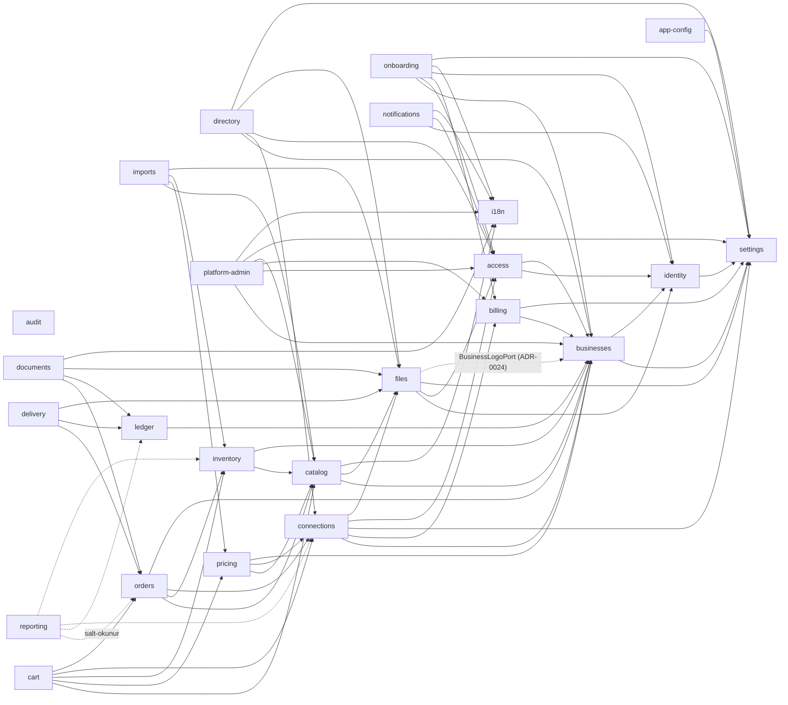

# C4 Seviye 3 — Bileşenler (API modülleri)

| Alan | Değer |
| --- | --- |
| Sürüm | 1.0 |
| Tarih | 2026-10-24 |

`api` (`apps/api/src/main.ts`) ve `worker` (`apps/api/src/worker.main.ts`) aynı modül kümesini kullanır. Her modül `apps/api/src/modules/<modül-adı>/` klasöründedir. Bu belge modüllerin sorumluluklarını ve **birbirine nasıl bağımlı olabileceklerini** tanımlar. Bağımlılık kuralları, AI asistanlarının en sık bozduğu yapıdır; bu yüzden CI'da otomatik kontrol edilir (bkz. [coding-guidelines.md](../07-ai-development/coding-guidelines.md)).

## 1. Modül bağımlılık diyagramı

Ok yönü = "bağımlıdır" (A → B: A, B'nin dışa açık servisini kullanabilir). Tüm modüller `core`'a bağımlıdır; diyagramda gösterilmemiştir.

## 2. Modüller

| Modül | Sorumluluk | Sahip olduğu tablolar | İlgili story'ler |
| --- | --- | --- | --- |
| `core` | Veritabanı bağlantısı ve işlem yönetimi, `TenantContext`, RLS `SET LOCAL`, hata tipleri, idempotens, outbox yazımı, saat (test edilebilir), para ve zaman yardımcıları, audit yazıcısı | `idempotency_keys`, `outbox_events`, `audit_logs`, `ops_metrics` | US-057 |
| `identity` | Kullanıcı, OTP, oturum, yenileme anahtarı, TOTP | `users`, `otp_challenges`, `user_sessions`, `user_totp`, `platform_staff`, `dev_sms_outbox` | US-001–US-004 |
| `settings` | Katmanlı ayar çözümleme (işletme → plan → platform) ve önbellek | `settings` | US-017 |
| `i18n` | Diller, arayüz çevirileri, para birimleri, ülkeler, bölgeler | `languages`, `ui_translations`, `currencies`, `countries`, `regions` | US-058, US-059 |
| `files` | Süreli imzalı yükleme URL'si, yükleme sonrası doğrulama, dosya kaydı | `files` | US-030 |
| `businesses` | İşletme, yetenek, profiller, kişisel veri, gizlilik, şubeler, depolar, toptancı başvurusu, faaliyet alanları | `businesses`, `business_capabilities`, `seller_profiles`, `buyer_profiles`, `person_data`, `business_privacy`, `branches`, `warehouses`, `seller_applications`, `activity_types`, `service_areas` | US-005–US-011 |
| `access` | Unvanlar, rol şablonları, roller, izinler, üyelikler, davetler; `PermissionGuard` | `job_titles`, `role_templates`, `role_template_permissions`, `roles`, `role_permissions`, `permissions`, `memberships`, `membership_regions`, `invitations` | US-012–US-014 |
| `billing` | Planlar, haklar, abonelikler, istisnalar; hak kontrolü | `plans`, `plan_entitlements`, `subscriptions`, `entitlement_overrides` | US-055 |
| `onboarding` | Kimliksiz perakendeci kaydının düzenleyicisi (F2.3a): kayıt anahtarı, IP hız sınırı, telefon kapsamlı idempotens; `businesses`, `access`, `billing`, `identity`'nin `tx` alan fonksiyonlarını tek kiracı işleminde çağırır (R15). `access → businesses`, `billing → businesses` yönü nedeniyle `businesses` içinde olamaz (§3.3) | — | US-005 |
| `connections` | İstek, yanıt, engel, iptal, bekleme süresi, kota, süre dolumu, bağlantı koşulları | `connection_requests`, `connections`, `blocks` | US-021–US-026 |
| `directory` | Perakendeci dizini (Meilisearch), görünürlük filtresi, tam eşleşme araması, bağlantısız hesap politikası | — (indeks) | US-019, US-020, US-027 |
| `catalog` | Birimler, kategoriler, markalar, ürünler, varyantlar, ambalaj, görseller, görünürlük, ürün araması | `units`, `unit_conversions`, `categories`, `brands`, `products`, `product_variants`, `product_packaging`, `product_images`, `product_visibility` | US-028–US-030, US-032, US-033 |
| `imports` | Excel içe aktarma işleri (ürün, müşteri fiyatı, stok); şablon, doğrulama, önizleme, uygulama. Uygulama adımında `catalog`, `pricing` ve `inventory` servislerini çağırır | `import_jobs` | US-031, US-035 AC2 |
| `pricing` | Fiyat listeleri, müşteri ve şube fiyatları, şube indirimi, kademeler; `PriceResolver` | `price_lists`, `price_list_items`, `customer_prices` (şube fiyatı dahil), `branch_discounts`, `tier_prices` | US-034–US-037 |
| `inventory` | Stok modu, stok, hareketler, rezervasyon | `stock`, `stock_movements` | US-038, US-039 |
| `cart` | Şube sepeti, şube onayı, bölünme | `carts`, `cart_items`, `cart_approvals` | US-040–US-042 |
| `orders` | Sipariş, satırlar, durum geçişleri, toptancı onayı/düzenleme/red, favoriler | `orders`, `order_items`, `order_item_changes`, `order_status_history`, `seller_sequences`, `favorites` | US-043, US-045, US-061 |
| `delivery` | Teslimat, kargocu atama, teslim kanıtı, itiraz, otomatik onay, teslimat sağlayıcıları | `deliveries`, `delivery_attempts`, `delivery_proofs`, `disputes` | US-046–US-049 |
| `ledger` | Cari hareketleri, tahsilat, kargocu nakdi, dışa aktarma | `ledger_entries`, `payments`, `courier_cash` | US-050, US-051, US-053 |
| `documents` | Sipariş belgesi ve ekstre PDF'i (worker'da üretilir) | `documents` | US-044, US-052 |
| `notifications` | Push cihaz anahtarları, bildirim kayıtları, şablonlar, tercihler, `SmsSender` ve `PushSender` adaptörleri | `push_tokens`, `notifications`, `notification_templates`, `notification_preferences` | US-054 |
| `reporting` | Dashboard sorguları (salt-okunur) | — | US-056 |
| `platform-admin` | Moderasyon, perakendeci askıya alma/arşivleme/birleştirme, kullanıcı taklidi; diğer modüllerin servislerini yönetici izinleriyle çağırır | `impersonation_sessions` | US-009, US-015, US-016, US-018 |
| `app-config` | Minimum ve önerilen mobil sürüm | — (ayarlardan) | US-060 |

## 3. Bağımlılık kuralları

1. **Modül içi katmanlar:** `controller` → `service` → `repository`. Controller iş kuralı içermez. Repository yalnızca kendi modülünün tablolarına sorgu yazar.
2. **Modüller arası erişim yalnızca dışa açık servisle:** Her modül `index.ts` dosyasında yalnızca dışa açık servis arayüzünü ve DTO'larını dışa aktarır. Başka bir modülün repository'sine, tablosuna veya iç dosyasına erişmek yasaktır.
3. **Döngü yasak:** Bağımlılıklar yukarıdaki diyagramdaki yönde akar. Ters yönde bir ihtiyaç doğarsa (ör. `ledger`, `delivery`'yi çağırmak isterse) bu bir **olay** ile çözülür (`outbox_events`), doğrudan çağrıyla değil.
4. **Tek işlem gerektiren yan etkiler doğrudan çağrıdır:** Aynı veritabanı işleminde birlikte olması gereken değişiklikler (ör. teslim onayı + cari borç kaydı; sipariş onayı + stok rezervasyonu; sepet bölünmesi + sipariş oluşumu) bağımlılık yönünde doğrudan servis çağrısıyla, aynı işlem nesnesi geçirilerek yapılır.
5. **Ertelenebilir yan etkiler olaydır:** Bildirim, arama indeksi, PDF üretimi ve gelecekteki entegrasyonlar outbox olayından tetiklenir ve worker'da çalışır. API isteği bunları beklemez.
6. **`reporting` istisnası:** `reporting` diğer modüllerin tablolarını salt-okunur sorgulayabilir; yazma yapamaz. Bu sorgular da RLS altında çalışır.
7. **`platform-admin` istisnası:** Platform rolleri RLS'i aşan bir bağlamla (`app.is_platform = true`) çalışır. Bu bağlam yalnızca `platform-admin` modülündeki uç noktalarda ve yalnızca platform rolü olan kullanıcılar için açılır. Platform admini fiyat, sipariş ve cari tablolarına yazamaz (US-016 AC5); bu kural bu tabloların RLS politikalarında da yazılıdır.
8. **Adaptörler `core` ya da ilgili modülde arayüz, `infrastructure/` altında uygulama:** Uygulama kodu yalnızca arayüzü bilir (`SmsSender`, `PushSender`, `FileStorage`, `DeliveryProvider`).
9. **Port (bağımlılığın tersine çevrilmesi) istisnası:** Bir modülün durum değişikliği, ona bağımlı bir modülde **aynı işlemde** yan etki gerektiriyorsa (olay yeterli değilse), üst modül bir port arayüzü tanımlar ve bağımlı modül bu arayüzü uygulayıp kaydeder. Üst modül uygulamayı tanımaz. Bu istisna yalnızca aşağıdaki listedeki portlar için kullanılır; yeni port eklemek ADR gerektirir.

| Port | Tanımlayan | Uygulayan | Neden aynı işlem |
| --- | --- | --- | --- |
| `ConnectionCancelledHandler` | `connections` | `cart` (sepet kalemlerini sil), `orders` (`submitted` siparişleri iptal et) | İptal anında onay bekleyen bir siparişin onaylanması yarışını önlemek (US-025 AC3) |
| `BusinessLogoPort` | `businesses` | `files` (logo dosyası doğrulama, okuma adresi) | Aynı işlem değil, eşzamanlı sorgu: `PATCH /business` logo dosyasının sahipliğini, amacını ve hazır durumunu yazmadan önce doğrular; yanıt okuma adresini taşır. `files → access → businesses` yönü nedeniyle doğrudan çağrı döngü olur ([ADR-0024](../04-decisions/adr-0024-business-logo-port.md)) |

## 4. Kritik servisler

| Servis | Modül | Girdi | Çıktı | Not |
| --- | --- | --- | --- | --- |
| `PermissionGuard` | access | uç noktanın `@RequirePermission('orders.approve')` dekoratörü, `TenantContext` | izin / 403 | İzinler üyelik başına önbelleklenir (Redis, `access.permission_cache_seconds`, varsayılan 60 sn); kayıt rol kimliğiyle doğrulanır, rol değişikliğinde silinir. Üyelik ve işletme durumu önbelleklenmez (her istekte okunur). Global `AccessGuard` (F1.8b). |
| `SettingsService.get(key, businessId)` | settings | anahtar, işletme | değer | İşletme → plan → platform sırası. |
| `EntitlementService.check(key, businessId, delta)` | billing | hak anahtarı | izin / `ENTITLEMENT_LIMIT_REACHED` | Limit + mevcut kullanım. |
| `ConnectionPolicy.canRequest(sellerId, buyerId)` | connections | çift | izin / hata kodu | Aktif bağlantı, bekleyen istek, engel, bekleme süresi, kota sırasıyla kontrol edilir. |
| `PriceResolver.resolve(variantIds, buyerId, branchId, qtys)` | pricing | varyantlar, alıcı, şube, miktarlar | birim fiyat, indirimler, fiyat kaynağı | Saf fonksiyon çekirdeği + veri yükleyici; en çok test edilen kod. |
| `StockService.reserve(orderId, lines, tx)` | inventory | satırlar | başarı / `STOCK_INSUFFICIENT` | `SELECT … FOR UPDATE` ile satır kilidi. |
| `CartService.submit(cartId)` | cart | sepet | oluşan siparişler | Tek işlemde bölünme (US-042 AC5). |
| `OrderStateMachine` | orders | sipariş, olay | yeni durum | Geçiş tablosu [state-machines.md](state-machines.md) ile birebir. |
| `LedgerService.post(entry, tx)` | ledger | hareket | kayıt | Yalnızca ekleme; bakiye hesaplanır, saklanmaz. |

## 5. İzin kataloğu

İzin kodları `packages/shared/src/permissions.ts` dosyasında sabittir ve `permissions` tablosuna migration ile eklenir ([ADR-0004](../04-decisions/adr-0004-capability-based-authorization.md)). Her uç noktanın `@RequirePermission` değeri bu listeden olmalıdır. Platform rolleri (`platform_staff.role`) bu izinleri kullanmaz; `platform-admin` uç noktaları rol kontrolüyle korunur.

| İzin kodu | Yetenek | Kapsam seçenekleri | Kullanıldığı yer |
| --- | --- | --- | --- |
| `business.manage` | any | all | Profil, depolar, şubeler, gizlilik, işletme ayarları |
| `team.manage` | any | all | Ekip, davet, roller (US-013, US-014) |
| `audit.view` | any | all | Audit log ekranı (US-057) |
| `reports.view` | any | all, branch, warehouse, assigned | Dashboard (US-056) |
| `documents.generate` | any | all, branch, assigned | Sipariş belgesi, ekstre (US-044, US-052) |
| `directory.search` | seller | all, assigned | Perakendeci dizini (US-019, US-020) |
| `connections.view` | any | all, assigned | Bağlantı listesi |
| `connections.request.send` | seller | all, assigned | İstek gönderme ve geri çekme (US-021, US-022) |
| `connections.terms.manage` | seller | all | Bağlantı koşulları (US-024) |
| `connections.request.respond` | buyer | all | Kabul / red (US-023) |
| `connections.block` | buyer | all | Engelleme (US-023) |
| `connections.cancel` | any | all | Bağlantı iptali (US-025) |
| `catalog.view` | seller | all | Kendi ürünlerini görme |
| `catalog.manage` | seller | all | Ürün, varyant, ambalaj, görsel (US-030) |
| `catalog.browse` | buyer | all, branch | Bağlı toptancı ürünleri (US-032, US-033) |
| `imports.run` | seller | all | Excel içe aktarma (US-031, US-035) |
| `pricing.view` | seller | all, assigned | Fiyat listeleri ve müşteri fiyatları |
| `pricing.manage` | seller | all | Fiyat listesi, müşteri/şube fiyatı, indirim, kademe (US-034–US-037) |
| `inventory.view` | seller | all, warehouse | Stok |
| `inventory.manage` | seller | all, warehouse | Mal girişi, sayım, var/yok (US-038, US-039) |
| `cart.edit` | buyer | branch | Sepete ekleme (US-040) |
| `cart.submit` | buyer | branch | Onaya gönderme (US-041) |
| `cart.approve` | buyer | branch | Şube onayı (US-041) |
| `orders.view` | any | all, branch, assigned | Sipariş listesi ve detay |
| `orders.approve` | seller | all | Onay, kısmi onay, red (US-043) |
| `orders.prepare` | seller | all, warehouse | Hazırlanıyor (US-043 AC5) |
| `orders.cancel` | seller | all | Onaylı siparişi iptal |
| `orders.cancel_own` | buyer | branch | `submitted` siparişi iptal |
| `orders.confirm_delivery` | buyer | branch | Teslim onayı / itiraz (US-048) |
| `orders.resolve_dispute` | seller | all | İtiraz çözümü (US-048 AC4) |
| `orders.create_on_behalf` | seller | assigned | Müşteri adına sipariş (US-061, Could) |
| `delivery.view` | seller | all, warehouse | Teslimat ekranı |
| `delivery.assign` | seller | all, warehouse | Kargocu atama, dış kargo (US-046, US-049) |
| `delivery.update_own` | seller | assigned | Kargocu: yola çıktım, teslim ettim, teslim edilemedi (US-046, US-047) |
| `ledger.view` | any | all, assigned | Cari ve bakiyeler (US-050) |
| `ledger.payment.create` | seller | all, assigned | Tahsilat girişi (US-051) |
| `ledger.payment.review` | seller | all | Temsilci tahsilatı onayı (US-051 AC4) |
| `ledger.courier_cash.manage` | seller | all | Kargocu nakdi teslimi (US-051 AC3) |
| `ledger.export` | seller | all | e-qaimə uyumlu dışa aktarma (US-053) |

**Rol şablonları (seed):** Analiz raporundaki varsayılan rol tabloları bu kodlara eşlenir. Kod karşılığı `apps/api/src/modules/access/seed/role-templates.ts` (F1.8a); tablo ile dosya birebir aynıdır (test: `role-templates.test.ts`). Kapsam yazılmayan izin `all` kapsamlıdır. Her şablon için aynı kodla bir unvan (`job_titles`) açılır.

| Şablon kodu | Ad (tr) | Yetenek | İşletme admini | İzinler |
| --- | --- | --- | --- | --- |
| `seller_business_admin` | İşletme Admini | seller | evet | `business.manage`, `team.manage`, `audit.view`, `reports.view`, `documents.generate`, `directory.search`, `connections.view`, `connections.request.send`, `connections.terms.manage`, `connections.cancel`, `catalog.view`, `catalog.manage`, `imports.run`, `pricing.view`, `pricing.manage`, `inventory.view`, `inventory.manage`, `orders.view`, `orders.approve`, `orders.prepare`, `orders.cancel`, `orders.resolve_dispute`, `orders.create_on_behalf` (assigned), `delivery.view`, `delivery.assign`, `delivery.update_own` (assigned), `ledger.view`, `ledger.payment.create`, `ledger.payment.review`, `ledger.courier_cash.manage`, `ledger.export` |
| `seller_sales_manager` | Satış Müdürü | seller | — | `catalog.view`, `catalog.manage`, `pricing.view`, `pricing.manage`, `inventory.view`, `directory.search`, `connections.view`, `connections.request.send`, `connections.terms.manage`, `connections.cancel`, `orders.view`, `orders.approve`, `delivery.view`, `ledger.view`, `reports.view` |
| `seller_sales_rep` | Satış Temsilcisi | seller | — | `directory.search` (assigned), `connections.view` (assigned), `connections.request.send` (assigned), `catalog.view`, `pricing.view` (assigned), `orders.view` (assigned), `ledger.view` (assigned), `ledger.payment.create` (assigned), `reports.view` (assigned) |
| `seller_accountant` | Muhasebe | seller | — | `catalog.view`, `pricing.view`, `inventory.view`, `orders.view`, `ledger.view`, `ledger.payment.create`, `ledger.payment.review`, `ledger.courier_cash.manage`, `ledger.export`, `reports.view`, `documents.generate` |
| `seller_warehouse` | Depo Sorumlusu | seller | — | `catalog.view`, `inventory.view` (warehouse), `inventory.manage` (warehouse), `orders.prepare` (warehouse), `delivery.view` (warehouse), `delivery.assign` (warehouse), `reports.view` (warehouse) |
| `seller_courier` | Kargocu | seller | — | `delivery.update_own` (assigned), `orders.view` (assigned), `ledger.payment.create` (assigned) |
| `buyer_business_admin` | İşletme Admini | buyer | evet | `business.manage`, `team.manage`, `audit.view`, `reports.view`, `documents.generate`, `connections.view`, `connections.request.respond`, `connections.block`, `connections.cancel`, `catalog.browse`, `orders.view`, `ledger.view` |
| `buyer_branch_admin` | Şube Admini | buyer | — | `catalog.browse` (branch), `cart.edit` (branch), `cart.submit` (branch), `cart.approve` (branch), `orders.view` (branch), `orders.cancel_own` (branch), `orders.confirm_delivery` (branch) |
| `buyer_purchaser` | Satın Alma Sorumlusu | buyer | — | `catalog.browse` (branch), `cart.edit` (branch), `cart.submit` (branch), `orders.view` (branch), `connections.view` |
| `buyer_accountant` | Muhasebe | buyer | — | `ledger.view`, `documents.generate` |
| `buyer_branch_staff` | Şube Çalışanı | buyer | — | `catalog.browse` (branch), `cart.edit` (branch), `orders.view` (branch), `orders.confirm_delivery` (branch) |

📌 VARSAYILAN, KULLANICI ONAYI BEKLİYOR (F1.8a, Mimar): Analiz raporu ile izin kataloğunun örtüşmediği 7 noktada daha dar (az yetkili) seçenek seçildi. Platform sahibi onaylarsa not kaldırılır; değişiklik istenirse önce bu tablo, sonra `role-templates.ts` güncellenir.

| # | Fark | Seçilen varsayılan |
| --- | --- | --- |
| 1 | `cart.*`, `orders.cancel_own`, `orders.confirm_delivery` yalnızca `branch` kapsamlı; perakendeci İşletme Admini tüm şubeler için kullanamaz. | İşletme Admini şablonuna bu izinler verilmez (şube işleri Şube Admini / çalışanında). |
| 2 | Şube Admini "şube kullanıcılarını görür"; katalogda `team.view` yok, `team.manage` yalnız `all`. | Verilmez. |
| 3 | Depo Sorumlusu için `orders.view` kapsamlarında `warehouse` yok. | `orders.view` verilmez; yalnız `orders.prepare` (warehouse). |
| 4 | Satış Temsilcisi: rapor stok, teslimat görme ve müşteri adına sipariş diyor. | Verilmez (`inventory.view`, `delivery.view`, `orders.create_on_behalf` yok); yukarıdaki örnek liste korunur. |
| 5 | Satış Müdürü "sipariş düzenle" (kod yok) ve "dışa aktar: evet". | `orders.view` + `orders.approve`; `ledger.export` verilmez. |
| 6 | Rapor türleri (satış, finans, stok) kodda ayrı değil. | Hepsi `reports.view`; kapsam rolün işine göre (müdür/muhasebe `all`, depo `warehouse`, temsilci `assigned`). |
| 7 | `documents.generate` raporda geçmiyor. | Yalnız İşletme Admini (iki taraf) ve Muhasebe (iki taraf). |

📌 VARSAYIM: Analiz raporundaki "maliyeti gör" izni MVP'de yoktur, çünkü veri modelinde alış maliyeti alanı bulunmaz. Maliyet ve kâr marjı takibi istenirse önce veri modeline eklenir, sonra `pricing.view_cost` izni tanımlanır.

### Platform rolleri ve admin uçları

Platform uçları `@RequirePlatformRole(...)` ile korunur; izin kodu kullanmaz. Rol `platform_staff.role` (`super_admin`, `operations`, `support`, `content`). Tablo `endpoint-access.test.ts` bekçisiyle birebir aynıdır; yeni admin ucu önce buraya eklenir.

| Uç | Roller | Karar |
| --- | --- | --- |
| `POST /api/v1/admin/sellers` | `super_admin`, `operations` | S1 = A (platform sahibi, 2026-10-31; F2.1a) |
| `GET /api/v1/admin/sellers` | `super_admin`, `operations` | S1 = A |
| `POST /api/v1/admin/sellers/{id}/activation` | `super_admin`, `operations` | S1 = A |
| `GET /api/v1/admin/plans` (yalnız okuma) | `super_admin`, `operations` | S1 = A; plan yönetimi F6.3 |
| `GET`, `POST /api/v1/admin/catalog/role-templates`; `PATCH .../role-templates/{id}` | `super_admin`, `content` | F2.9 V1 (productreport "Çeviri ve içerik: ortak katalog"; varsayım, onay bekliyor) |
| `GET`, `POST /api/v1/admin/catalog/job-titles`; `PATCH`, `DELETE .../job-titles/{id}` | `super_admin`, `content` | F2.9 V1 |
