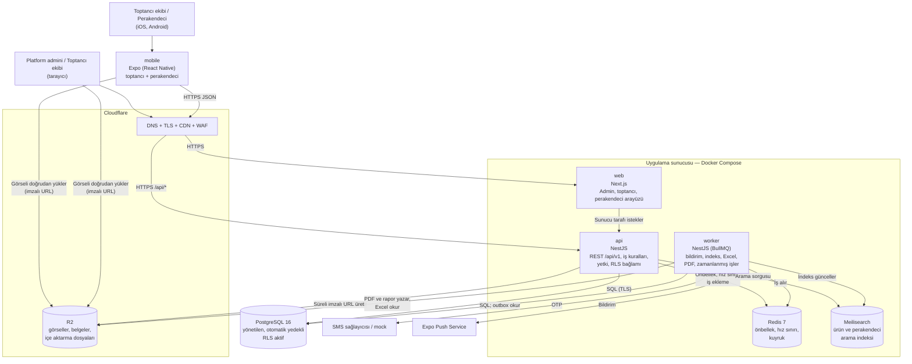

# C4 Seviye 2 — Container'lar

| Alan | Değer |
| --- | --- |
| Sürüm | 1.0 |
| Tarih | 2026-10-24 |

Bu diyagram sistemi çalışan parçalarına böler. Pilotta `api`, `worker`, `web`, Redis ve Meilisearch tek bir sunucuda Docker Compose ile çalışır; PostgreSQL ayrı ve yönetilen bir servistir (ADR-0012). Dağıtım ayrıntısı: [infrastructure.md](infrastructure.md).

## Container'lar

| Container | Teknoloji | Sorumluluk | Ölçekleme notu |
| --- | --- | --- | --- |
| `web` | Next.js (App Router), React, TypeScript | Tüm web arayüzleri. Sunucu tarafı render yalnızca giriş ve genel sayfalarda; panel sayfaları istemci tarafında API'yi çağırır. | Tasarım tavanına kadar tek kopya yeterli. |
| `api` | NestJS, TypeScript, Drizzle ORM | REST API (`/api/v1`), kimlik, yetki, kiracı bağlamı, iş kuralları, outbox yazımı. Durumsuzdur; oturum durumu PostgreSQL ve Redis'tedir. | Durumsuz olduğu için ileride yatay çoğaltılabilir. |
| `worker` | NestJS, BullMQ | Arka plan işleri ve zamanlanmış işler (her 15 dk: süre dolumu, otomatik onay; gece: bağlantısız hesap politikası, tam yeniden indeksleme). | Tek kopya; zamanlanmış işler çift çalışmaması için Redis kilidiyle korunur. |
| `mobile` | Expo SDK, React Native, TypeScript | Toptancı (yönetici, temsilci, depo, kargocu) ve perakendeci ekranları. Erişim anahtarı bellekte, yenileme anahtarı güvenli depoda. | — |
| PostgreSQL | 16, yönetilen servis | Tüm kalıcı veri. RLS politikaları; zamana göre geri yükleme (RPO ≤ 5 dk). | Dikey büyütme. |
| Redis | 7, Docker | BullMQ kuyrukları, hız sınırı sayaçları, kısa ömürlü önbellek (çeviriler, ayarlar, fiyat listesi). **Kalıcı veri içermez**; kaybı veri kaybı değildir. | — |
| Meilisearch | 1.x, Docker | `products` ve `buyer_directory` indeksleri. Veritabanından türetilir; kaybı veri kaybı değildir, yeniden indekslenir. | — |
| Cloudflare R2 | — | `public` (ürün görselleri, CDN'den) ve `private` (belgeler, içe aktarma dosyaları; süreli imzalı URL) bucket'ları. | — |

📌 VARSAYIM: Meilisearch'in 100.000 varyant ve 1.000 perakendeci için gereken belleği (yaklaşık 0,5–1 GB) pilot sunucusunda ayrılabilir. Sunucu boyutu F0.4 adımında bu değerle seçilir.

## Container'lar arası kurallar

1. Yalnızca `api` ve `worker` PostgreSQL'e bağlanır. `web` veritabanına doğrudan bağlanmaz; her zaman `api` üzerinden gider.
2. `web` ve `mobile` aynı API sözleşmesini (`/api/v1`) kullanır; web'e özel gizli uç nokta yoktur.
3. `worker` HTTP sunmaz. `api` ile tek iletişimi Redis kuyruğu ve PostgreSQL'deki outbox tablosudur.
4. Redis ve Meilisearch'teki her veri PostgreSQL'den yeniden üretilebilir olmalıdır.
5. Dosyalar API sunucusundan geçmez; istemci, API'nin verdiği süreli imzalı URL ile R2'ye doğrudan yükler. Yükleme sonrası API dosyayı doğrular (tür, boyut).
