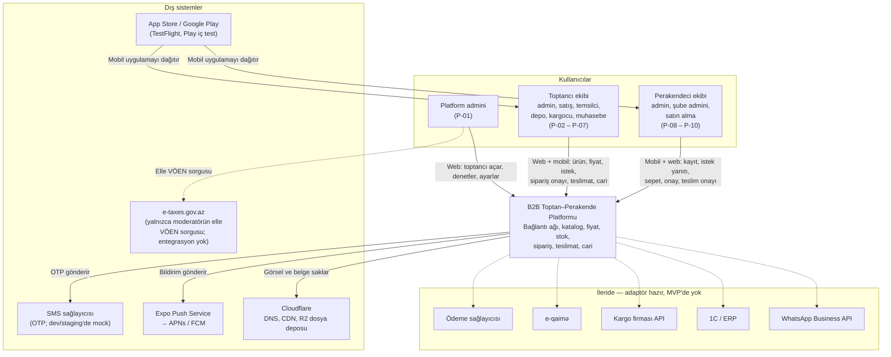

# C4 Seviye 1 — Sistem Bağlamı

| Alan | Değer |
| --- | --- |
| Sürüm | 1.0 |
| Tarih | 2026-10-24 |

Bu diyagram platformu tek bir kutu olarak gösterir: kim kullanır ve hangi dış sistemlerle konuşur. İç yapı [c4-container.md](c4-container.md) dosyasındadır.

## Açıklama

| Öğe | Tür | Etkileşim |
| --- | --- | --- |
| Platform admini | Kişi | Web paneli. Toptancı açar, perakendecileri denetler, ayarları, planları, katalogları ve çevirileri yönetir. Müşteri verisini (fiyat, sipariş, cari) değiştiremez. |
| Toptancı ekibi | Kişi | Web (yönetim, katalog, fiyat, cari) ve mobil (temsilci, depo, kargocu). |
| Perakendeci ekibi | Kişi | Ana kanal mobil; web sürümü aynı işlevlerle. |
| SMS sağlayıcısı | Dış sistem | Yalnızca OTP. Geliştirme ve staging'de mock gönderici (NFR-95–NFR-98). |
| Expo Push Service | Dış sistem | Push bildirimlerini APNs (iOS) ve FCM (Android) üzerinden iletir. |
| Cloudflare | Dış sistem | DNS, TLS, CDN ve R2 dosya deposu. |
| App Store / Google Play | Dış sistem | Mobil dağıtım: önce TestFlight ve Play iç test. |
| e-taxes.gov.az | Dış sistem | Sistemle entegre değildir; moderatör VÖEN'i elle sorgular. |
| İleride eklenecekler | Dış sistem | Adaptör arayüzleri tanımlıdır; MVP'de bağlantı yoktur (ADR-0008). |

**Güven sınırları:** Tüm kullanıcı trafiği Cloudflare üzerinden gelir. Platformdan dışarı giden tek MVP bağlantıları SMS sağlayıcısı, Expo Push Service ve Cloudflare R2'dir. Ayrıntı: [threat-model.md](threat-model.md).
