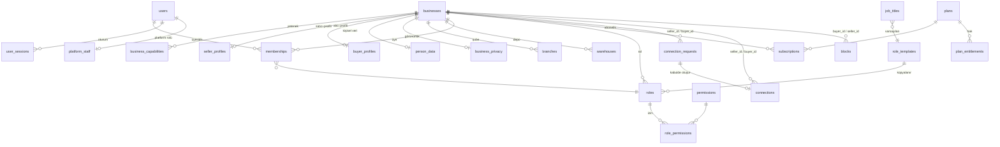
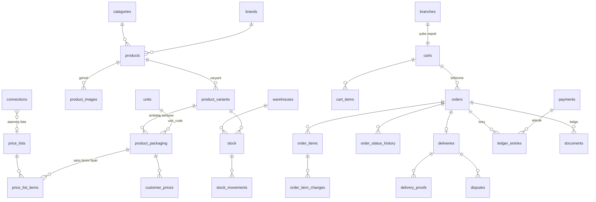

# Veri Modeli

| Alan | Değer |
| --- | --- |
| Sürüm | 1.0 |
| Tarih | 2026-10-24 |
| Veritabanı | PostgreSQL 16 |
| İlgili belgeler | [c4-component.md](c4-component.md) (tablo sahipliği) · [state-machines.md](state-machines.md) (durum alanları) · [glossary.md](../02-requirements/glossary.md) |

## 1. Genel kurallar

| Konu | Kural |
| --- | --- |
| Birincil anahtar | `id uuid` (UUIDv7, uygulama üretir; zamana göre sıralanabilir). İstisnalar belirtilmiştir. |
| Zaman | `timestamptz`, UTC. Her tabloda `created_at timestamptz not null default now()`; değişebilen tablolarda `updated_at`. |
| Para | Birim fiyat `numeric(14,4)`; tutarlar `numeric(14,2)`; her para alanının yanında `currency_code char(3)` veya kaydın para birimine bağlı. |
| Miktar | `numeric(14,3)` (kg gibi ondalıklı birimler için). |
| Çok dilli içerik | `jsonb`: `{"az": "...", "ru": "...", "tr": "...", "en": "..."}`. Eksik anahtar geri dönüşü uygulamada (ADR-0007). |
| Durum alanları | `text` + `CHECK (status IN (...))`. PostgreSQL enum tipi kullanılmaz (migration'da değer eklemek zahmetli). |
| Silme | İş kayıtları silinmez: `status = 'archived'` veya `archived_at`. Fiziksel silme yalnızca kişisel veri temizliğinde ve geçmişi olmayan kayıtlarda. |
| Kişisel veri | 🔒 ile işaretli alanlar. Loglanmaz (maskelenir), dışa aktarmalarda yalnızca yetkiliye, silme talebinde temizlenir. |
| Adlandırma | Tablolar çoğul `snake_case`; yabancı anahtar `<tekil>_id`; satıcı işletme `seller_id`, alıcı işletme `buyer_id` (her ikisi de `businesses.id`). |

### 1.1 Kiracı izolasyonu (RLS) sınıfları

Her istek işleminin başında uygulama `SET LOCAL app.business_id = '<uuid>'` çalıştırır. Platform yönetici uç noktaları ayrıca `SET LOCAL app.is_platform = 'true'` çalıştırır (ADR-0003).

| Sınıf | Kural | Örnek tablolar |
| --- | --- | --- |
| **T** (tek kiracı) | `business_id = current_setting('app.business_id')::uuid` (satıcı tablolarında sütun adı `seller_id`, alıcı tablolarında `buyer_id`) | `products`, `price_lists`, `stock`, `carts`, `branches` |
| **P** (çift kiracı) | `seller_id = app.business_id OR buyer_id = app.business_id` | `connections`, `orders`, `order_items`, `deliveries`, `ledger_entries`, `payments` |
| **G** (genel katalog) | Herkes okur; yalnızca `app.is_platform = true` yazar | `units`, `categories`, `brands` (aktif), `activity_types`, `languages`, `currencies`, `regions`, `permissions`, `job_titles`, `role_templates`, `plans` |
| **U** (kullanıcıya bağlı) | `user_id = app.user_id` | `user_sessions`, `push_tokens`, `notifications`, `notification_preferences` |
| **S** (sistem) | RLS dışında; yalnızca belirli servisler erişir; uygulama rolünün doğrudan okuma izni yok, yalnızca güvenli fonksiyonlar | `otp_challenges`, `idempotency_keys`, `outbox_events`, `audit_logs` (yalnızca ekleme), `settings`, `dev_sms_outbox` |
| **D** (dizin) | Perakendeci dizini sorguları yalnızca `directory` modülünün `SECURITY DEFINER` fonksiyonu ve Meilisearch indeksi üzerinden; görünürlük ayarları fonksiyon içinde uygulanır | `businesses`, `buyer_profiles`, `business_privacy` (başka kiracının okuması) |

**Ek RLS kuralları:**

- Platform bağlamı (`app.is_platform = true`) `orders`, `order_items`, `ledger_entries`, `payments`, `price_lists`, `price_list_items`, `customer_prices` tablolarında **yazma** iznine sahip değildir (US-016 AC5).
- Alıcı, satıcının ürün ve fiyat tablolarını yalnızca **aktif bağlantı** varsa okuyabilir: bu sorgular `catalog` modülünün `buyer_visible_products(buyer_id)` fonksiyonu üzerinden yapılır ve fonksiyon aktif bağlantıyı kontrol eder.

## 2. ERD — Kimlik, işletme, erişim, bağlantı

## 3. ERD — Katalog, fiyat, stok, sipariş, teslimat, cari

## 4. Tablolar

Sütun listesinde `id`, `created_at`, `updated_at` her tabloda vardır ve tekrar yazılmamıştır (istisnalar belirtilmiştir).

### 4.1 `core`

#### `outbox_events` (S)

| Alan | Tip | Kısıt | Not |
| --- | --- | --- | --- |
| id | bigserial | PK | `id` uuid değil; sıra önemli |
| type | text | not null | ör. `order.submitted`, `connection.request_created` |
| aggregate_type | text | not null | `order`, `connection`, … |
| aggregate_id | uuid | not null | |
| business_ids | uuid[] | not null | Olayla ilgili kiracılar |
| payload | jsonb | not null | Kişisel veri içermez; kimlikler taşır |
| processed_at | timestamptz | null | |
| attempts | int | not null default 0 | |
| last_error | text | null | |

İndeks: `(processed_at) WHERE processed_at IS NULL`.

#### `ops_metrics` (S)

| Alan | Tip | Kısıt | Not |
| --- | --- | --- | --- |
| id | bigserial | PK | |
| measured_at | timestamptz | not null | 5 dakikada bir (worker) |
| key | text | not null | ör. `http.5xx_rate`, `queue.oldest_age_s`, `sms.sent_today` |
| value | numeric(18,4) | not null | |
| labels | jsonb | null | ör. `{"queue": "notifications"}` |

İndeks: `(key, measured_at DESC)`. 90 günden eski kayıtlar gece silinir. Kaynak: [observability.md](../06-operations/observability.md) §2.

#### `idempotency_keys` (S)

| Alan | Tip | Kısıt | Not |
| --- | --- | --- | --- |
| key | text | PK (key, user_id) | İstemcinin `Idempotency-Key` başlığı |
| user_id | uuid | not null | |
| endpoint | text | not null | |
| status_code | int | not null | |
| response_body | jsonb | not null | |
| expires_at | timestamptz | not null | 24 saat |

#### `audit_logs` (S, yalnızca ekleme)

| Alan | Tip | Kısıt | Not |
| --- | --- | --- | --- |
| id | bigserial | PK | |
| occurred_at | timestamptz | not null | |
| actor_user_id | uuid | null | Sistem işlerinde null |
| actor_type | text | `user` / `system` / `platform` | |
| impersonation_session_id | uuid | null | |
| business_id | uuid | null | İşlemin ait olduğu kiracı |
| action | text | not null | ör. `role.updated`, `connection.cancelled` |
| target_type | text | not null | |
| target_id | text | not null | |
| before | jsonb | null | 🔒 alanlar maskelenir |
| after | jsonb | null | 🔒 alanlar maskelenir |
| ip | inet | null | |
| request_id | text | null | |

İndeks: `(business_id, occurred_at DESC)`, `(target_type, target_id)`. Saklama 2 yıl (NFR-52); uygulama rolünün `UPDATE`/`DELETE` izni yoktur.

### 4.2 `identity`

#### `users` (U — kendisi; diğerleri üyelik üzerinden)

| Alan | Tip | Kısıt | Not |
| --- | --- | --- | --- |
| phone_e164 | text | unique, not null | 🔒 ör. `+994501234567` |
| full_name | text | not null | 🔒 |
| preferred_language | char(2) | FK `languages.code` | |
| timezone | text | null | IANA; null ise işletme saat dilimi |
| status | text | `active` / `locked` / `deleted` | |
| last_login_at | timestamptz | null | |

#### `otp_challenges` (S)

| Alan | Tip | Kısıt | Not |
| --- | --- | --- | --- |
| phone_e164 | text | not null | 🔒 |
| purpose | text | `login` / `register` / `invitation` | |
| code_hash | text | not null | Kod düz metin saklanmaz |
| expires_at | timestamptz | not null | +5 dk |
| attempts | smallint | not null default 0 | 5'te kilit |
| consumed_at | timestamptz | null | |
| request_ip | inet | null | |

İndeks: `(phone_e164, created_at DESC)`. 7 günden eski kayıtlar gece silinir.

#### `user_sessions` (U)

| Alan | Tip | Kısıt | Not |
| --- | --- | --- | --- |
| user_id | uuid | FK users | |
| refresh_token_hash | text | unique | Döndürülür; eskisi kullanılırsa tüm aile iptal |
| family_id | uuid | not null | Döndürme ailesi |
| device_type | text | `web` / `ios` / `android` | |
| device_name | text | null | |
| ip_city | text | null | |
| last_used_at | timestamptz | | |
| expires_at | timestamptz | | +30 gün |
| revoked_at | timestamptz | null | |
| impersonation_session_id | uuid | null | |

#### `user_totp`

| Alan | Tip | Kısıt | Not |
| --- | --- | --- | --- |
| user_id | uuid | PK, FK users | `id` yok |
| secret_encrypted | bytea | not null | Uygulama anahtarıyla şifreli |
| recovery_codes_hash | jsonb | not null | 10 kod |
| enabled_at | timestamptz | null | |

#### `platform_staff`

| Alan | Tip | Kısıt | Not |
| --- | --- | --- | --- |
| user_id | uuid | PK, FK users | |
| role | text | `super_admin` / `operations` / `support` / `content` | |
| is_active | boolean | default true | |

#### `dev_sms_outbox` (S — yalnızca dev/staging)

| Alan | Tip | Kısıt | Not |
| --- | --- | --- | --- |
| phone_e164 | text | | 🔒 |
| body | text | | |

Production'da tablo boş kalır; production'da mock sağlayıcıyla uygulama başlamaz (NFR-97).

### 4.3 `settings`, `i18n`, `files`

#### `settings` (S)

| Alan | Tip | Kısıt | Not |
| --- | --- | --- | --- |
| scope | text | `platform` / `plan` / `business` | |
| scope_id | uuid | null (platform için) | |
| key | text | not null | ör. `connection.cooldown_after_reject_days` |
| value | jsonb | not null | |
| updated_by | uuid | FK users | |

Benzersiz: `(scope, coalesce(scope_id, '00000000-0000-0000-0000-000000000000'), key)`. Anahtar listesi: [user-stories.md](../02-requirements/user-stories.md) US-017.

#### `languages` (G) — `code char(2) PK`, `name text`, `is_active bool`, `is_default bool`, `sort_order int`, `direction text (ltr/rtl)`

#### `ui_translations` (G) — `key text`, `lang char(2)`, `value text`; PK `(key, lang)`

#### `currencies` (G) — `code char(3) PK`, `symbol text`, `decimals smallint`, `is_active bool`

#### `countries` (G) — `code char(2) PK`, `name jsonb`, `default_currency char(3)`, `default_timezone text`, `phone_prefix text`

#### `regions` (G)

| Alan | Tip | Kısıt | Not |
| --- | --- | --- | --- |
| country_code | char(2) | FK | |
| parent_id | uuid | null, FK regions | Şehir → rayon |
| type | text | `city` / `district` | |
| name | jsonb | not null | |

#### `files` (T: `owner_business_id`)

| Alan | Tip | Kısıt | Not |
| --- | --- | --- | --- |
| owner_business_id | uuid | null | Platform dosyalarında null |
| bucket | text | `public` / `private` | |
| object_key | text | unique | |
| content_type | text | | İmzayla doğrulanmış |
| size_bytes | int | | |
| status | text | `pending` / `ready` / `rejected` | |
| created_by | uuid | FK users | |

### 4.4 `businesses`

#### `businesses` (T kendisi; D başkaları için)

| Alan | Tip | Kısıt | Not |
| --- | --- | --- | --- |
| legal_name | text | not null | Ünvan |
| voen | char(10) | unique (null hariç) | Format: 10 rakam, son hane 1/2 |
| legal_type | text | `legal_entity` / `individual_entrepreneur`, null | VÖEN'den türetilir |
| country_code | char(2) | FK, default `AZ` | |
| region_id | uuid | FK regions, not null | Şehir/rayon |
| address_line | text | null | Gizlilik ayarına bağlı |
| geo_lat, geo_lng | numeric(9,6) | null | |
| business_phone | text | null | Gizlilik ayarına bağlı |
| logo_file_id | uuid | FK files | |
| default_language | char(2) | FK | |
| currency_code | char(3) | FK | |
| timezone | text | not null | IANA, ör. `Asia/Baku` |
| status | text | `active` / `suspended` / `dormant` / `archived` | |
| verified_at | timestamptz | null | Moderatör doğrulaması |
| verified_by | uuid | null | |
| created_via | text | `admin` / `self_signup` | |
| data_consent_version | text | null | NFR-63 |
| data_consent_at | timestamptz | null | |
| profile_completeness | smallint | 0–100 | |

İndeks: `(region_id) WHERE status = 'active'`.

#### `business_capabilities`

| Alan | Tip | Kısıt | Not |
| --- | --- | --- | --- |
| business_id | uuid | PK parçası | `id` yok |
| capability | text | PK parçası; `seller` / `buyer` | |
| status | text | `pending` / `approved` / `suspended` | |
| approved_by | uuid | null | |
| approved_at | timestamptz | null | |

Kural: `seller` yeteneği yalnızca platform bağlamında `approved` yapılabilir (K1). MVP'de bir işletmenin yalnızca bir yeteneği olur; ikinci yetenek ekleme uç noktası özellik bayrağıyla kapalıdır (D20).

#### `seller_profiles` (T)

| Alan | Tip | Kısıt | Not |
| --- | --- | --- | --- |
| business_id | uuid | PK | |
| description | jsonb | null | Tanıtım metni |
| stock_mode | text | `none` / `availability` / `quantity` | default `availability` |
| min_order_amount | numeric(14,2) | null | Para birimi: işletme |
| require_delivery_photo | boolean | default false | |
| low_stock_display_threshold | numeric(14,3) | default 5 | US-039 AC6 |
| default_price_list_id | uuid | FK price_lists | |
| default_warehouse_id | uuid | FK warehouses | |

#### `service_areas` (T) — `seller_id uuid`, `region_id uuid`; PK `(seller_id, region_id)`

#### `buyer_profiles` (T)

| Alan | Tip | Kısıt | Not |
| --- | --- | --- | --- |
| business_id | uuid | PK | |
| activity_type_id | uuid | FK activity_types, not null | |
| listed_in_directory | boolean | default true | US-007 AC4 |
| dormant_stage | text | `none` / `reminded_7` / `reminded_30` / `warned` / `deactivated` | US-027 |
| dormant_stage_at | timestamptz | null | |

#### `business_privacy` (T)

| Alan | Tip | Varsayılan |
| --- | --- | --- |
| business_id | uuid PK | |
| show_logo | boolean | false |
| show_address | boolean | false |
| show_business_phone | boolean | false |
| show_voen | boolean | false |
| show_contact_name | boolean | false |
| show_personal_contact | boolean | false |

#### `person_data` (T)

| Alan | Tip | Kısıt | Not |
| --- | --- | --- | --- |
| business_id | uuid | unique, FK | Bir işletmeye bir kayıt |
| contact_name | text | | 🔒 |
| personal_phone | text | null | 🔒 |
| email | text | null | 🔒 |

#### `branches` (T)

| Alan | Tip | Kısıt | Not |
| --- | --- | --- | --- |
| business_id | uuid | FK | |
| name | text | not null | |
| region_id | uuid | FK | |
| address_line | text | not null (sipariş için) | |
| geo_lat, geo_lng | numeric(9,6) | null | Konum uyuşmazlığı hesabı |
| approval_rule | text | `every_order` / `above_amount` / `none` | default `every_order` |
| approval_threshold | numeric(14,2) | null | `above_amount` için zorunlu |
| status | text | `active` / `inactive` | |

#### `warehouses` (T) — `business_id`, `name`, `address_line`, `is_default bool`, `status (active/inactive)`

#### `seller_applications` (G — yalnızca platform okur)

| Alan | Tip | Kısıt | Not |
| --- | --- | --- | --- |
| legal_name | text | | |
| voen | char(10) | | Açık başvurularda unique |
| contact_name | text | | 🔒 |
| phone_e164 | text | | 🔒 |
| region_id | uuid | | |
| category_note | text | | |
| status | text | `pending` / `approved` / `rejected` | |
| reviewed_by | uuid | null | |
| business_id | uuid | null | Onayda oluşan işletme |

#### `activity_types` (G) — `name jsonb`, `is_active bool`, `sort_order int`

### 4.5 `access`

#### `permissions` (G)

| Alan | Tip | Kısıt | Not |
| --- | --- | --- | --- |
| code | text | PK | ör. `orders.approve` |
| capability | text | `seller` / `buyer` / `any` | |
| module | text | | |
| description | jsonb | | |

İzin kodları kodda sabittir ve migration ile eklenir; admin yalnızca şablonlara atar.

#### `role_templates` (G) — `code text unique`, `name jsonb`, `capability`, `version int`

#### `role_template_permissions` (G) — `template_id`, `permission_code`, `default_scope`; PK `(template_id, permission_code)`

#### `job_titles` (G) — `name jsonb`, `capability`, `role_template_id`, `is_active`

#### `roles` (T)

| Alan | Tip | Kısıt | Not |
| --- | --- | --- | --- |
| business_id | uuid | FK | |
| name | jsonb | | |
| capability | text | | İşletmenin yeteneğiyle eşleşmeli |
| is_business_admin | boolean | default false | |
| source_template_id | uuid | null | |
| source_template_version | int | null | Yeni sürüm bildirimi için |

#### `role_permissions` (T) — `role_id`, `permission_code`, `scope (all/branch/warehouse/assigned)`; PK `(role_id, permission_code)`

#### `memberships` (T)

| Alan | Tip | Kısıt | Not |
| --- | --- | --- | --- |
| user_id | uuid | FK | |
| business_id | uuid | FK | |
| role_id | uuid | FK roles | |
| job_title_id | uuid | FK | |
| branch_id | uuid | null | Kapsam `branch` ise |
| warehouse_id | uuid | null | Kapsam `warehouse` ise |
| status | text | `active` / `removed` | |
| joined_at | timestamptz | | |

Benzersiz: `(user_id, business_id)`. Kural: her işletmede en az bir `active` ve `is_business_admin` rollü üyelik (trigger ile).

#### `membership_regions` (T) — `membership_id`, `region_id`; satış temsilcisinin `assigned` kapsamı (US-019 AC3)

#### `invitations` (T)

| Alan | Tip | Kısıt | Not |
| --- | --- | --- | --- |
| business_id | uuid | | |
| phone_e164 | text | | 🔒 |
| role_id | uuid | | |
| job_title_id | uuid | | |
| branch_id, warehouse_id | uuid | null | |
| token_hash | text | unique | |
| expires_at | timestamptz | | Toptancı aktivasyonu: 7 gün |
| accepted_at | timestamptz | null | |
| created_by | uuid | | |

### 4.6 `billing`

#### `plans` (G) — `code unique`, `name jsonb`, `capability`, `price numeric(14,2)`, `currency_code`, `period (month/year)`, `is_active`

#### `plan_entitlements` (G) — `plan_id`, `key`, `value jsonb`; PK `(plan_id, key)`. Anahtarlar: `users.max`, `buyers.active.max`, `warehouses.max`, `connection_requests.daily`, `feature.courier_app`, `feature.export`, `feature.branch_pricing`

#### `subscriptions` (T)

| Alan | Tip | Kısıt | Not |
| --- | --- | --- | --- |
| business_id | uuid | | |
| plan_id | uuid | | |
| status | text | `active` / `grace` / `read_only` / `cancelled` | |
| current_period_start | date | | |
| current_period_end | date | | |
| grace_until | date | null | +7 gün |
| payment_note | text | null | Manuel ödeme notu |

Benzersiz: `(business_id) WHERE status IN ('active','grace','read_only')`.

#### `entitlement_overrides` (T) — `business_id`, `key`, `value jsonb`, `reason text`, `created_by`; PK `(business_id, key)`

### 4.7 `connections`

#### `connection_requests` (P)

| Alan | Tip | Kısıt | Not |
| --- | --- | --- | --- |
| seller_id | uuid | FK businesses | |
| buyer_id | uuid | FK businesses | |
| sent_by_user_id | uuid | | |
| message | text | null, ≤ 500 karakter | |
| proposed_payment_term_days | int | null | |
| status | text | `pending` / `accepted` / `rejected` / `expired` / `withdrawn` | |
| expires_at | timestamptz | not null | |
| responded_at | timestamptz | null | |
| responded_by_user_id | uuid | null | |
| seller_local_date | date | not null | Kota hesabı için, satıcının saat diliminde |

Benzersiz: `(seller_id, buyer_id) WHERE status = 'pending'`. İndeks: `(seller_id, seller_local_date)` (kota), `(buyer_id, status)`, `(expires_at) WHERE status = 'pending'`.

#### `connections` (P)

| Alan | Tip | Kısıt | Not |
| --- | --- | --- | --- |
| seller_id | uuid | | |
| buyer_id | uuid | | |
| request_id | uuid | FK connection_requests | |
| status | text | `active` / `cancelled` | |
| price_list_id | uuid | null | null = satıcının varsayılan listesi |
| branch_pricing_enabled | boolean | default false | D3 |
| credit_limit | numeric(14,2) | null | MVP'de uyarı amaçlı |
| payment_term_days | int | default 0 | |
| sales_rep_membership_id | uuid | null | |
| started_at | timestamptz | | |
| ended_at | timestamptz | null | |
| ended_by_side | text | `seller` / `buyer`, null | |
| end_reason | text | null | |
| ended_by_user_id | uuid | null | |

Benzersiz: `(seller_id, buyer_id) WHERE status = 'active'`. İndeks: `(buyer_id) WHERE status = 'active'`.

#### `blocks` (T: `buyer_id`; satıcı yalnızca var/yok bilgisini fonksiyonla alır)

`buyer_id uuid`, `seller_id uuid`, `created_by_user_id uuid`; PK `(buyer_id, seller_id)`.

### 4.8 `catalog`

#### `units` (G) — `code text PK` (UN/ECE), `kind (count/weight/volume/length/area/package)`, `name jsonb`, `abbreviation jsonb`, `allows_decimal bool`, `is_active bool`

#### `unit_conversions` (G) — `from_code`, `to_code`, `factor numeric(18,6)`; PK `(from_code, to_code)`

#### `categories` (G) — `parent_id`, `name jsonb`, `depth smallint CHECK (depth BETWEEN 1 AND 3)`, `sort_order`, `is_active`

#### `brands` (G) — `name text unique`, `status (active/requested/rejected)`, `requested_by_business_id uuid null`

#### `products` (T: `seller_id`)

| Alan | Tip | Kısıt | Not |
| --- | --- | --- | --- |
| seller_id | uuid | | |
| sku | text | not null | |
| name | jsonb | not null, en az bir dil | |
| description | jsonb | null | |
| category_id | uuid | FK | |
| brand_id | uuid | FK, null | |
| base_unit_code | text | FK units | |
| has_expiry | boolean | default false | |
| shelf_life_months | smallint | `has_expiry` ise zorunlu | |
| status | text | `draft` / `active` / `archived` | |

Benzersiz: `(seller_id, sku)`.

#### `product_variants` (T)

| Alan | Tip | Kısıt | Not |
| --- | --- | --- | --- |
| product_id | uuid | FK | |
| seller_id | uuid | | |
| sku | text | | |
| attributes | jsonb | | ör. `{"volume_ml": 400}` |
| gtin | text | null | Tüketici birimi barkodu |
| is_available | boolean | default true | Stok modu `availability` |
| status | text | `active` / `archived` | |

Benzersiz: `(seller_id, sku)`. İndeks: `(seller_id, gtin)`.

#### `product_packaging` (T)

| Alan | Tip | Kısıt | Not |
| --- | --- | --- | --- |
| variant_id | uuid | FK | |
| seller_id | uuid | | |
| level | text | `unit` / `inner` / `case` / `pallet` | |
| unit_code | text | FK units | ör. `H87`, `XCT` |
| base_qty | numeric(14,3) | > 0 | İçerdiği temel birim sayısı |
| gtin | text | null | |
| weight_g | int | null | |
| dimensions_mm | jsonb | null | `{l, w, h}` |
| is_sales_unit | boolean | | En az biri true |
| min_order_qty | numeric(14,3) | default 1 | Satış biriminde |
| order_multiple | numeric(14,3) | default 1 | |

Benzersiz: `(variant_id, level)`.

#### `product_images` (T) — `product_id`, `seller_id`, `file_id`, `sort_order`; ürün başına en fazla 8

#### `product_visibility` (T) — `product_id`, `seller_id`, `price_list_id uuid null`, `region_id uuid null`. Kayıt yoksa ürün tüm bağlı perakendecilere görünür.

#### `import_jobs` (T) — sahibi `imports` modülü

| Alan | Tip | Kısıt | Not |
| --- | --- | --- | --- |
| seller_id | uuid | | |
| type | text | `products` / `customer_prices` / `stock` | |
| file_id | uuid | | |
| status | text | `uploaded` / `validating` / `preview_ready` / `applying` / `done` / `failed` | |
| stats | jsonb | | `{insert, update, error}` |
| error_report_file_id | uuid | null | |
| created_by | uuid | | |

### 4.9 `pricing`

#### `price_lists` (T)

| Alan | Tip | Kısıt | Not |
| --- | --- | --- | --- |
| seller_id | uuid | | |
| name | text | | |
| currency_code | char(3) | | |
| vat_included | boolean | | |
| vat_rate | numeric(5,2) | | 📌 VARSAYIM: Liste düzeyinde tek ƏDV oranı; ürün bazında farklı oran gerekirse `products.vat_rate` eklenir |
| is_default | boolean | | Satıcı başına tek |
| status | text | `active` / `archived` | |

#### `price_list_items` (T)

| Alan | Tip | Kısıt | Not |
| --- | --- | --- | --- |
| price_list_id | uuid | | |
| seller_id | uuid | | |
| packaging_id | uuid | FK | Fiyat satış birimi başınadır |
| unit_price | numeric(14,4) | ≥ 0 | |
| valid_from | timestamptz | not null | Geleceğe tarihli değişiklik |

PK: `(price_list_id, packaging_id, valid_from)`. Geçerli fiyat: `valid_from ≤ now()` olan en büyük `valid_from`.

#### `customer_prices` (T: `seller_id`)

| Alan | Tip | Kısıt | Not |
| --- | --- | --- | --- |
| seller_id | uuid | | |
| buyer_id | uuid | | |
| branch_id | uuid | null | null = müşteri fiyatı; dolu = şube fiyatı (yalnızca `connections.branch_pricing_enabled`) |
| packaging_id | uuid | | |
| unit_price | numeric(14,4) | | |
| valid_from | timestamptz | | |

Benzersiz: `(seller_id, buyer_id, coalesce(branch_id, …), packaging_id, valid_from)`.

#### `branch_discounts` (T)

| Alan | Tip | Kısıt | Not |
| --- | --- | --- | --- |
| seller_id | uuid | | |
| buyer_id | uuid | | |
| branch_id | uuid | | |
| target | text | `all` / `brand` / `category` | |
| brand_id, category_id | uuid | null | |
| percent | numeric(5,2) | 0 < x ≤ 100 | |
| valid_from, valid_to | timestamptz | valid_to null | |

#### `tier_prices` (T) — `seller_id`, `packaging_id`, `min_qty numeric(14,3)`, `discount_percent numeric(5,2)`; benzersiz `(packaging_id, min_qty)`

### 4.10 `inventory`

#### `stock` (T)

| Alan | Tip | Kısıt | Not |
| --- | --- | --- | --- |
| seller_id | uuid | | |
| warehouse_id | uuid | PK parçası | `id` yok |
| variant_id | uuid | PK parçası | |
| on_hand | numeric(14,3) | ≥ 0 | Temel birimde |
| reserved | numeric(14,3) | ≥ 0, ≤ on_hand | |
| low_threshold | numeric(14,3) | null | Depo uyarısı |

#### `stock_movements` (T, yalnızca ekleme)

| Alan | Tip | Kısıt | Not |
| --- | --- | --- | --- |
| seller_id | uuid | | |
| warehouse_id | uuid | | |
| variant_id | uuid | | |
| type | text | `receipt` / `reserve` / `release` / `ship` / `return` / `adjustment` | |
| on_hand_delta | numeric(14,3) | | |
| reserved_delta | numeric(14,3) | | |
| order_id | uuid | null | |
| lot_no | text | null | D24 |
| expiry_date | date | null | |
| note | text | null | |
| created_by | uuid | null | |

İndeks: `(warehouse_id, variant_id, created_at)`.

### 4.11 `cart`

#### `carts` (T: `buyer_id`)

| Alan | Tip | Kısıt | Not |
| --- | --- | --- | --- |
| buyer_id | uuid | | |
| branch_id | uuid | unique | Şube başına tek sepet |
| status | text | `open` / `pending_approval` | |
| submitted_by_user_id | uuid | null | |
| submitted_at | timestamptz | null | |
| return_note | text | null | |

#### `cart_items` (T)

| Alan | Tip | Kısıt | Not |
| --- | --- | --- | --- |
| cart_id | uuid | | |
| buyer_id | uuid | | |
| seller_id | uuid | | |
| packaging_id | uuid | | |
| qty | numeric(14,3) | > 0 | Satış biriminde |
| added_by_user_id | uuid | | |

Benzersiz: `(cart_id, packaging_id)`.

#### `cart_approvals` (T) — `cart_id`, `buyer_id`, `action (submitted/approved/returned)`, `user_id`, `note`, `order_ids uuid[]`

### 4.12 `orders`

#### `seller_sequences` (T) — `seller_id`, `kind ('order')`, `year smallint`, `next_value int`; PK `(seller_id, kind, year)`

#### `orders` (P)

| Alan | Tip | Kısıt | Not |
| --- | --- | --- | --- |
| number | text | unique `(seller_id, number)` | ör. `2026-000123` |
| seller_id | uuid | | |
| buyer_id | uuid | | |
| branch_id | uuid | | |
| connection_id | uuid | | |
| cart_id | uuid | null | |
| currency_code | char(3) | | |
| language_code | char(2) | | Belge dili |
| status | text | bkz. [state-machines.md](state-machines.md) §3 | |
| vat_included | boolean | | |
| subtotal | numeric(14,2) | | |
| discount_total | numeric(14,2) | | |
| vat_total | numeric(14,2) | | |
| total | numeric(14,2) | | |
| payment_term_days | int | | Bağlantıdan kopya |
| delivery_snapshot | jsonb | | 🔒 Şube adresi, konum, iletişim adı ve telefonu |
| submitted_by_user_id | uuid | | |
| branch_approved_by_user_id | uuid | null | |
| created_by_seller_user_id | uuid | null | US-061 |
| seller_decided_by_user_id | uuid | null | |
| submitted_at | timestamptz | | |
| approved_at | timestamptz | null | |
| shipped_at | timestamptz | null | |
| delivered_at | timestamptz | null | Kesinleşme anı |
| auto_confirmed | boolean | default false | KPI-05 |
| cancelled_at | timestamptz | null | |
| reject_reason | text | null | |
| einvoice_number | text | null | US-053 AC2 |

İndeks: `(seller_id, status, submitted_at DESC)`, `(buyer_id, status, submitted_at DESC)`, `(branch_id, submitted_at DESC)`.

#### `order_items` (P)

| Alan | Tip | Kısıt | Not |
| --- | --- | --- | --- |
| order_id | uuid | | |
| seller_id, buyer_id | uuid | | RLS için |
| variant_id | uuid | | |
| packaging_id | uuid | | |
| name_snapshot | jsonb | | Tüm dillerde ad |
| unit_code | text | | |
| base_qty_per_unit | numeric(14,3) | | |
| qty_ordered | numeric(14,3) | | |
| qty_approved | numeric(14,3) | null | Toptancı onayında |
| unit_price | numeric(14,4) | | |
| price_source | text | `branch_price` / `customer_price` / `price_list` / `default_list` | |
| tier_discount_pct | numeric(5,2) | default 0 | |
| branch_discount_pct | numeric(5,2) | default 0 | |
| line_total | numeric(14,2) | | |
| vat_rate | numeric(5,2) | | |
| lot_no | text | null | |
| expiry_date | date | null | |

#### `order_item_changes` (P) — `order_item_id`, `order_id`, `seller_id`, `buyer_id`, `old_qty`, `new_qty`, `reason`, `user_id`

#### `order_status_history` (P, yalnızca ekleme) — `order_id`, `seller_id`, `buyer_id`, `from_status`, `to_status`, `actor_user_id null`, `actor_type (user/system)`, `note`

#### `favorites` (T: `buyer_id`) — `buyer_id`, `user_id`, `product_id`; PK `(user_id, product_id)`

### 4.13 `delivery`

#### `deliveries` (P)

| Alan | Tip | Kısıt | Not |
| --- | --- | --- | --- |
| order_id | uuid | unique | |
| seller_id, buyer_id | uuid | | |
| provider | text | `own_courier` / `manual_carrier` | |
| courier_membership_id | uuid | null | |
| carrier_name | text | null | |
| tracking_no | text | null | |
| status | text | bkz. [state-machines.md](state-machines.md) §4 | |
| assigned_at | timestamptz | | |
| departed_at | timestamptz | null | |
| delivered_at | timestamptz | null | "Teslim ettim" anı |
| auto_confirm_at | timestamptz | null | +48 saat |
| confirmed_at | timestamptz | null | |
| location_mismatch | boolean | default false | |

İndeks: `(auto_confirm_at) WHERE status = 'delivered_pending'`, `(courier_membership_id, status)`.

#### `delivery_attempts` (P) — `delivery_id`, `seller_id`, `buyer_id`, `reason`, `geo_lat`, `geo_lng`

#### `delivery_proofs` (P)

| Alan | Tip | Kısıt | Not |
| --- | --- | --- | --- |
| delivery_id | uuid | | |
| seller_id, buyer_id | uuid | | |
| kind | text | `courier_delivered` / `buyer_confirmed` / `auto_confirmed` / `buyer_disputed` | |
| file_id | uuid | null | Fotoğraf |
| geo_lat, geo_lng | numeric(9,6) | null | |
| distance_m | int | null | Şubeye uzaklık |
| user_id | uuid | null | |

#### `disputes` (P)

| Alan | Tip | Kısıt | Not |
| --- | --- | --- | --- |
| delivery_id, order_id | uuid | | |
| seller_id, buyer_id | uuid | | |
| type | text | `missing` / `damaged` / `not_received` | |
| description | text | | |
| file_id | uuid | null | |
| status | text | `open` / `accepted` / `rejected` | |
| resolution_note | text | null | |
| resolved_by | uuid | null | |
| resolved_at | timestamptz | null | |

### 4.14 `ledger`

#### `ledger_entries` (P, yalnızca ekleme)

| Alan | Tip | Kısıt | Not |
| --- | --- | --- | --- |
| seller_id, buyer_id | uuid | | |
| currency_code | char(3) | | |
| type | text | `order_delivered` / `payment` / `adjustment` / `reversal` / `opening_balance` | |
| debit | numeric(14,2) | ≥ 0 | |
| credit | numeric(14,2) | ≥ 0 | |
| order_id | uuid | null | |
| payment_id | uuid | null | |
| reverses_entry_id | uuid | null | |
| due_date | date | null | Teslim + vade |
| posted_at | timestamptz | | |
| created_by | uuid | null | |

Kısıt: `(debit > 0) <> (credit > 0)` (tam olarak biri). Benzersiz: `(order_id) WHERE type = 'order_delivered'`. İndeks: `(seller_id, buyer_id, currency_code, posted_at)`. Bakiye saklanmaz; sorguyla hesaplanır.

#### `payments` (P)

| Alan | Tip | Kısıt | Not |
| --- | --- | --- | --- |
| seller_id, buyer_id | uuid | | |
| currency_code | char(3) | | |
| amount | numeric(14,2) | > 0 | |
| method | text | `cash` / `bank_transfer` / `card` | |
| received_at | timestamptz | | |
| status | text | `pending_review` / `posted` / `rejected` | |
| entered_by_user_id | uuid | | |
| reviewed_by_user_id | uuid | null | |
| delivery_id | uuid | null | Kapıda tahsilat |
| provider | text | default `manual` | İleride ödeme sağlayıcısı (D1) |
| note | text | null | |

#### `courier_cash` (T: `seller_id`) — `seller_id`, `courier_membership_id`, `payment_id unique`, `amount`, `currency_code`, `status (held/handed_over)`, `handed_over_at`, `confirmed_by`

### 4.15 `documents`

#### `documents` (P)

| Alan | Tip | Kısıt | Not |
| --- | --- | --- | --- |
| seller_id, buyer_id | uuid | | |
| type | text | `order_document` / `statement` | |
| order_id | uuid | null | |
| period_from, period_to | date | null | Ekstre |
| language_code | char(2) | | |
| file_id | uuid | null | |
| status | text | `pending` / `ready` / `failed` | |

### 4.16 `notifications`

| Tablo | Sınıf | Alanlar |
| --- | --- | --- |
| `push_tokens` | U | `user_id`, `token text unique`, `platform (ios/android)`, `last_seen_at` |
| `notifications` | U | `user_id`, `business_id`, `type`, `payload jsonb`, `read_at` |
| `notification_templates` | G | `type`, `lang`, `title`, `body`; PK `(type, lang)` |
| `notification_preferences` | U | `user_id`, `type`, `push_enabled bool`; PK `(user_id, type)` |

### 4.17 `platform-admin`

#### `impersonation_sessions` (S) — `staff_user_id`, `target_user_id`, `target_business_id`, `reason text not null`, `started_at`, `ends_at (+30 dk)`, `ended_at`

## 5. Kişisel veri alanları özeti

| Tablo | Alanlar |
| --- | --- |
| `users` | `phone_e164`, `full_name` |
| `otp_challenges` | `phone_e164` |
| `person_data` | `contact_name`, `personal_phone`, `email` |
| `invitations` | `phone_e164` |
| `seller_applications` | `contact_name`, `phone_e164` |
| `orders` | `delivery_snapshot` (iletişim adı ve telefonu) |
| `dev_sms_outbox` | `phone_e164` |

Silme / anonimleştirme talebinde (NFR-64): `users.full_name` → `Silinmiş kullanıcı`, `phone_e164` → `+000<id kısaltması>`; `person_data` silinir; `orders.delivery_snapshot` içindeki iletişim alanları silinir, adres korunur.

## 6. Migration kuralları

1. Migration'lar Drizzle Kit ile üretilir ve `apps/api/drizzle/` altında sürüm kontrolündedir.
2. Her migration geri alınabilir olmalıdır (veri kaybettiren geri alma yasak; kolon silme iki adımda: önce kullanımdan kaldır, sonraki sürümde sil).
3. Her yeni kiracı tablosu, aynı migration içinde RLS politikasıyla gelir. CI, RLS'si olmayan T/P sınıfı tabloyu reddeder (bkz. [test-strategy.md](../05-planning/test-strategy.md)).
4. Başlangıç verileri (birimler, diller, para birimleri, AZ bölgeleri, izinler, rol şablonları, platform ayarları) `seed` betikleriyle yüklenir ve idempotendir.
5. Veritabanı rolleri (`app_user`, `migrator`, `readonly`) migration dışında `pnpm db:bootstrap` ile süper kullanıcıyla oluşturulur; şifreler depoda tutulmaz, ortam değişkenlerinden atanır. `ALTER DEFAULT PRIVILEGES` kullanılmaz; her migration tablo izinlerini `GRANT` ile verir. RLS politikaları elle SQL ile yazılır (ADR-0005) ve bağlamı `nullif(current_setting('app.business_id', true), '')::uuid` kalıbıyla okur. Yalnızca testte kullanılan tablolar migration'a girmez.

⚠️ AÇIK SORU: Azerbaycan şehir ve rayon listesinin (regions) kaynağı nedir? 📌 VARSAYIM: Platform admini başlangıçta pilot bölgelerini elle girer; tam liste sonra eklenir.
