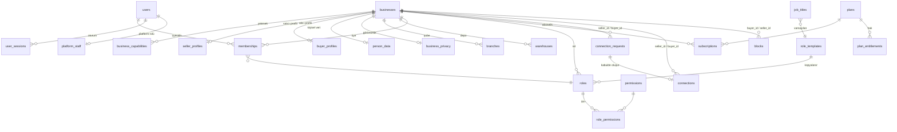
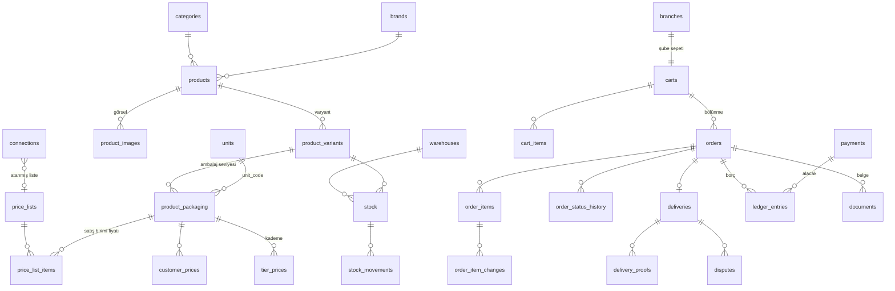

# Veri Modeli

| Alan | Değer |
| --- | --- |
| Sürüm | 1.0 |
| Tarih | 2026-10-24 |
| Veritabanı | PostgreSQL 16 |
| İlgili belgeler | [c4-component.md](c4-component.md) (tablo sahipliği) · [state-machines.md](state-machines.md) (durum alanları) · [glossary.md](../02-requirements/glossary.md) |

## 1. Genel kurallar

| Konu | Kural |
| --- | --- |
| Birincil anahtar | `id uuid` (UUIDv7, uygulama üretir; zamana göre sıralanabilir). İstisnalar belirtilmiştir. |
| Zaman | `timestamptz`, UTC. Her tabloda `created_at timestamptz not null default now()`; değişebilen tablolarda `updated_at`. |
| Para | Birim fiyat `numeric(14,4)`; tutarlar `numeric(14,2)`; her para alanının yanında `currency_code char(3)` veya kaydın para birimine bağlı. |
| Miktar | `numeric(14,3)` (kg gibi ondalıklı birimler için). |
| Çok dilli içerik | `jsonb`: `{"az": "...", "ru": "...", "tr": "...", "en": "..."}`. Eksik anahtar geri dönüşü uygulamada (ADR-0007). |
| Durum alanları | `text` + `CHECK (status IN (...))`. PostgreSQL enum tipi kullanılmaz (migration'da değer eklemek zahmetli). |
| Silme | İş kayıtları silinmez: `status = 'archived'` veya `archived_at`. Fiziksel silme yalnızca kişisel veri temizliğinde ve geçmişi olmayan kayıtlarda. |
| Kişisel veri | 🔒 ile işaretli alanlar. Loglanmaz (maskelenir), dışa aktarmalarda yalnızca yetkiliye, silme talebinde temizlenir. |
| Adlandırma | Tablolar çoğul `snake_case`; yabancı anahtar `<tekil>_id`; satıcı işletme `seller_id`, alıcı işletme `buyer_id` (her ikisi de `businesses.id`). |

### 1.1 Kiracı izolasyonu (RLS) sınıfları

Her istek işleminin başında uygulama `SET LOCAL app.business_id = '<uuid>'` çalıştırır. Platform yönetici uç noktaları ayrıca `SET LOCAL app.is_platform = 'true'` çalıştırır (ADR-0003).

| Sınıf | Kural | Örnek tablolar |
| --- | --- | --- |
| **T** (tek kiracı) | `business_id = current_setting('app.business_id')::uuid` (satıcı tablolarında sütun adı `seller_id`, alıcı tablolarında `buyer_id`) | `products`, `price_lists`, `stock`, `carts`, `branches` |
| **P** (çift kiracı) | `seller_id = app.business_id OR buyer_id = app.business_id` | `connections`, `orders`, `order_items`, `deliveries`, `ledger_entries`, `payments` |
| **G** (genel katalog) | Herkes okur; yalnızca `app.is_platform = true` yazar | `units`, `categories`, `brands` (aktif), `activity_types`, `languages`, `currencies`, `regions`, `permissions`, `job_titles`, `role_templates`, `plans` |
| **U** (kullanıcıya bağlı) | `user_id = app.user_id` | `user_sessions`, `push_tokens`, `notifications`, `notification_preferences` |
| **S** (sistem) | RLS dışında; yalnızca belirli servisler erişir; uygulama rolünün doğrudan okuma izni yok, yalnızca güvenli fonksiyonlar | `otp_challenges`, `idempotency_keys`, `outbox_events`, `audit_logs` (yalnızca ekleme), `settings`, `dev_sms_outbox` |
| **D** (dizin) | Perakendeci dizini sorguları yalnızca `directory` modülünün `SECURITY DEFINER` fonksiyonu ve Meilisearch indeksi üzerinden; görünürlük ayarları fonksiyon içinde uygulanır | `businesses`, `buyer_profiles`, `business_privacy`, `person_data` (yetkili adı F2.11a; kişisel iletişim yalnız açıksa F2.11b), `files` (yalnız logo, F2.11b), `seller_profiles` (yalnız tanıtım metni; perakendecinin gördüğü toptancı özeti, `connections` modülü, F2.13a) (başka kiracının okuması) |

**Ek RLS kuralları:**

- `withSystemTx` yalnızca bağlamsız sistem okumaları (ayar, worker) içindir; kiracı verisi göremez: `app.business_id`, `app.user_id` ve `app.is_platform` boştur, T/P/U tablolarında 0 satır döner. S tablolarına yalnızca `SECURITY DEFINER` fonksiyonlarla erişir (F1.4a).
- Platform bağlamı (`app.is_platform = true`) `orders`, `order_items`, `ledger_entries`, `payments`, `price_lists`, `price_list_items`, `customer_prices`, `tier_prices` (F3.9) tablolarında **yazma** iznine sahip değildir (US-016 AC5). F3.3a (R39): `products`, `product_variants`, `product_packaging`, `product_visibility` ve F3.4a'da `product_images`, F3.5a'da `import_jobs` da bu listededir (platform yalnız okur).
- T tablolarında kiracı politikasının yanında ayrı bir platform politikası bulunur: `current_setting('app.is_platform', true) = 'true'` iken USING ve WITH CHECK (c4-component §7; `withPlatformTx` `app.business_id`'yi boş bıraktığı için kiracı politikası platforma 0 satır gösterir). İlk uygulama F1.7 (`businesses` grubu). US-016 AC5 listesindeki tablolara bu politika **asla** eklenmez. F2.18: `pnpm check-rls` bu listeyi (`PLATFORM_WRITE_FORBIDDEN_TABLES`, `check-rls.ts`) denetler: listedeki tabloda `app.is_platform` geçen veya kiracı koşulu taşımayan yazma politikası (INSERT, UPDATE, DELETE, FOR ALL) CI'ı kırar; tablo henüz yoksa kural atlanır.
- Alıcı, satıcının ürün ve fiyat tablolarını yalnızca **aktif bağlantı** varsa okuyabilir: bu sorgular `catalog` modülünün `buyer_visible_products(buyer_id)` fonksiyonu üzerinden yapılır ve fonksiyon aktif bağlantıyı kontrol eder.

## 2. ERD — Kimlik, işletme, erişim, bağlantı

## 3. ERD — Katalog, fiyat, stok, sipariş, teslimat, cari

## 4. Tablolar

Sütun listesinde `id`, `created_at`, `updated_at` her tabloda vardır ve tekrar yazılmamıştır (istisnalar belirtilmiştir).

### 4.1 `core`

#### `outbox_events` (S)

| Alan | Tip | Kısıt | Not |
| --- | --- | --- | --- |
| id | bigserial | PK | `id` uuid değil; sıra önemli |
| type | text | not null | ör. `order.submitted`, `connection.request_created` |
| aggregate_type | text | not null | `order`, `connection`, … |
| aggregate_id | uuid | not null | |
| business_ids | uuid[] | not null | Olayla ilgili kiracılar |
| payload | jsonb | not null | Kişisel veri içermez; kimlikler taşır |
| processed_at | timestamptz | null | |
| attempts | int | not null default 0 | |
| last_error | text | null | |

İndeks: `(processed_at) WHERE processed_at IS NULL`.

#### `ops_metrics` (S)

| Alan | Tip | Kısıt | Not |
| --- | --- | --- | --- |
| id | bigserial | PK | |
| measured_at | timestamptz | not null | 5 dakikada bir (worker) |
| key | text | not null | ör. `http.5xx_rate`, `queue.oldest_age_s`, `sms.sent_today` |
| value | numeric(18,4) | not null | |
| labels | jsonb | null | ör. `{"queue": "notifications"}` |

İndeks: `(key, measured_at DESC)`. 90 günden eski kayıtlar gece silinir. Kaynak: [observability.md](../06-operations/observability.md) §2.
F2.16'dan beri zamanlanmış işler her başarılı çalışmada bir satır yazar: `key = job.<iş adı>` (ör. `job.connections.expire_requests`), `value` = işlenen kayıt sayısı, `labels` boş. app_user yalnız INSERT yapar; okuma ve temizlik F6.7.

#### `idempotency_keys` (S)

| Alan | Tip | Kısıt | Not |
| --- | --- | --- | --- |
| key | text | PK (key, user_id) | İstemcinin `Idempotency-Key` başlığı |
| user_id | uuid | not null | |
| endpoint | text | not null | |
| request_hash | text | not null | Yöntem + yol + sorgu dizesi + `X-Business-Id` + kanonik JSON gövdenin SHA-256 özeti; aynı anahtar farklı istekle gelirse `IDEMPOTENCY_CONFLICT` (F1.2b) |
| status_code | int | null | null = istek işleniyor (kilit); yalnızca 2xx yanıt saklanır |
| response_body | jsonb | null | null = istek işleniyor |
| locked_until | timestamptz | null | İşlenen isteğin kilidi (`idempotency.lock_seconds`); geçince kayıt sahipsiz sayılır, yeni istek işlenir |
| expires_at | timestamptz | not null | `idempotency.ttl_hours` (varsayılan 24 saat); süresi dolan anahtar yeni istek sayılır |

#### `audit_logs` (S, yalnızca ekleme)

| Alan | Tip | Kısıt | Not |
| --- | --- | --- | --- |
| id | bigserial | PK | |
| occurred_at | timestamptz | not null | |
| actor_user_id | uuid | null | Sistem işlerinde null |
| actor_type | text | `user` / `system` / `platform` | |
| impersonation_session_id | uuid | null | |
| business_id | uuid | null | İşlemin ait olduğu kiracı |
| action | text | not null | ör. `role.updated`, `connection.cancelled` |
| target_type | text | not null | |
| target_id | text | not null | |
| before | jsonb | null | 🔒 alanlar maskelenir |
| after | jsonb | null | 🔒 alanlar maskelenir |
| ip | inet | null | |
| request_id | text | null | |

İndeks: `(business_id, occurred_at DESC)`, `(target_type, target_id)`. Saklama 2 yıl (NFR-52); uygulama rolünün `UPDATE`/`DELETE` izni yoktur.

### 4.2 `identity`

#### `users` (U — kendisi; diğerleri üyelik üzerinden)

| Alan | Tip | Kısıt | Not |
| --- | --- | --- | --- |
| phone_e164 | text | unique, not null | 🔒 ör. `+994501234567` |
| full_name | text | not null | 🔒 |
| preferred_language | char(2) | FK `languages.code` | |
| timezone | text | null | IANA; null ise işletme saat dilimi |
| status | text | `active` / `locked` / `deleted` | |
| last_login_at | timestamptz | null | |
| last_business_id | uuid | null, FK `businesses.id` (migration'da elle, F2.7a) | Son kullanılan işletme (US-003 AC1, S8); kullanıcı `PATCH /me` ile yazar, aktif üyelik yoksa `/me` null döner |

**RLS (F1.5a):** `SELECT` ve `UPDATE` yalnızca kendi satırı (`id = app.user_id`); `phone_e164`, `status` ve `last_login_at` yalnızca platform bağlamında değişir (tetikleyici `users_guard_platform_columns`, ihlal 42501); platform bağlamı (`app.is_platform = 'true'`) tüm işlemler. Üyelik üzerinden görme: `users_member_select` (F2.7a) — bağlamdaki işletmede (`app.business_id`) aktif üyeliği olan kullanıcıların satırı okunur; yazma yok. Davet edilen kişinin satırı `user_ensure_for_invitation()` ile (F2.7a). Önceki adımlarda FK'sız bırakılan `settings.updated_by`, `businesses.verified_by`, `business_capabilities.approved_by`, `entitlement_overrides.created_by` sütunlarına `users(id)` FK'sı F1.5a migration'ında eklenir (`audit_logs.actor_user_id` FK'sız kalır: yalnızca ekleme yapılan kayıt).

#### `otp_challenges` (S)

| Alan | Tip | Kısıt | Not |
| --- | --- | --- | --- |
| phone_e164 | text | not null | 🔒 |
| purpose | text | `login` / `register` / `invitation` | |
| code_hash | text | not null | Kod düz metin saklanmaz |
| expires_at | timestamptz | not null | +5 dk |
| attempts | smallint | not null default 0 | 5'te kilit |
| consumed_at | timestamptz | null | |
| request_ip | inet | null | |

İndeks: `(phone_e164, created_at DESC)`. 7 günden eski kayıtlar gece silinir.

`code_hash` = `HMAC-SHA256(OTP_HASH_KEY, 'otp:' + challengeId + ':' + kod)` (hex); karşılaştırma sabit zamanlı (F1.5a). Uygulama tabloya yalnızca `SECURITY DEFINER` fonksiyonlarla erişir: `otp_challenge_create`, `otp_challenge_lock` (doğrulama için satırı kilitler), `otp_challenge_fail`, `otp_challenge_close`; mock SMS kutusu için `dev_sms_outbox_insert`, `dev_sms_outbox_list`.

**Numara kilidi ve hız sınırları tabloda değil, Redis'tedir (F1.5a):** kilit süreli bir anahtardır (`otp.lock_minutes`); numara ve IP sayaçları kayan penceredir. Anahtarlarda telefon düz yazılmaz, `OTP_HASH_KEY` ile HMAC'li hâli kullanılır. Redis'e ulaşılamazsa kod gönderilmez ve doğrulama yapılmaz (`503 SMS_UNAVAILABLE`).

#### `user_sessions` (U)

| Alan | Tip | Kısıt | Not |
| --- | --- | --- | --- |
| user_id | uuid | FK users | |
| refresh_token_hash | text | unique | Döndürülür; eskisi kullanılırsa tüm aile iptal |
| family_id | uuid | not null | Döndürme ailesi |
| device_type | text | `web` / `ios` / `android` | |
| device_name | text | null | |
| ip_city | text | null | |
| last_used_at | timestamptz | | |
| expires_at | timestamptz | | +30 gün |
| revoked_at | timestamptz | null | |
| impersonation_session_id | uuid | null | |

**F1.5b:** Yenileme anahtarı 32 rastgele bayt (base64url); `refresh_token_hash` = SHA-256 (hex). Her yenilemede aynı `family_id` ile yeni satır açılır, eski satır `revoked_at` ile kapanır; iptal edilmiş satırın anahtarı tekrar gelirse aynı ailedeki tüm satırlar iptal edilir (`401 REFRESH_TOKEN_REUSED`, audit `session.refresh_reused`). Oturum listesinde aile başına geçerli satır görünür; oturumu kapatmak ailesini iptal eder. `device_type` istekte yoksa `web`; `ip_city` kaynağı belgede yok, şimdilik null.

**RLS (F1.5b):** `SELECT`, `INSERT`, `UPDATE` yalnızca kendi satırları (`user_id = app.user_id`); platform bağlamı tüm işlemler; silme yok. Kullanıcı bağlamı dışından erişim (doğrulama, yenileme) yalnızca `SECURITY DEFINER` fonksiyonlarla: `identity_user_by_phone`, `user_session_rotate`, `identity_record_login` (`users.last_login_at`). Bu fonksiyonlar kullanıcı bağlamı olmadan çalıştığı için `users` (SELECT, UPDATE) ve `user_sessions` (ALL) tablolarında yalnızca `migrator` rolüne açık politikalar vardır (`TO migrator`; `app_user` bu rolü üstlenemez). Koruma tetikleyicileri: `users_guard_platform_columns` fonksiyon sahibi `migrator` olarak çalışan yazmaya izin verir, `app_user` bu alanları yine yazamaz; `user_sessions_guard_columns` ile `app_user` platform dışında oturumu yalnızca kapatabilir (anahtar özeti, aile, süre, cihaz değişmez; kapatılmış oturum açılmaz).

#### `user_totp` (U)

| Alan | Tip | Kısıt | Not |
| --- | --- | --- | --- |
| user_id | uuid | PK, FK users | `id` yok |
| secret_encrypted | bytea | not null | Uygulama anahtarıyla şifreli |
| recovery_codes_hash | jsonb | not null | 10 kod |
| enabled_at | timestamptz | null | |
| last_used_step | bigint | null | Son kabul edilen TOTP adımı (30 sn); aynı kod tekrar kullanılamaz (F1.6) |

**F1.6:** `secret_encrypted` = AES-256-GCM (`TOTP_ENCRYPTION_KEY`), biçim `nonce (12 bayt) ‖ etiket (16) ‖ şifreli metin`; her şifrelemede yeni rastgele nonce, ek doğrulama verisi (AAD) `user_id`. `recovery_codes_hash` = `[{ "hash": HMAC-SHA256(OTP_HASH_KEY, 'recovery:' + user_id + ':' + kod), "usedAt": null | zaman }]`; kurulum onaylanınca 10 kod üretilir ve yalnızca o yanıtta bir kez gösterilir; her kod bir kez kullanılır. Onaysız kurulumda (`enabled_at` null) liste boştur ve yeni kurulum sırrı ezer. RLS: kullanıcı yalnızca kendi satırını okur, ekler, günceller (`user_id = app.user_id`); platform bağlamı her şey; silme yok.

#### `platform_staff` (S)

| Alan | Tip | Kısıt | Not |
| --- | --- | --- | --- |
| user_id | uuid | PK, FK users | |
| role | text | `super_admin` / `operations` / `support` / `content` | |
| is_active | boolean | default true | |

**F1.6:** S sınıfı: `app_user`'ın tablo izni yok; giriş akışı rolü `platform_staff_role(user_id)` SECURITY DEFINER fonksiyonuyla okur (aktif satır yoksa null). Yazma şimdilik yalnızca seed (`SUPER_ADMIN_PHONE` → `super_admin`); platform admin paneli F2.

#### `dev_sms_outbox` (S — yalnızca dev/staging)

| Alan | Tip | Kısıt | Not |
| --- | --- | --- | --- |
| phone_e164 | text | | 🔒 |
| body | text | | |

Production'da tablo boş kalır; production'da mock sağlayıcıyla uygulama başlamaz (NFR-97).

### 4.3 `settings`, `i18n`, `files`

#### `settings` (S)

| Alan | Tip | Kısıt | Not |
| --- | --- | --- | --- |
| id | uuid | PK, `default gen_random_uuid()` | Satırı yalnızca `settings_put` fonksiyonu yazar; kimlik veritabanında üretilir |
| scope | text | `platform` / `plan` / `business` (CHECK) | |
| scope_id | uuid | null (platform için); plan ve işletme için not null (CHECK) | |
| key | text | not null | ör. `connection.cooldown_after_reject_days` |
| value | jsonb | not null | |
| updated_by | uuid | FK users (F1.5a'da eklenir) | `settings_put` fonksiyonu `app.user_id`'den yazar |
| created_at, updated_at | timestamptz | not null default now() | |

Benzersiz: `(scope, coalesce(scope_id, '00000000-0000-0000-0000-000000000000'), key)`. Anahtar listesi: [user-stories.md](../02-requirements/user-stories.md) US-017.

Erişim (S sınıfı, F1.4a): `app_user`'ın tabloda hiçbir izni yoktur. `migrator` sahipli `SECURITY DEFINER` fonksiyonlar:

- `settings_get(p_key text, p_business_id uuid)` → `(scope, value)` satırları: platform satırı ve (`p_business_id` verildiyse) işletme satırı ile işletmenin güncel aboneliğinin (`subscriptions.status IN ('active','grace','read_only')`) planına ait `scope = 'plan'` satırı (F1.4b). İşletme ve plan satırları yalnızca `p_business_id = app.business_id` iken veya platform bağlamında döner.
- `settings_put(p_scope text, p_scope_id uuid, p_key text, p_value jsonb) RETURNS jsonb`: yalnızca platform bağlamında (`app.is_platform = 'true'`); `updated_by` = `app.user_id`. Aynı kapsamdaki önceki değeri döner (yoksa `NULL`); `SettingsService.set` bunu aynı işlemde audit'e eski değer olarak yazar (US-017 AC2, F1.9). Değer doğrulaması uygulamada (`SettingsService`).
- `settings_admin_list(p_scope text, p_scope_id uuid)` → `(scope, key, value, updated_at)` satırları (F2.19, admin ayar ekranı): yalnızca platform bağlamında (aksi `42501`). Platform satırları; `p_scope = 'plan'` ise o planın satırları; `p_scope = 'business'` ise işletmenin satırları ve işletmenin güncel aboneliğinin planının satırları (`settings_get` ile aynı plan seçimi).

SECURITY DEFINER fonksiyonlarda search_path her zaman `pg_catalog, public, pg_temp` ile (pg_temp en sonda) sabitlenir.

#### `languages` (G) — `code char(2) PK`, `name text`, `is_active bool`, `is_default bool`, `sort_order int`, `direction text (ltr/rtl)`

Tek varsayılan dil: `is_default` üzerinde kısmi benzersiz indeks (`WHERE is_default`). `direction` CHECK `ltr`/`rtl`.

#### `ui_translations` (G) — `key text`, `lang char(2)`, `value text`; PK `(key, lang)`

`lang` FK `languages(code)`. Anahtar adı coding-guidelines §2 (`<alan>.<ekran>.<öğe>`); hata mesajları `errors.<ErrorCode>` (F1.3).

#### `currencies` (G) — `code char(3) PK`, `symbol text`, `decimals smallint`, `is_active bool`

`decimals` CHECK `0–4`.

#### `countries` (G) — `code char(2) PK`, `name jsonb`, `default_currency char(3)`, `default_timezone text`, `phone_prefix text`

`default_currency` FK `currencies(code)`. `default_timezone` IANA adı (ör. `Asia/Baku`).

#### `regions` (G)

| Alan | Tip | Kısıt | Not |
| --- | --- | --- | --- |
| id | uuid | PK, `default gen_random_uuid()` | Geçici istisna (UUIDv7 kuralı, `settings.id` gibi; açık soru S5). Satırları admin ekranı veya SQL ile girer. |
| country_code | char(2) | FK countries | |
| parent_id | uuid | null, FK regions | Şehir → rayon |
| type | text | `city` / `district` | |
| name | jsonb | not null | |

G tablolarının hepsinde `created_at`, `updated_at` (§1). RLS: `SELECT USING (true)`; `INSERT` (WITH CHECK), `UPDATE` (USING ve WITH CHECK), `DELETE` (USING) politikaları yalnızca `current_setting('app.is_platform', true) = 'true'` iken. `app_user`: SELECT, INSERT, UPDATE, DELETE (yazma RLS ile sınırlanır); `readonly`: SELECT (F1.3).

#### `files` (T: `owner_business_id`)

| Alan | Tip | Kısıt | Not |
| --- | --- | --- | --- |
| id | uuid | PK (UUIDv7, uygulamada) | Anahtardaki `<fileId>` |
| owner_business_id | uuid | null, FK businesses | Platform dosyalarında null |
| purpose | text | `product_image` / `logo` / `delivery_photo` / `dispute_photo` / `import` (CHECK) | Bucket ve izin buna göre (F1.10) |
| bucket | text | `public` / `private` (CHECK) | |
| object_key | text | not null, unique | `<businessId>/<purpose>/<fileId>.<ext>` (platform: `platform/...`) |
| content_type | text | not null | İstekte bildirilen; `ready` olunca imzayla doğrulanmış tür |
| size_bytes | int | not null, > 0 | İstekte bildirilen; `ready` olunca depodaki gerçek boyut |
| status | text | `pending` / `ready` / `rejected` (CHECK) | |
| created_by | uuid | not null, FK users | |
| created_at, updated_at | timestamptz | not null default now() | |

Benzersiz: `(owner_business_id, id)` (bileşik FK hedefi). RLS (F1.10): `files_tenant` — `owner_business_id = app.business_id` (FOR ALL); `files_platform` — `app.is_platform = 'true'` (FOR ALL). Platform dosyası (`owner_business_id` null) yalnızca platform bağlamında görünür ve yazılır. `app_user`: SELECT, INSERT, UPDATE (DELETE yok; reddedilen dosyanın satırı `rejected` olarak kalır); `readonly`: SELECT.

`businesses.logo_file_id` FK'sı bileşiktir: `(id, logo_file_id) → files(owner_business_id, id)`; işletme yalnızca kendi dosyasını logo yapabilir (FK denetimi RLS dışıdır, F1.8a kuralı).

### 4.4 `businesses`

#### `businesses` (T kendisi; D başkaları için)

RLS: `rls:T,D`; kiracı politikası `id = app.business_id`, platform politikası (§1.1). Başka kiracının dizin okuması (D) F2 dizin adımındaki `SECURITY DEFINER` fonksiyonuyla gelir. `buyer_profiles` ve `business_privacy` da `rls:T,D`; bu bölümdeki diğer T tabloları `rls:T`. Kimlikler (`id`) uygulamada UUIDv7 (`IdGenerator`, F1 faz spesifikasyonu S5 = A).

| Alan | Tip | Kısıt | Not |
| --- | --- | --- | --- |
| legal_name | text | not null | Ünvan |
| voen | char(10) | unique (null hariç) | Format: 10 rakam, son hane 1/2 |
| legal_type | text | `legal_entity` / `individual_entrepreneur`, null | VÖEN'den türetilir |
| country_code | char(2) | FK, default `AZ` | |
| region_id | uuid | FK regions, not null | Şehir/rayon |
| address_line | text | null | Gizlilik ayarına bağlı |
| geo_lat, geo_lng | numeric(9,6) | null | |
| business_phone | text | null | Gizlilik ayarına bağlı |
| logo_file_id | uuid | FK files | |
| default_language | char(2) | FK | |
| currency_code | char(3) | FK | |
| timezone | text | not null | IANA, ör. `Asia/Baku` |
| status | text | `active` / `suspended` / `dormant` / `archived` | |
| verified_at | timestamptz | null | Moderatör doğrulaması |
| verified_by | uuid | null | |
| created_via | text | `admin` / `self_signup` | |
| data_consent_version | text | null | NFR-63 |
| data_consent_at | timestamptz | null | |
| profile_completeness | smallint | 0–100 | |

İndeks: `(region_id) WHERE status = 'active'`. `voen` biçimi veritabanında da `CHECK (voen ~ '^[0-9]{9}[12]$')`.

Alan koruması (F1.7): `status`, `verified_at`, `verified_by`, `created_via` yalnızca platform bağlamında değişir. `BEFORE INSERT OR UPDATE` tetikleyicisi `businesses_guard_platform_columns` (SECURITY DEFINER değil; `SET search_path = pg_catalog, public, pg_temp`, `REVOKE ALL FROM PUBLIC`): kiracı bağlamında INSERT yalnızca `status = active`, `created_via = self_signup` ve doğrulama alanları boşken; UPDATE bu dört alanı değiştiremez. İhlal `42501`. F2.4 (migration 0016, R20): aynı tetikleyici her bağlamda `legal_type`'ı VÖEN'in son hanesinden türetir (1 = `legal_entity`, 2 = `individual_entrepreneur`, VÖEN yoksa null) ve UPDATE'te `voen` değişip aynı ifadede `verified_at`/`verified_by` değiştirilmezse doğrulama rozetini sıfırlar (`verified_at = verified_by = null`); kiracı bu alanları yine yazamaz, platform aynı ifadede VÖEN + doğrulama yazarsa korunur. Not: `dormant` geçişleri (state-machines §9) geldikleri adımda platform bağlamı veya ayrı bir fonksiyon gerektirir.

**Platform yönetimi (F2.18, `0029_buyer_moderation.sql`; US-015, US-016).** Doğrulama `verified_at = now`, `verified_by = admin`; red VÖEN'i temizler (tetikleyici hukuki tipi ve rozeti sıfırlar). Askı/arşiv `BusinessStateMachine` ile. "Sil": migrator sahipli `SECURITY DEFINER` `business_purge(p_business_id) RETURNS TABLE (purged boolean, object_keys text[])` — yalnız platform bağlamı (`app.is_platform`, `app.user_id` dolu, `app.business_id` boş; aksi `42501`), yalnız `buyer` yetenekli işletme; satırı `FOR UPDATE` kilitler, geçmişi (alıcının herhangi bir `connections`, `connection_requests`, `blocks` satırı; F3–F5'te sipariş/belge/cari eklenir) kilitten sonra denetler; geçmiş varsa hiçbir şey silmez (`purged = false`) ve çağıran arşivler (`status = archived`, `person_data` silinir, açık davetler kapanır). Geçmiş yoksa işletmeye bağlı satırları (bildirim, davet, üyelik, rol, şube, depo, abonelik, hak istisnası, alıcı profili, gizlilik, `person_data`, yetenek, dosya) ve işletmeyi siler, `users.last_business_id` null olur; `audit_logs` ve `outbox_events` kalır; dosya nesneleri commit sonrası silinir. `memberships_last_admin_guard` arşivli işletmede son admini korumaz. Yalnız migrator'a açık politikalar: `notifications_definer_select`, `notifications_definer_delete`.

#### `business_capabilities` (T)

| Alan | Tip | Kısıt | Not |
| --- | --- | --- | --- |
| business_id | uuid | PK parçası | `id` yok |
| capability | text | PK parçası; `seller` / `buyer` | |
| status | text | `pending` / `approved` / `suspended` | |
| approved_by | uuid | null | |
| approved_at | timestamptz | null | |

Kural: `seller` yeteneği yalnızca platform bağlamında `approved` yapılabilir (K1). RLS ile uygulanır (F1.7): kiracı kendi satırlarını okur ve yalnızca INSERT yapabilir — `buyer` + `approved` (perakendeci kaydı) veya `seller` + `pending`, `approved_by`/`approved_at` boş. Kiracıya UPDATE/DELETE politikası yoktur (0 satır); `approved` ↔ `suspended` geçişleri (`buyer` dahil) yalnızca platform politikasıyla. İhlal `42501`. MVP'de bir işletmenin yalnızca bir yeteneği olur; ikinci yetenek ekleme uç noktası özellik bayrağıyla kapalıdır (D20).

#### `seller_profiles` (T)

| Alan | Tip | Kısıt | Not |
| --- | --- | --- | --- |
| business_id | uuid | PK | |
| description | jsonb | null | Tanıtım metni |
| stock_mode | text | `none` / `availability` / `quantity` | default `availability` |
| min_order_amount | numeric(14,2) | null | Para birimi: işletme |
| require_delivery_photo | boolean | default false | |
| low_stock_display_threshold | numeric(14,3) | default 5 | US-039 AC6 |
| default_price_list_id | uuid | FK price_lists | |
| default_warehouse_id | uuid | FK warehouses | Bileşik FK `(business_id, default_warehouse_id)` → `warehouses(business_id, id)`: yalnızca kendi deposu (FK kontrolü RLS'e bakmaz) |

#### `service_areas` (T) — `seller_id uuid`, `region_id uuid`; PK `(seller_id, region_id)`

#### `buyer_profiles` (T)

| Alan | Tip | Kısıt | Not |
| --- | --- | --- | --- |
| business_id | uuid | PK | |
| activity_type_id | uuid | FK activity_types, not null | |
| listed_in_directory | boolean | default true | US-007 AC4 |
| dormant_stage | text | `none` / `reminded_7` / `reminded_30` / `warned` / `deactivated` | US-027 |
| dormant_stage_at | timestamptz | null | |
| dormant_since | timestamptz | not null, default `now()` | F2.17: bağlantısız hesap sayacının başladığı an (kayıt; her girişte veya oturum yenilemede yeniden). Mevcut satırlar `businesses.created_at` ile dolduruldu |

**Bağlantısız hesap (F2.17, `0030_dormant_accounts.sql`; US-027, state-machines §9).** `dormant_stage`, `dormant_stage_at`, `dormant_since` kiracı bağlamında değişmez: `BEFORE INSERT OR UPDATE` bekçisi `buyer_profiles_guard_dormant_columns` (kiracı INSERT'te aşama `none`, aşama anı boş; UPDATE'te üç kolon yalnız `current_user = migrator` (aşağıdaki fonksiyonlar) veya platform bağlamında; aksi `42501`). `businesses_guard_platform_columns` migrator yolunda (platform bağlamı yok) yalnız `active → dormant`, `dormant → active`, `dormant → archived` geçişlerine izin verir. Migrator sahipli `SECURITY DEFINER` fonksiyonlar (`search_path = pg_catalog, public, pg_temp`, PUBLIC EXECUTE yok, yalnız `app_user`):

- `dormant_scan(p_now, p_after, p_min_days, p_limit)` → `(business_id, status, stage, stage_at, since)`: yalnız bağlamsız (`withSystemTx`; `app.business_id`, `app.user_id`, `app.is_platform` boş, aksi `42501`; ortak denetim `dormant_assert_system`). Uygun perakendeci (`dormant_eligible`) = `status` `active` veya `dormant`, onaylı `buyer` yeteneği, alıcı olduğu hiçbir `connections` satırı yok (iptal dahil; sipariş/cari F3–F5'te eklenir, US-027 AC5); sayacı en az `p_min_days` gün; kimlik sırasıyla `p_after`'dan sonra (keyset), `FOR UPDATE OF buyer_profiles SKIP LOCKED`. Hedef aşama uygulamadaki saf kuraldan (`dormant-policy.ts`).
- `dormant_advance(p_business_id, p_stage, p_now)` → `boolean`: yalnız bağlamsız; kilitli satırda uygunluğu ve aşama sırasını yeniden denetler (hatırlatma yalnız ileri, `warned` uyarı öncesinden, `deactivated` yalnız `warned` + `active`'ten), `dormant_stage`/`_at` yazar; `deactivated`'da işletme `dormant` olur. Uygun değilse `false`.
- `dormant_archive(p_business_id, p_now)` → `(outcome, person_rows, invitations_closed, object_keys)`: yalnız bağlamsız; aşama `deactivated` ve işletme `dormant` olmalı (aksi `skipped`). Kullanıcı kararı S1 = B (admin "sil" ile aynı): `business_has_history` (bağlantı, istek, engel) yoksa `business_purge_rows` ile kalıcı silinir (`purged`; satır silme platform politikalarıyla, fonksiyon içinde platform bağlamı geçici açılır ve hemen kapanır); varsa `archived`, `person_data` silinir, açık davetler kapanır. `users` silinmez. Dosya nesneleri worker'da silinmez (F2.16b artık temizliği).
- `business_purge_rows(p_business_id)` (DEFINER değil, PUBLIC EXECUTE yok; yalnız migrator + platform bağlamında) ve `business_has_history(p_business_id)`: 0029 `business_purge`'ün silme listesi ve geçmiş tanımı tek yere taşındı; `business_purge` davranışı aynı.
- `dormant_recipients(p_business_id, p_kind)` → `(user_id, business_id)`: yalnız bağlamsız; `buyer_admins` = perakendecinin aktif adminleri; `region_sellers` = hizmet bölgesi (`service_areas`) perakendecinin bölgesini kapsayan, `active` ve `seller` yeteneği onaylı toptancıların aktif adminleri; perakendeci dizinde gizliyse (`listed_in_directory = false`) veya toptancıyı engellediyse (`blocks`) toptancı listede yok.
- `buyer_dormant_touch(p_now, p_min_interval_minutes)` → `(business_id, reactivated)`: yalnız kullanıcı bağlamı (`withUserTx`; `app.user_id` dolu, işletme/platform boş). Kullanıcının aktif üyesi olduğu perakendecilerde aşama `none`, `dormant_since = p_now`; `dormant` işletme `active` olur. Yazma yalnız aşama `none` değilse, işletme `dormant` ise veya sayaç `p_min_interval_minutes`'tan eskiyse.

Yalnız migrator'a açık politikalar: `connections_definer_select`, `service_areas_definer_select`, `buyer_profiles_definer_update`, `businesses_definer_dormant_update` (USING `status in (active, dormant)`), `person_data_definer_delete`.

#### `business_privacy` (T)

| Alan | Tip | Varsayılan |
| --- | --- | --- |
| business_id | uuid PK | |
| show_logo | boolean | false |
| show_address | boolean | false |
| show_business_phone | boolean | false |
| show_voen | boolean | false |
| show_contact_name | boolean | false |
| show_personal_contact | boolean | false |

#### `person_data` (T, D)

| Alan | Tip | Kısıt | Not |
| --- | --- | --- | --- |
| business_id | uuid | unique, FK | Bir işletmeye bir kayıt |
| contact_name | text | | 🔒 |
| personal_phone | text | null | 🔒 |
| email | text | null | 🔒 |

İndeks (F2.11a): `person_data_personal_phone_idx (personal_phone) WHERE personal_phone IS NOT NULL`; `businesses_business_phone_digits_idx (regexp_replace(business_phone, '[^0-9]', '', 'g')) WHERE business_phone IS NOT NULL` (tam telefon eşleşmesi).

**Dizin D okuması (F2.11a, `0020_directory.sql`).** `businesses`, `buyer_profiles`, `business_privacy` ve `person_data` (yalnız yetkili adı) başka kiracı için yalnız migrator sahipli `SECURITY DEFINER` fonksiyonlarla okunur (`search_path = pg_catalog, public, pg_temp`, PUBLIC EXECUTE yok, yalnız `app_user`). Fonksiyonlar için yalnız migrator'a açık okuma politikaları: `buyer_profiles_definer_select`, `business_privacy_definer_select`, `person_data_definer_select`, `business_capabilities_definer_select`, `memberships_definer_select`, `roles_definer_select` (`businesses`, `users` için 0013 / 0008'de var). Çağıran kontrolü `directory_assert_caller` (SECURITY DEFINER değil, PUBLIC EXECUTE yok); ihlal `42501`.

- `directory_buyer_documents(p_ids uuid[])` (en fazla 1000): `buyer` yeteneği `approved` ve işletmesi `active` olanların belgesi. Ünvan, faaliyet alanı, bölge, şehir (bölge rayonsa üstü), doğrulanmış her zaman; logo kimliği, adres, işletme telefonu, VÖEN, yetkili adı yalnız `business_privacy` açıksa, değilse `null`; `listed_in_directory`. Kişisel telefon, e-posta, bağlantı ve alım verisi hiç dönmez (US-007 AC6). Çağıran: onaylı ve aktif `seller` bağlamı, platform veya bağlamsız sistem işlemi (worker).
- `directory_buyer_page(p_after uuid, p_limit int)` (1–1000): dizinde görünmesi gereken kimlikler, `id` sırasıyla. Yalnız platform / bağlamsız sistem işlemi (yeniden indeksleme).
- `directory_buyer_exact_match(p_phone text, p_voen text)`: yalnız biri; tam E.164 telefon veya 10 haneli VÖEN. Biçimsiz/kısmi değer boş döner (US-020 AC2). "Dizinde görünme" kapalı olsa da bulur; `active` + `buyer approved` şartı. Telefon (kullanıcı kararı 2026-11-09): işletme telefonu (yalnız rakamlar karşılaştırılır), kişisel telefon veya işletme admini aktif üyenin giriş telefonu. Yalnız kimlik döner, en fazla 20. Çağıran yalnız onaylı ve aktif `seller` bağlamı.

- `directory_buyer_cards(p_ids uuid[])` (F2.11b, `0021_directory_cards.sql`; en fazla 20): arama ucunun kartı. Kimlikler yalnız indeks sonucundan veya `directory_buyer_exact_match`'ten gelir, istemciden gelmez (Müfettiş 15 L1). `directory_buyer_documents` alanları + bölge ve faaliyet adları (`LocalizedText`) + kişisel telefon ve e-posta (yalnız `show_personal_contact` açıksa, US-007 AC2) + logo nesnesi (`bucket`, `object_key`; yalnız `show_logo` açık ve dosya `ready`). Çağıran yalnız onaylı ve aktif `seller` bağlamı. Bunun için `files` sınıfı `rls:T,D` olur ve yalnız migrator'a açık `files_definer_select` politikası eklenir. Uç alanları her istekte buradan taze okur; indeks bayatsa (gizlenmiş, askıya alınmış, filtreden çıkmış) kayıt dönmez. Kişisel iletişim indekse hiç yazılmaz.

İndeks `buyer_directory` (Meilisearch) yalnız `active` + `buyer approved` + dizinde görünen perakendecileri ve yalnız açık alanları tutar; aranabilir yalnız `legalName`, filtre `regionId`, `cityId`, `activityTypeId`, `verified`. Outbox `buyer.registered`, `buyer.privacy_changed`, `buyer.profile_changed` (yükte yalnız `businessId`) belgeyi D fonksiyonundan yeniden okur; gece tam yeniden indeksleme (`directory.reindex_hour_utc`) ve `pnpm search:reindex` yeni indeksi doldurup takas eder (Redis kilidi). Kilit tutulurken her artımlı yenileme kimliği önce `directory:reindex:dirty` kümesine ekler; takastan hemen sonra küme boşaltılıp bu kimlikler yeni indekste yeniden işlenir (Müfettiş 15 M1).

#### `branches` (T)

| Alan | Tip | Kısıt | Not |
| --- | --- | --- | --- |
| business_id | uuid | FK | |
| name | text | not null | |
| region_id | uuid | FK | |
| address_line | text | null | Kayıtta açılan varsayılan şubede boş (F2.3a); sepet onayı / sipariş gönderiminde zorunlu (F4) |
| geo_lat, geo_lng | numeric(9,6) | null | Konum uyuşmazlığı hesabı |
| approval_rule | text | `every_order` / `above_amount` / `none` | default `every_order` |
| approval_threshold | numeric(14,2) | null | `above_amount` için zorunlu |
| status | text | `active` / `inactive` | |

Benzersiz `(business_id, id)`: memberships / invitations bileşik FK hedefi (F1.8a).

**F2.5 (`0028_branches.sql`, US-010):** CHECK'ler: eşik yalnız `above_amount`'ta (`branches_approval_threshold_only_above_check`) ve > 0; `geo_lat`/`geo_lng` ikisi birden dolu ya da boş, −90..90 / −180..180. Silme yok, yalnız `status = inactive`; son aktif şube ve aktif üyesi / açık daveti olan şube pasifleşemez (servis, işletme satırı kilidiyle; üye/davet sayımı `BranchUsageGate`, uygulaması `access`; atama ve davet şube satırını `FOR SHARE` okur). Eşiğe tam eşit toplam onaysız gider (kullanıcı kararı S4). Kural hesabı tek yerde: `businesses` `requiresBranchApproval` (F4 sepeti kullanır). Ekip: işletme admini olmayan yönetici üyeyi yalnız kendi şubesine bağlar, başka şubedeki üyeyi değiştiremez (kullanıcı kararı 2026-11-13, `team.service`) ve başka şubenin davetini geri çekemez (Mimar kararı K1).

#### `warehouses` (T) — `business_id`, `name`, `address_line`, `is_default bool`, `status (active/inactive)`; benzersiz `(business_id, id)` (bileşik FK hedefi); işletme başına tek `is_default` (kısmi benzersiz indeks)

#### `seller_applications` (G — yalnızca platform okur)

| Alan | Tip | Kısıt | Not |
| --- | --- | --- | --- |
| legal_name | text | | |
| voen | char(10) | | Açık başvurularda unique |
| contact_name | text | | 🔒 |
| phone_e164 | text | | 🔒 |
| region_id | uuid | FK | |
| category_note | text | null, ≤ 500 | |
| status | text | `pending` / `approved` / `rejected` | default `pending`; geçişler [state-machines.md](state-machines.md) §12 |
| reviewed_by | uuid | null, FK `users` | Onaylayan / reddeden platform kullanıcısı |
| business_id | uuid | null, FK `businesses` | Onayda oluşan işletme |

**Kurallar (F2.2):** `id` UUIDv7 (uygulama), `created_at`, `updated_at`. VÖEN tekilliği kısmi benzersiz indeksle: `voen WHERE status = 'pending'` (US-008 AC3). Tutarlılık `CHECK`'i: `pending` iken `reviewed_by` ve `business_id` boş; `approved` iken ikisi dolu; `rejected` iken `reviewed_by` dolu, `business_id` boş. **RLS:** G sınıfının istisnası: okuma ve güncelleme yalnızca `app.is_platform = 'true'` (kişisel veri; herkes okumaz). Kimliksiz başvuru yalnızca `seller_application_submit(...)` `SECURITY DEFINER` fonksiyonuyla eklenir (`withSystemTx`); fonksiyon yalnızca `pending` satır yazar, migrator'a özel (`TO migrator`) ekleme politikası yalnızca bu fonksiyonun içinde etkilidir. Silme yok.

#### Perakendeci kaydı (F2.3a, SF-02)

Kayıt tek kiracı işlemidir: `withTenantTx({ businessId: yeni, userId: yeni })` (R15). İşletme, yetenek, profiller, kişisel veri, gizlilik, şube, rol ve üyelik mevcut kiracı politikalarıyla yazılır (F1.7 tetikleyicisi ve `business_capabilities_tenant_insert` yalnızca `self_signup` + `active` / `buyer` + `approved` kabul eder). Kiracının yazamadığı satırlar migrator sahipli `SECURITY DEFINER` fonksiyonlarla (`0015_buyer_signup.sql`); kimlikler parametreden değil bağlamdan alınır:

| Fonksiyon | Yazdığı | Koşul |
| --- | --- | --- |
| `user_create_self_signup(phone, full_name, preferred_language, now)` | `users` (`id = app.user_id`) | Kiracı ve kullanıcı bağlamı dolu; telefon kayıtlıysa `users_phone_e164_uq` 23505 (eşzamanlı ikinci kayıt bu satırda bekler) |
| `subscription_start_self_signup(id, plan_id, start, end, now)` | `subscriptions` (`business_id = app.business_id`, `active`) | İşletme `self_signup` + `active`, `buyer` yeteneği `approved`, hiç aboneliği yok; plan aktif, `buyer`, fiyatı 0. Aksi 42501 |
| `idempotency_lookup_by_phone(phone, key, endpoint, hash, now)` | — (okur) | Kimliksiz kayıt idempotensi, kapsam telefon (R13): `new` / `registered` / `conflict` / `replay` |
| `idempotency_store(key, endpoint, hash, status, body, expires_at)` | `idempotency_keys` (`user_id = app.user_id`) | Yanıt kayıt işleminin içinde yazılır (R12 çözümü) |

Yalnız bu fonksiyonların içinde etkili politikalar: `users_definer_insert`, `subscriptions_definer_insert` (`TO migrator`). Plan ayardan seçilir (`onboarding.buyer_plan_code`); para birimi ve saat dilimi bölgenin ülkesinden (`countries.default_currency/default_timezone`). `profile_completeness` VARSAYIM (K10): 10 alan × %10, kayıtta 40.

#### `activity_types` (G) — `name jsonb`, `is_active bool`, `sort_order int`. `id` `default gen_random_uuid()` (G tablosu istisnası, `regions` gibi; S5). Seed F2.3a'da: onaylı liste [F2-seed-listeleri.md](../tasks/F2-seed-listeleri.md) §2 (`seedBusinesses`, ada göre tekrar çalışır). Liste `GET /api/v1/catalog/activity-types` ile (yalnız aktifler).

### 4.5 `access`

#### `permissions` (G)

| Alan | Tip | Kısıt | Not |
| --- | --- | --- | --- |
| code | text | PK | ör. `orders.approve` |
| capability | text | `seller` / `buyer` / `any` | |
| module | text | | |
| description | jsonb | | |

İzin kodları kodda sabittir ve migration ile eklenir; admin yalnızca şablonlara atar.

#### `role_templates` (G) — `code text unique`, `name jsonb`, `capability`, `is_business_admin boolean default false` (kopyalanan rolün admin bayrağı, F1.8a), `version int`

#### `role_template_permissions` (G) — `template_id`, `permission_code`, `default_scope`; PK `(template_id, permission_code)`

#### `job_titles` (G) — `code text unique` (seed eşleşme anahtarı, F1.8a), `name jsonb`, `capability`, `role_template_id`, `is_active`

**F2.9 (US-012, admin kataloğu; yeni kolon yok):** şablon ve unvanı platform admini açar (`/api/v1/admin/catalog/*`, platform bağlamı). `code` adminin girdiği, sonradan değişmeyen anahtardır; `capability` değişmez. Admin ekranından açılan şablon hiçbir zaman `is_business_admin` değildir; admin şablonunun izinleri değişmez. Yeni şablon aynı işlemde yeteneğin var olan işletmelerine rol olarak kopyalanır (F2.7c kuralı). `role_templates.version` yalnız izin listesi değişince 1 artar; işletme kopyaları (`roles.source_template_version`) değişmez, şablondan rolü olan arşivlenmemiş işletmelerin aktif adminlerine "yeni şablon sürümü" bildirimi gider (outbox `role_template.version_published`). Bir üyelik (`removed` dahil) veya davet unvanı gösteriyorsa unvan silinemez (`409 JOB_TITLE_IN_USE`), yalnız `is_active = false` olur; pasif unvan davet listesinde görünmez.

#### `roles` (T)

| Alan | Tip | Kısıt | Not |
| --- | --- | --- | --- |
| business_id | uuid | FK | |
| name | jsonb | | |
| capability | text | | İşletmenin yeteneğiyle eşleşmeli |
| is_business_admin | boolean | default false | |
| source_template_id | uuid | null | |
| source_template_version | int | null | Yeni sürüm bildirimi için |
| is_custom | boolean | not null default false | F2.8 (US-014): şablondan kopyalanıp izinleri değiştirilmiş işletmeye özel rol; yalnız bu roller düzenlenir. Özel rol hiçbir zaman işletme admini değildir |
| permissions_version | int | not null default 1 | F2.8 (R22): rolün izinleri her değiştiğinde 1 artar; izin önbelleği rol kimliği + bu sürümle doğrulanır |

F2.8: `roles_business_template_copy_uq` kısmi tekil indeksi `(business_id, source_template_id) WHERE source_template_id IS NOT NULL AND NOT is_custom` aynı şablonun ikinci kopyasını veritabanında engeller (Müfettiş 12 notu); özel roller bu kısıta girmez.

#### `role_permissions` (T) — `role_id`, `permission_code`, `scope (all/branch/warehouse/assigned)`; PK `(role_id, permission_code)`

`business_id` kolonu yoktur; RLS politikası `roles` satırının görünür olmasını ister (`EXISTS`). F2.7c: işletme açılışında (F2.1a, F2.3a) yeteneğin tüm `role_templates` satırları rol olarak kopyalanır (admin dahil; aynı `source_template_id` ikinci kez açılmaz). Var olan işletmeler `business_roles_backfill(p_business_id uuid default null)` (0018; SECURITY DEFINER değil, yalnız `app.is_platform`, aksi 42501; PUBLIC EXECUTE yok) ile tamamlanır. Kapsamın iznin kapsam seçeneklerinden biri olması ve iznin rolün yeteneğine uyması servis kuralıdır (`permissions.ts`, F1.8a Mimar K3).

#### `memberships` (T)

| Alan | Tip | Kısıt | Not |
| --- | --- | --- | --- |
| user_id | uuid | FK | |
| business_id | uuid | FK | |
| role_id | uuid | FK roles | |
| job_title_id | uuid | FK | |
| branch_id | uuid | null | Kapsam `branch` ise |
| warehouse_id | uuid | null | Kapsam `warehouse` ise |
| status | text | `active` / `removed` | |
| joined_at | timestamptz | | |

Benzersiz: `(user_id, business_id)`. Kural: her işletmede en az bir `active` ve `is_business_admin` rollü üyelik (trigger ile).

F1.8a uygulaması: `memberships` UPDATE/DELETE ve `roles` UPDATE (`is_business_admin` true→false) tetikleyicileri son admini korur; ihlal `LAST_ADMIN_PROTECTED` (SQLSTATE `AC001`). Eşzamanlı kaldırma işletme başına `pg_advisory_xact_lock` ile sıraya girer. `role_id`, `branch_id`, `warehouse_id` bileşik FK ile aynı işletmeye bağlıdır (`(business_id, x_id)`; FK denetimi RLS dışıdır). Kullanıcının tüm işletmelerdeki aktif üyelikleri `list_my_memberships()` SECURITY DEFINER fonksiyonuyla okunur (yalnız `app.user_id` satırları); `app_user` için T kuralına ek politika yoktur.

#### `membership_regions` (T) — `membership_id`, `region_id`; satış temsilcisinin `assigned` kapsamı (US-019 AC3). `business_id` yok; RLS `memberships` üzerinden (`EXISTS`).

#### `invitations` (T)

| Alan | Tip | Kısıt | Not |
| --- | --- | --- | --- |
| business_id | uuid | | |
| phone_e164 | text | | 🔒 |
| role_id | uuid | | |
| job_title_id | uuid | | |
| branch_id, warehouse_id | uuid | null | |
| token_hash | text | unique | SHA-256 (hex); ham token 32 bayt base64url, yalnızca SMS bağlantısında |
| expires_at | timestamptz | | Toptancı aktivasyonu: ayar `invitation.seller_activation_days` (varsayılan 7 gün); yeniden gönderimde açık davetler `expires_at = now` ile kapanır |
| accepted_at | timestamptz | null | |
| created_by | uuid | | |

**Kabul (F2.1a):** `invitation_accept(p_token_hash, p_membership_id, p_now)` (migrator sahipli `SECURITY DEFINER`, `0013_invitation_accept.sql`). Kullanıcı `app.user_id`'den alınır. Davet `FOR UPDATE` kilitlenir; kabul edilmemiş, süresi dolmamış, kullanıcı aktif ve telefonu davetteki telefonla aynı, işletme `active` ve kullanıcının o işletmede üyeliği yoksa aktif üyelik eklenir ve `accepted_at` yazılır; aksi hâlde hiçbir şey yazılmaz (uç `404`). Fonksiyon için yalnız migrator'a açık politikalar: `invitations_definer_select`, `invitations_definer_update`, `businesses_definer_select`, `memberships_definer_insert` (`user_id = app.user_id`).

**Ekip daveti (F2.7a, `0017_team.sql`):** Kiracı (`team.manage`) daveti kendi işleminde yazar. Davet edilen telefonun kullanıcı satırı `user_ensure_for_invitation(p_id, p_phone, p_full_name, p_now)` ile (migrator sahipli `SECURITY DEFINER`; `app.business_id` + `app.user_id` bağlamı ve çağıranın o işletmede `team.manage` izinli aktif üyeliği yoksa 42501; telefon kayıtlıysa var olan kimlik, ad değişmez; yalnız kimlik döner; politika `users_definer_insert_invited`). Kabul fonksiyonu genişledi: kullanıcının o işletmede `removed` üyeliği varsa aynı satır davetteki rol/unvan/şube/depo ile `active` olur (VARSAYIM K5; politika `memberships_definer_update`, `user_id = app.user_id`). Aynı telefona açık davet yenisiyle kapanır (`expires_at = now`, VARSAYIM K3); geri çekme de aynı. `users.max` kullanımı = aktif üyelik + açık davet (VARSAYIM K2). Üyelik çıkarılınca `membership_regions` satırları silinir.

### 4.6 `billing`

#### `plans` (G)

| Alan | Tip | Kısıt | Not |
| --- | --- | --- | --- |
| id | uuid | PK | UUIDv7, uygulama üretir (`IdGenerator`) |
| code | text | unique, not null | Yalnızca seed ve admin ekranında kullanılır; kod plan adına göre dallanmaz (ADR-0009 §3) |
| name | jsonb | not null | Çok dilli |
| capability | text | `seller` / `buyer` (CHECK) | |
| price | numeric(14,2) | not null, ≥ 0 (CHECK) | Kodda `Money`, asla `number` |
| currency_code | char(3) | FK currencies, not null | |
| period | text | `month` / `year` (CHECK) | |
| is_active | boolean | not null default true | |

Seed (F1.4b): `pilot` (seller, 0.00 AZN, aylık, bütün sayısal haklar sınırsız, bütün `feature.*` açık) ve `buyer_free` (buyer, 0.00 AZN, aylık, bütün sayısal haklar sınırsız, bütün `feature.*` kapalı). Gerçek fiyatlar F6.3 admin ekranından girilir.

#### `plan_entitlements` (G) — `plan_id` (FK plans), `key text`, `value jsonb not null`; PK `(plan_id, key)`; `id` yok

Anahtarlar ve tipleri (kayıt: `packages/shared/src/entitlements.ts`; yazımda Zod ile doğrulanır, bilinmeyen anahtar veya yanlış tip → `VALIDATION_FAILED`):

| Anahtar | Tip |
| --- | --- |
| `users.max`, `buyers.active.max`, `warehouses.max`, `connection_requests.daily` | tamsayı ≥ 0 veya `null` (= sınırsız) |
| `feature.courier_app`, `feature.export`, `feature.branch_pricing` | boolean |

#### `subscriptions` (T)

| Alan | Tip | Kısıt | Not |
| --- | --- | --- | --- |
| id | uuid | PK | UUIDv7, uygulama üretir (`IdGenerator`) |
| business_id | uuid | FK businesses, not null | |
| plan_id | uuid | FK plans, not null | |
| status | text | `active` / `grace` / `read_only` / `cancelled` (CHECK) | Geçişler: state-machines §8 |
| current_period_start | date | not null | |
| current_period_end | date | not null, ≥ start (CHECK) | |
| grace_until | date | null | +7 gün |
| payment_note | text | null | Manuel ödeme notu |

Benzersiz: `(business_id) WHERE status IN ('active','grace','read_only')`. Bu üç durumdaki satır işletmenin **güncel aboneliğidir**; hak kontrolü ve ayarların plan katmanı bu satırın planını kullanır.

#### `entitlement_overrides` (T) — `business_id` (FK businesses), `key text`, `value jsonb not null`, `reason text null`, `created_by uuid null` (FK users F1.5a'da); PK `(business_id, key)`; `id` yok

Değer tipi `plan_entitlements` ile aynıdır ve aynı kayıtla doğrulanır.

**RLS (F1.4b, Mimar düzeltmesi D1):** `subscriptions` ve `entitlement_overrides` için kiracı politikası yalnızca `FOR SELECT` (kiracı kendi aboneliğini ve istisnasını okur, yazamaz); yazma yalnızca platform politikasıyla (`app.is_platform = 'true'`, USING ve WITH CHECK). `plans` ve `plan_entitlements` G kalıbı (F1.3).

**Hak kontrolü (`EntitlementService`, F1.4b):** değer sırası `entitlement_overrides` → güncel aboneliğin planı (`plan_entitlements`). Güncel aboneliği olmayan işletmede veya planda anahtar yoksa sayısal hak reddedilir (`ENTITLEMENT_LIMIT_REACHED`), `feature.*` kapalı sayılır. `null` = sınırsız.

### 4.7 `connections`

#### `connection_requests` (P)

| Alan | Tip | Kısıt | Not |
| --- | --- | --- | --- |
| seller_id | uuid | FK businesses | |
| buyer_id | uuid | FK businesses | |
| sent_by_user_id | uuid | | |
| message | text | null, ≤ 500 karakter | |
| proposed_payment_term_days | int | null | |
| status | text | `pending` / `accepted` / `rejected` / `expired` / `withdrawn` | |
| expires_at | timestamptz | not null | |
| responded_at | timestamptz | null | |
| responded_by_user_id | uuid | null | |
| seller_local_date | date | not null | Kota hesabı için, satıcının saat diliminde |

Benzersiz: `(seller_id, buyer_id) WHERE status = 'pending'`. İndeks: `(seller_id, seller_local_date)` (kota), `(buyer_id, status)`, `(expires_at) WHERE status = 'pending'`.

#### `connections` (P)

| Alan | Tip | Kısıt | Not |
| --- | --- | --- | --- |
| seller_id | uuid | | |
| buyer_id | uuid | | |
| request_id | uuid | FK connection_requests | |
| status | text | `active` / `cancelled` | |
| price_list_id | uuid | null | null = satıcının varsayılan listesi |
| branch_pricing_enabled | boolean | default false | D3 |
| credit_limit | numeric(14,2) | null | MVP'de uyarı amaçlı |
| payment_term_days | int | default 0 | |
| sales_rep_membership_id | uuid | null, FK memberships (F2.14a) | Satıcının satış temsilcisi rolündeki aktif üyesi (atanırken; `0025`) |
| terms_set_at | timestamptz | null | F2.14a: koşulların son kaydı; null = "koşul atanmadı" (US-024 AC1) |
| terms_set_by_user_id | uuid | null, FK users | `terms_set_at` ile birlikte dolu/boş |
| started_at | timestamptz | | |
| ended_at | timestamptz | null | |
| ended_by_side | text | `seller` / `buyer` / `platform` (F2.18), null | |
| end_reason | text | null | |
| ended_by_user_id | uuid | null | |

Benzersiz: `(seller_id, buyer_id) WHERE status = 'active'`. İndeks: `(buyer_id) WHERE status = 'active'`.

#### `blocks` (T: `buyer_id`; satıcı yalnızca var/yok bilgisini fonksiyonla alır)

`buyer_id uuid`, `seller_id uuid`, `created_by_user_id uuid`; PK `(buyer_id, seller_id)`.

**RLS ve fonksiyonlar (F2.12a):** `connection_requests` ve `connections` P: okuma ve güncelleme `seller_id` veya `buyer_id` = `app.business_id`; istek yalnız satıcı (`seller_id` = bağlam), bağlantı yalnız alıcı (`buyer_id` = bağlam, kabul F2.13) ekler; silme yok; platform yalnız okur. `app_user`'ın UPDATE izni kolon düzeyindedir: taraf ve kimlik kolonları (`id`, `seller_id`, `buyer_id`, `request_id`, `sent_by_user_id`, `seller_local_date`, `started_at`, `created_at`) değiştirilemez (Müfettiş 16 M1). `blocks` T (alıcı). `migrator` sahipli `SECURITY DEFINER`, yalnız onaylı ve aktif satıcı bağlamında: `connection_buyer_targets(p_ids uuid[])` (≤20; onaylı `buyer`, aktif, çağıran olmayan işletmelerin ünvanı, bölgesi/şehri ve çağıranı engelleyip engellemediği), `connection_request_recipients(p_request_id uuid)` (çağıranın `pending` isteğindeki alıcının aktif işletme adminleri). Kota günü satıcının saat dilimindeki `seller_local_date`; aynı satıcının eşzamanlı istekleri `pg_advisory_xact_lock` ile sıralanır.

**Yanıt, geri çekme, engel (F2.13a, `0023_connection_responses.sql`):** `connections.request_id` benzersiz. İstek gönderme ve engel aynı çift için `pg_advisory_xact_lock` alır (önce çift, sonra satıcı kotası; Müfettiş 17 M1). Süresi geçmiş istek kabul edilemez ve reddedilemez (`409 CONNECTION_REQUEST_EXPIRED`). Tetikleyiciler (DEFINER değil, ikinci savunma): `connection_requests_guard` — yeni istek yalnız `pending` ve yanıt alanları boş; geçiş yalnız `pending →`; `accepted`/`rejected` yalnız alıcı bağlamında ve `responded_at`/`responded_by_user_id` dolu; `withdrawn` yalnız satıcı bağlamında, yanıt alanları boş; `expired` yalnız bağlamsız ve `current_user = migrator` (F2.16'nın sahipli fonksiyonu); durum değişmeden yanıt alanı yazılamaz. `connections_guard` — bağlantıyı yalnız alıcı bağlamı ekler, yalnız `active` ve yalnız aynı çiftin `accepted` isteğinden; `started_at` = isteğin `responded_at`'i, satıcı koşulları (`price_list_id`, `credit_limit`, `sales_rep_membership_id`) boş, `branch_pricing_enabled = false`, `payment_term_days` = 0 (F2.14a'dan önce: önerilen vade), bitiş alanları boş (Müfettiş 17 M2); `cancelled` bir daha `active` olmaz. Engel aktif bağlantıyı kapatırsa `ended_by_side = buyer`, `end_reason = blocked`. Kabulde `payment_term_days` = 0 (kullanıcı kararı 2026-11-10, F2.13a K1 = B; F2.14a'dan önce önerilen vade yazılıyordu, o satırlar değiştirilmedi). `migrator` sahipli `SECURITY DEFINER`, yalnız onaylı ve aktif `buyer` bağlamında (`connection_assert_buyer_caller`): `connection_seller_summaries(p_ids uuid[])` (≤50; yalnız çağıranla isteği, bağlantısı veya engeli olan satıcıların ünvanı, `seller_profiles.description` ve `ready` logo nesnesi; satıcının gizlilik ayarı yoktur) ve `connection_seller_recipients(p_request_id uuid)` (çağıranın yanıtladığı isteği gönderen, hâlâ aktif üyeyse, + satıcının aktif işletme adminleri). Bunun için `seller_profiles` sınıfı `rls:T,D` ve yalnız migrator'a açık `seller_profiles_definer_select` politikası.

**Koşullar (F2.14a, `0024_connection_terms.sql`; US-024):** `terms_set_at`, `terms_set_by_user_id` eklenir (app_user UPDATE izni yalnız bu iki kolona genişler; taraf kolonları değişmez). `connections_guard` yeniden: INSERT'te `payment_term_days = 0` ve `terms_set_*` boş; UPDATE'te koşul kolonlarından (`price_list_id`, `branch_pricing_enabled`, `credit_limit`, `payment_term_days`, `sales_rep_membership_id`, `terms_set_*`) biri değişirse bağlam satırın `seller_id`'si olmalı (alıcı, bağlamsız veya boş bağlam `42501`; Müfettiş 17 #60 L2), eski ve yeni durum `active` olmalı (`23514`), yeni temsilci aynı satıcının `active` üyeliği olmalı (`23514`). **`0025_connection_sales_rep_role.sql`** (kullanıcı kararı 2026-11-10, temsilci B): yeni temsilcinin rolü `seller_sales_rep` şablonundan (`roles.source_template_id` → `role_templates.code`) gelmeli; özel rol bu şablondan türetildiyse de geçerli. Denetim yalnız temsilci değişirken çalışır: rolü sonradan değişen üyenin var olan ataması korunur, satırlar değiştirilmez. Fiyat listesi ve şube fiyatı F3.6'ya kadar API'de kapalı. Koşul önerisi (`suggestedTerms`, satıcı bakışı): aynı çiftin son iptal edilmiş ve `terms_set_at` dolu bağlantısı, yoksa isteğin önerilen vadesi; yazılmaz.

**İptal (F2.15a, `0026_connection_cancel.sql`; US-025, SF-07):** `connections_guard` (0025'in kuralları aynen) iptal kurallarıyla genişler: `active → cancelled` geçişinde `ended_at`, `ended_by_side`, `end_reason`, `ended_by_user_id` dolu olmalı (`23514`) ve `ended_by_side` bağlamın tarafı olmalı (`seller_id` = bağlam → `seller`, `buyer_id` = bağlam → `buyer`; bağlamsız, boş veya yabancı bağlam `42501`); `active` satırda bitiş alanları yazılamaz, `cancelled` satırda bitiş alanları değişmez (`23514`). Platform kaynaklı kapatma (F2.18, `0029`): yalnız migrator sahipli `SECURITY DEFINER` `business_close_archived_connections(p_business_id, p_now)` (platform bağlamı, işletme `archived`) yazar; bekçi platform bağlamında yalnız `current_user = migrator`, `ended_by_side = platform`, `end_reason = business_archived` ve alıcı arşivliyken kabul eder (aksi `42501`); politika `connections_definer_platform_update` (yalnız migrator). Askıya alma bağlantıyı kapatmaz (US-016 AC1). F2.17 anonimleştirmesi aynı yolu kullanabilir. `end_reason`: `no_longer_working`, `payment_issue`, `quality_issue`, `other` (API) veya `blocked` (engel); iptal notu kolon değil, yalnız audit'te (Mimar K1). Karşı taraf `end_reason`'ı hiçbir yoldan görmez (K2; engel bilgisi sızmaz). `migrator` sahipli `SECURITY DEFINER` `connection_counterpart_admins(p_connection_id uuid) RETURNS TABLE (user_id uuid)`: çağıran bağlam bağlantının tarafı ve onaylı, aktif bir işletme; bağlantı `cancelled`; karşı tarafın aktif `is_business_admin` üyelerinin kullanıcı kimlikleri (bildirim alıcıları, US-054 "Bağlantı iptal edildi").

### 4.8 `catalog`

#### `units` (G) — `code text PK` (UN/ECE), `kind (count/weight/volume/length/area/package)`, `name jsonb`, `abbreviation jsonb`, `allows_decimal bool`, `is_active bool`

#### `unit_conversions` (G) — `from_code`, `to_code`, `factor numeric(18,6)`; PK `(from_code, to_code)`

**Birim kataloğu (F3.1, `0032_units.sql`; US-028):** `units.code` UN/ECE Rec 20 biçimi (`^[A-Z0-9]{2,3}$`, CHECK); `kind` CHECK ile altı değerden biri; `name` ve `abbreviation` az/ru/tr zorunlu jsonb; `created_at`, `updated_at`. `code` ve `kind` sonradan değişmez. `units` silinmez (US-028 AC3, R38): `app_user`'a yalnız `SELECT, INSERT, UPDATE` verilir, silme politikası yoktur; ürün tabloları (F3.3a) `units.code`'a FK ile bağlanır. `unit_conversions`: iki uç `units.code` FK, `from_code <> to_code` ve `factor > 0` CHECK; `1 from = factor to`; aynı türde olma ve ters yönün kayıtlı olmaması servis kuralı (422). Başlangıç verisi `pnpm db:seed` (19 birim, 5 dönüşüm; liste `docs/tasks/F3.1.md`).

#### `categories` (G) — `parent_id`, `name jsonb`, `depth smallint CHECK (depth BETWEEN 1 AND 3)`, `sort_order`, `is_active`

#### `brands` (G) — `name text unique`, `status (active/requested/rejected)`, `is_active bool`, `requested_by_business_id uuid null`, `requested_by_user_id uuid null`, `decided_at`, `decided_by_user_id`

**Kategori, marka, faaliyet alanı (F3.2a, `0033_catalog_taxonomy.sql`; US-029):** `categories.id` veritabanında üretilir (`gen_random_uuid()`, G istisnası, `regions` gibi); `name` az/ru/tr zorunlu jsonb. `categories_guard` tetikleyicisi (BEFORE INSERT/UPDATE) `depth`'i her zaman üstten hesaplar (kök 1, aksi üst + 1), 3'ü aşarsa `23514`; `parent_id` sonradan değişmez (`23514`; kart K4). Aynı üst altında herhangi bir dilde aynı ad olamaz (servis kuralı, 422; K3); faaliyet alanlarında da aynı kural. Görünür ağaç: kendisi ve bütün üstleri aktif düğümler. `brands`: `id` uygulamada (UUIDv7); ad tek metin (V4); `is_active` pasifleştirme içindir (K6, R38; yalnız `active` markada değişir). Benzersiz indeks `brands_name_uq` `lower(btrim(name)) WHERE status <> 'rejected'` (K1: reddedilen ad yeniden talep edilebilir). CHECK: `requested` ise `requested_by_business_id` dolu. FK'lar: `requested_by_business_id` → `businesses`, `requested_by_user_id` ve `decided_by_user_id` → `users`. RLS: okuma `status = 'active'` veya `requested_by_business_id = app.business_id` veya platform (V5); yazma yalnız platform; ayrıca yalnız `migrator`'a `brands_definer_insert` (`status = 'requested'`, işletme = bağlam). Toptancı talebi yalnız migrator sahipli `SECURITY DEFINER` `brand_request_create(p_id, p_name, p_user_id, p_limit, p_now)` ile (R37): bağlam onaylı `seller` yetenekli aktif işletme, `p_user_id` onun aktif üyesi (aksi `42501`); işletme başına `pg_advisory_xact_lock`; son 24 saatteki talep sayısı `p_limit`e (ayar `catalog.brand_request_daily_limit`, K2) ulaştıysa SQLSTATE `CT001` (API 429). Üç tabloda da (`categories`, `brands`, `activity_types`) silme politikası yoktur (R38); `activity_types_platform_delete` kaldırıldı (`app_user`'ın DELETE izni 0004'teki F1.7 testleri için duruyor, etkisi 0 satır). Durum geçişleri state-machines §13. Başlangıç verisi `pnpm db:seed`: 8 üst + 43 alt kategori (`docs/tasks/F3-seed-listeleri.md`). `business_has_history` / `business_purge_rows` değişmez: `brands` `buyer_id` taşımaz ve arşivlenen işletmenin satırı silinmez.

**Ürün tabloları (F3.3a, `0034_products.sql`; US-030):** dördü T (`seller_id`, `rls:T`). Kimlikler uygulamada (UUIDv7). Çocuk tablolar üst satıra bileşik FK ile bağlanır (`(product_id, seller_id)` → `products(id, seller_id)`, `(variant_id, seller_id)` → `product_variants(id, seller_id)`): başka satıcının ürününe satır eklenemez. RLS: kiracı politikası `seller_id = app.business_id`; platform yalnız `FOR SELECT` (R39; `check-rls` yasak listesi); perakendeciye hiçbir politika yok (perakendeci listesi yalnız `buyer_visible_products`, F3.12a). `products` ve `product_variants` silinmez (DELETE izni yok; kaldırılan varyant `archived`, kart K3); `product_packaging` ve `product_visibility` silinebilir. `app_user`'ın UPDATE izni kolon düzeyinde (`id`, `seller_id`, `product_id`, `variant_id`, `level`, `created_at` değişmez). Ek kolonlar: `products.published_at`, `products.created_at/updated_at`, `product_variants.sort_order`, zaman damgaları. CHECK: `has_expiry` ise `shelf_life_months` 1–120, değilse boş (US-030 AC5); `base_qty`, `min_order_qty`, `order_multiple` > 0; `weight_g` > 0. Benzersiz: `products (seller_id, lower(sku))`, `product_variants (seller_id, lower(sku))` (arşivliler dahil; F3.5a, kullanıcı kararı A: SKU büyük/küçük harf duyarsız, `0037`), `product_packaging (variant_id, level)`, `product_visibility (product_id, region_id)`. Ambalaj kuralları servis katmanında (kart K4): seviye sırasıyla `base_qty` kesin artar; `unit` seviyesi `base_qty = 1` ve `unit_code = base_unit_code`; ondalığa izin vermeyen birimde tam sayı; ≥ 1 satış birimi; `min_order_qty` `order_multiple`'ın katı. `product_visibility` F3.3a'da yalnız `region_id` (not null, FK `regions`); `price_list_id` F3.6a kendi migration'ıyla eklenir. Marka reddi (V5): `brands` üzerindeki `brands_rejected_clear_products` tetikleyicisi (`requested → rejected`) migrator sahipli `SECURITY DEFINER` `product_brand_rejected_clear()` ile talep eden satıcının o markalı ürünlerinde `brand_id`'yi boşaltır (yalnız migrator'a `products_definer_brand_clear`). Satıcı özeti (S3 = A): `connection_seller_summaries` ek kolon `categories jsonb` = satıcının `active` ürünlerinin aktif kök (depth 1) kategorileri `[{id, name}]` (yalnız migrator'a `products_definer_select`). `business_has_history` / `business_purge_rows` değişmez (ürün tablolarında `buyer_id` yok; kalıcı silme yalnız perakendeci). Durum geçişleri state-machines §14.

#### `products` (T: `seller_id`)

| Alan | Tip | Kısıt | Not |
| --- | --- | --- | --- |
| seller_id | uuid | | |
| sku | text | not null | |
| name | jsonb | not null, en az bir dil | |
| description | jsonb | null | |
| category_id | uuid | FK | |
| brand_id | uuid | FK, null | |
| base_unit_code | text | FK units | |
| has_expiry | boolean | default false | |
| shelf_life_months | smallint | `has_expiry` ise zorunlu | |
| status | text | `draft` / `active` / `archived` | |

Benzersiz: `(seller_id, lower(sku))` (F3.5a: harf duyarsız).

#### `product_variants` (T)

| Alan | Tip | Kısıt | Not |
| --- | --- | --- | --- |
| product_id | uuid | FK | |
| seller_id | uuid | | |
| sku | text | | |
| attributes | jsonb | | ör. `{"volume_ml": 400}` |
| gtin | text | null | Tüketici birimi barkodu |
| is_available | boolean | default true | Stok modu `availability` |
| status | text | `active` / `archived` | |

Benzersiz: `(seller_id, lower(sku))` (F3.5a: harf duyarsız, arşivliler dahil). İndeks: `(seller_id, gtin)`.

#### `product_packaging` (T)

| Alan | Tip | Kısıt | Not |
| --- | --- | --- | --- |
| variant_id | uuid | FK | |
| seller_id | uuid | | |
| level | text | `unit` / `inner` / `case` / `pallet` | |
| unit_code | text | FK units | ör. `H87`, `XCT` |
| base_qty | numeric(14,3) | > 0 | İçerdiği temel birim sayısı |
| gtin | text | null | |
| weight_g | int | null | |
| dimensions_mm | jsonb | null | `{l, w, h}` |
| is_sales_unit | boolean | | En az biri true |
| min_order_qty | numeric(14,3) | default 1 | Satış biriminde |
| order_multiple | numeric(14,3) | default 1 | |

Benzersiz: `(variant_id, level)`.

#### `product_images` (T) — F3.4a

| Alan | Tip | Kısıt | Not |
| --- | --- | --- | --- |
| id | uuid | PK | |
| product_id, seller_id | uuid | FK `(product_id, seller_id) → products(id, seller_id)` | |
| file_id | uuid | unique; FK `(seller_id, file_id) → files(owner_business_id, id)` | Aynı işletmenin `product_image` amaçlı `ready` dosyası (servis denetler); bir dosya tek görsel |
| sort_order | smallint | ≥ 0 | Küçükten büyüğe; ilk görsel kapak. Silmede boşluk kalabilir |
| status | text | `processing` / `ready` / `failed` (CHECK) | Worker küçültünce `ready`; çözülemeyen veya piksel sınırını aşan görsel `failed` (R34) |
| created_at, updated_at | timestamptz | | |

Ürün başına en çok `catalog.product_images_max` (8) satır (servis, ürün satırı `FOR UPDATE`). Boyutlar ayrı satır değildir: anahtar `<işletme>/product_image/<fileId>-<200|800|1600>.webp` (public bucket); orijinalin adresi API'de dönmez. RLS: `product_images_tenant` (FOR ALL), `product_images_platform_select`; `app_user` SELECT, INSERT, DELETE, UPDATE (`sort_order`, `status`, `updated_at`). Satır silinince depo nesneleri kalır (temizlik F2.16b önerisi).

#### `product_visibility` (T) — `product_id`, `seller_id`, `price_list_id uuid null`, `region_id uuid null`. Kayıt yoksa ürün tüm bağlı perakendecilere görünür. (F3.3a: yalnız `region_id`, not null. `price_list_id` kuralın değerlendirildiği F3.12a'da eklenir: F3.6a'da ürün düzenlemesi görünürlüğü sil-yaz yaptığından kolon tek başına eklenmedi. Kurallar VEYA ile değerlendirilir, F3.12a.)

#### `import_jobs` (T) — sahibi `imports` modülü

| Alan | Tip | Kısıt | Not |
| --- | --- | --- | --- |
| id | uuid | PK | |
| seller_id | uuid | FK businesses | |
| type | text | `products` / `customer_prices` / `stock` | F3.5a `products`; F3.7a `customer_prices`; `stock` 422 `type: not_supported` (F3.11a) |
| buyer_id | uuid | null; FK businesses; CHECK `(type = 'customer_prices') = (buyer_id is not null)` | F3.7a (S2 = A): `customer_prices` işinin perakendecisi (bir dosya bir müşteri) |
| file_id | uuid | tekil; bileşik FK `(seller_id, file_id) → files(owner_business_id, id)` | Bir dosya tek işe bağlanır (`fileId: in_use`) |
| status | text | `uploaded` / `validating` / `preview_ready` / `applying` / `done` / `failed` | state-machines §11 |
| stats | jsonb | nesne | `{insert, update, error, warning, notes[], problems[]}`; `problems` ilk 100 sorunlu satır (`{row, sku, issues[{column, code}]}`), tamamı raporda |
| error_report_file_id | uuid | null; bileşik FK `files` | Önizleme hata/uyarı raporu .xlsx (`purpose: import`, özel depo) |
| result_report_file_id | uuid | null; bileşik FK `files` | F3.5c (US-031 AC3): `done` işin sonuç raporu .xlsx (her satır eklendi / güncellendi / uygulanmadı + neden) |
| failure_code | text | null; yalnız `failed`'da dolu | `FILE_INVALID` / `IMPORT_TOO_MANY_ROWS` / `APPLY_FAILED` / `TIMED_OUT` (F3.5c) / `CONNECTION_INACTIVE` (F3.7a) |
| applied_until_row | integer | null | F3.5c: son uygulanan Excel satırı; 0 = iş alındı, henüz parti bitmedi (yinelenen teslim ikinci kez almaz) |
| can_write_prices | boolean | | İşi açanın `pricing.manage` izni (Mimar S2); yoksa fiyat sütunu yok sayılır + satır uyarısı. F3.5c: iş açılınca değişmez (UPDATE izni yok); onaylayan = işi açan (S1 = A) |
| locale | text | | İstekteki Accept-Language (en çok 200 karakter); rapor metinlerinin dili |
| created_by | uuid | FK users | |
| created_at, updated_at | timestamptz | | Süre dolumu `updated_at` + `imports.preview_ttl_hours` |

F3.5a (`0037_import_jobs.sql`): RLS `import_jobs_tenant` (FOR ALL), `import_jobs_platform_select`; perakendeci erişemez; platform yazamaz (`check-rls` yasak listesi). `app_user` SELECT, INSERT, UPDATE (`status`, `stats`, `error_report_file_id`, `failure_code`, `applied_until_row`, `can_write_prices`, `updated_at`); DELETE yok. SF-08 süre dolumu: migrator sahipli `SECURITY DEFINER` `import_jobs_expire(p_cutoff, p_limit)` yalnız bağlamsız sistem işleminden; süresi dolan `preview_ready` işleri ve bağlı `import` dosya satırlarını (yüklenen dosya + rapor) tek deyimde siler, depo anahtarlarını döner (worker nesneleri sonra siler). Yalnız migrator'a açık politikalar: `import_jobs_definer_select` (SELECT) ve `import_jobs_definer_expire` (DELETE), ikisi de yalnız `preview_ready`; `files_definer_import_delete` (DELETE, yalnız `purpose = 'import'`). Dosya okuması 0021'deki `files_definer_select` ile gelir. Politika kümesi bekçi testiyle sabit (`imports.isolation.test.ts`). İndeksler `(seller_id, created_at)`, `(status, updated_at)`.

F3.5c (`0038_import_apply.sql`): `result_report_file_id` + bileşik FK `import_jobs_result_file_fk`; `failure_code` CHECK'e `TIMED_OUT`; `app_user` UPDATE listesinden `can_write_prices` çıkar, `result_report_file_id` girer. `import_jobs_expire(p_preview_cutoff, p_result_cutoff, p_limit)` artık `imports.result_ttl_days` (30) geçen `done`/`failed` işleri de yüklenen dosya, hata ve sonuç raporuyla siler (S2 = A); sınırlar `now()`'dan sonra olamaz (22023). Yeni DEFINER `import_jobs_time_out(p_cutoff, p_limit)`: `imports.stuck_after_minutes` (60) boyunca ilerlemeyen `uploaded`/`validating`/`applying` işi `failed` + `TIMED_OUT` yapar (`applied_until_row` korunur). Migrator politikaları: `import_jobs_definer_select` (SELECT, bütün durumlar), `import_jobs_definer_expire` (DELETE, `preview_ready`/`done`/`failed`), `import_jobs_definer_time_out` (UPDATE, takılı durumdan yalnız `failed` + `TIMED_OUT`'a).

F3.7a (`0039_customer_prices.sql`): `buyer_id` + CHECK `import_jobs_buyer_check`; `failure_code` CHECK'e `CONNECTION_INACTIVE` (müşteri fiyatı işinin bağlantısı uygulama sırasında bitti). `buyer_id` iş açılınca değişmez (UPDATE izni yok).

### 4.9 `pricing`

#### `price_lists` (T)

| Alan | Tip | Kısıt | Not |
| --- | --- | --- | --- |
| id | uuid | PK; `unique (id, seller_id)` | Bileşik FK hedefi (`price_list_items`, `connections`, `seller_profiles`) |
| seller_id | uuid | FK businesses | |
| name | text | 1–120 karakter | |
| currency_code | char(3) | FK currencies | F3.6a K6: satıcının para birimi (`businesses.currency_code`, boşsa ülkenin varsayılanı) olmalı |
| vat_included | boolean | | |
| vat_rate | numeric(5,2) | 0–100 | Liste düzeyinde tek ƏDV oranı (F3 kararı S2 = A, 2026-11-16); ürün bazında farklı oran gerekirse `products.vat_rate` sonradan eklenir |
| is_default | boolean | Satıcı başına tek (kısmi benzersiz dizin `WHERE is_default`); varsayılan liste `active` olmalı (CHECK) | Satıcının ilk listesi varsayılan olur; `seller_profiles.default_price_list_id` aynı işlemde yazılır (K1) |
| status | text | `active` / `archived` | state-machines §15. Varsayılan liste ve aktif bağlantıya atanmış liste arşivlenemez (K2 = A, K3) |
| created_at, updated_at | timestamptz | | |

RLS: `price_lists_tenant` (FOR ALL), `price_lists_platform_select`; perakendeci erişemez. `app_user` SELECT, INSERT, UPDATE (`name`, `vat_included`, `vat_rate`, `is_default`, `status`, `updated_at`); silme yok. Platform yazamaz (`check-rls` yasak listesi, R39).

#### `price_list_items` (T)

| Alan | Tip | Kısıt | Not |
| --- | --- | --- | --- |
| price_list_id | uuid | FK `(price_list_id, seller_id) → price_lists(id, seller_id)` | |
| seller_id | uuid | | |
| packaging_id | uuid | FK `(packaging_id, seller_id) → product_packaging(id, seller_id)` ON DELETE CASCADE | Fiyat satış birimi başınadır; ambalaj seviyesi silinince fiyatları da silinir (sipariş fiyatı kopyadır) |
| unit_price | numeric(14,4) | ≥ 0 | |
| valid_from | timestamptz | not null | Geleceğe tarihli değişiklik: gün, toptancının `businesses.timezone`'unda 00:00 (US-034 AC6) |
| created_at | timestamptz | | |
| created_by | uuid | null | Yazan kullanıcı |

PK: `(price_list_id, packaging_id, valid_from)`. Geçerli fiyat: `valid_from ≤ now()` olan en büyük `valid_from`. Geçerli olmuş satır değişmez (K5); henüz geçerli olmayan satırın yalnız `unit_price`'ı güncellenir. RLS: `price_list_items_tenant` (FOR ALL), `price_list_items_platform_select`; `app_user` SELECT, INSERT, UPDATE (`unit_price`); silme yok. `connections.price_list_id` ve `seller_profiles.default_price_list_id` F3.6a'da bileşik FK aldı.

#### `customer_prices` (T: `seller_id`)

| Alan | Tip | Kısıt | Not |
| --- | --- | --- | --- |
| seller_id | uuid | FK businesses | |
| buyer_id | uuid | FK businesses | Perakendeci; yalnız aktif bağlantıda yazılır (US-035 AC1, R30) |
| branch_id | uuid | null | **F3.8'de eklenecek**: null = müşteri fiyatı; dolu = şube fiyatı (yalnızca `connections.branch_pricing_enabled`) |
| packaging_id | uuid | FK `(packaging_id, seller_id) → product_packaging(id, seller_id)` ON DELETE CASCADE | Fiyat satış birimi başınadır (liste satırlarıyla aynı) |
| unit_price | numeric(14,4) | ≥ 0 | |
| valid_from | timestamptz | not null | Gün, toptancının `businesses.timezone`'unda 00:00 veya hemen (F3.6a K4 ile aynı) |
| created_at | timestamptz | | |
| created_by | uuid | null | Yazan kullanıcı |

F3.7a (`0039_customer_prices.sql`): PK `(seller_id, buyer_id, packaging_id, valid_from)`; F3.8 `branch_id`'yi ekleyince benzersizlik `(seller_id, buyer_id, coalesce(branch_id, …), packaging_id, valid_from)` olur. Geçerli fiyat: `valid_from ≤ now()` olan en büyük `valid_from`; geçerli olmuş satırın fiyatı değişmez, henüz geçerli olmayanın `unit_price`'ı güncellenir. Kaldırma (kullanıcı kararı S1 = A): bir ambalajın bu perakendecideki bütün satırları silinir (`DELETE /customer-prices`, audit `customer_price.removed`). Bağlantı biterse satırlar kalır (S3 = A); perakendeci bağlantısızken hiçbir fiyat görmez. RLS: `customer_prices_tenant` (FOR ALL, `seller_id`), `customer_prices_platform_select`; perakendeciye politika yok (alıcı fiyatı yalnız `PriceResolver` üzerinden). `app_user` SELECT, INSERT, UPDATE (`unit_price`), DELETE. Arşiv (R40): `businesses.status` `archived` olunca migrator sahipli DEFINER tetikleyici `businesses_archived_clear_customer_prices` o perakendecinin bütün satırlarını siler (admin arşivi, 180. gün arşivi ve `business_purge_rows` önce `archived` yazar); yalnız migrator'a açık `customer_prices_definer_select` ve `customer_prices_definer_archive` (DELETE) politikaları. İndeks `(packaging_id)` (ambalaj silinince FK kaskadı) ve `(buyer_id)` (arşiv); kiracı sorguları PK önekini `(seller_id, buyer_id, …)` kullanır. F3.7b (`0040_customer_prices_archive_guard.sql`, Müfettiş 30 not 1): arşiv tetikleyicisi silmeden önce perakendecinin aktif bağlantı satırlarını `FOR NO KEY UPDATE` kilitler (yazım bağlantıyı `FOR SHARE` tutar; süren yazım biter, silme onu da görür; kilit sırası her iki yolda bağlantı → fiyat, tablo kilidi yok); migrator sahipli DEFINER `customer_prices_buyer_guard` (BEFORE INSERT) arşivli perakendeciye yazımı `55000` ile reddeder (uç 404, içe aktarma `CONNECTION_INACTIVE`). Excel ile yazılan fiyatlar da parti başına `customer_price.set` audit'i bırakır (`after.importJobId`).

#### `branch_discounts` (T)

| Alan | Tip | Kısıt | Not |
| --- | --- | --- | --- |
| seller_id | uuid | | |
| buyer_id | uuid | | |
| branch_id | uuid | | |
| target | text | `all` / `brand` / `category` | |
| brand_id, category_id | uuid | null | |
| percent | numeric(5,2) | 0 < x ≤ 100 | |
| valid_from, valid_to | timestamptz | valid_to null | |

#### `tier_prices` (T: `seller_id`)

| Alan | Tip | Kısıt | Not |
| --- | --- | --- | --- |
| seller_id | uuid | PK parçası; FK businesses | |
| packaging_id | uuid | PK parçası; bileşik FK `(packaging_id, seller_id)` → `product_packaging(id, seller_id)` ON DELETE CASCADE | Satış birimi (ambalaj seviyesi) |
| min_qty | numeric(14,3) | PK parçası; `> 1` | Satış birimi cinsinden eşik; miktar eşiğe eşitse uygulanır (P7) |
| discount_percent | numeric(5,2) | `> 0` ve `< 100` | |
| created_at | timestamptz | default now() | |
| created_by | uuid | null | |

F3.9 (`0041_tier_prices.sql`; US-037 AC1, ADR-0019): PK `(seller_id, packaging_id, min_qty)` (ambalaj tek satıcıya ait olduğundan `(packaging_id, min_qty)` benzersizliğini de verir; FK kaskadı PK önekini kullanır). Kademe ambalaj seviyesinin **bütün** perakendecilerine uygulanır (`buyer_id` yok; arşiv tetikleyicisi gerekmez) ve `PriceResolver`'da seçilen fiyatın (müşteri fiyatı, atanmış liste, varsayılan liste) üzerine, şube indiriminden önce gelir; miktarın ulaştığı en büyük eşik seçilir. Tarih yok: hemen geçerli. Kurallar (kullanıcı kararı S2 = A, servis + şema): eşik tekrarsız, eşik büyüdükçe indirim büyür; ambalaj başına en çok `pricing.tier_max_per_packaging` (5) kademe. `PUT /tier-prices` ambalajın bütün satırlarını siler ve yeniden yazar (ambalaj satırı `FOR NO KEY UPDATE`; eşzamanlı yazımlar sıralanır); audit `tier_price.set` (önceki ve yeni kademeler). RLS: `tier_prices_tenant` (FOR ALL, `seller_id`), `tier_prices_platform_select`; perakendeciye politika yok. `app_user` SELECT, INSERT, DELETE (UPDATE yok).

### 4.10 `inventory`

#### `stock` (T)

| Alan | Tip | Kısıt | Not |
| --- | --- | --- | --- |
| seller_id | uuid | | |
| warehouse_id | uuid | PK parçası | `id` yok |
| variant_id | uuid | PK parçası | |
| on_hand | numeric(14,3) | ≥ 0 | Temel birimde |
| reserved | numeric(14,3) | ≥ 0, ≤ on_hand | |
| low_threshold | numeric(14,3) | null | Depo uyarısı |

#### `stock_movements` (T, yalnızca ekleme)

| Alan | Tip | Kısıt | Not |
| --- | --- | --- | --- |
| seller_id | uuid | | |
| warehouse_id | uuid | | |
| variant_id | uuid | | |
| type | text | `receipt` / `reserve` / `release` / `ship` / `return` / `adjustment` | |
| on_hand_delta | numeric(14,3) | | |
| reserved_delta | numeric(14,3) | | |
| order_id | uuid | null | |
| lot_no | text | null | D24 |
| expiry_date | date | null | |
| note | text | null | |
| created_by | uuid | null | |

İndeks: `(warehouse_id, variant_id, created_at)`.

### 4.11 `cart`

#### `carts` (T: `buyer_id`)

| Alan | Tip | Kısıt | Not |
| --- | --- | --- | --- |
| buyer_id | uuid | | |
| branch_id | uuid | unique | Şube başına tek sepet |
| status | text | `open` / `pending_approval` | |
| submitted_by_user_id | uuid | null | |
| submitted_at | timestamptz | null | |
| return_note | text | null | |

#### `cart_items` (T)

| Alan | Tip | Kısıt | Not |
| --- | --- | --- | --- |
| cart_id | uuid | | |
| buyer_id | uuid | | |
| seller_id | uuid | | |
| packaging_id | uuid | | |
| qty | numeric(14,3) | > 0 | Satış biriminde |
| added_by_user_id | uuid | | |

Benzersiz: `(cart_id, packaging_id)`.

#### `cart_approvals` (T) — `cart_id`, `buyer_id`, `action (submitted/approved/returned)`, `user_id`, `note`, `order_ids uuid[]`

### 4.12 `orders`

#### `seller_sequences` (T) — `seller_id`, `kind ('order')`, `year smallint`, `next_value int`; PK `(seller_id, kind, year)`

#### `orders` (P)

| Alan | Tip | Kısıt | Not |
| --- | --- | --- | --- |
| number | text | unique `(seller_id, number)` | ör. `2026-000123` |
| seller_id | uuid | | |
| buyer_id | uuid | | |
| branch_id | uuid | | |
| connection_id | uuid | | |
| cart_id | uuid | null | |
| currency_code | char(3) | | |
| language_code | char(2) | | Belge dili |
| status | text | bkz. [state-machines.md](state-machines.md) §3 | |
| vat_included | boolean | | |
| subtotal | numeric(14,2) | | |
| discount_total | numeric(14,2) | | |
| vat_total | numeric(14,2) | | |
| total | numeric(14,2) | | |
| payment_term_days | int | | Bağlantıdan kopya |
| delivery_snapshot | jsonb | | 🔒 Şube adresi, konum, iletişim adı ve telefonu |
| submitted_by_user_id | uuid | | |
| branch_approved_by_user_id | uuid | null | |
| created_by_seller_user_id | uuid | null | US-061 |
| seller_decided_by_user_id | uuid | null | |
| submitted_at | timestamptz | | |
| approved_at | timestamptz | null | |
| shipped_at | timestamptz | null | |
| delivered_at | timestamptz | null | Kesinleşme anı |
| auto_confirmed | boolean | default false | KPI-05 |
| cancelled_at | timestamptz | null | |
| reject_reason | text | null | |
| einvoice_number | text | null | US-053 AC2 |

İndeks: `(seller_id, status, submitted_at DESC)`, `(buyer_id, status, submitted_at DESC)`, `(branch_id, submitted_at DESC)`.

#### `order_items` (P)

| Alan | Tip | Kısıt | Not |
| --- | --- | --- | --- |
| order_id | uuid | | |
| seller_id, buyer_id | uuid | | RLS için |
| variant_id | uuid | | |
| packaging_id | uuid | | |
| name_snapshot | jsonb | | Tüm dillerde ad |
| unit_code | text | | |
| base_qty_per_unit | numeric(14,3) | | |
| qty_ordered | numeric(14,3) | | |
| qty_approved | numeric(14,3) | null | Toptancı onayında |
| unit_price | numeric(14,4) | | |
| price_source | text | `branch_price` / `customer_price` / `price_list` / `default_list` | |
| tier_discount_pct | numeric(5,2) | default 0 | |
| branch_discount_pct | numeric(5,2) | default 0 | |
| line_total | numeric(14,2) | | |
| vat_rate | numeric(5,2) | | |
| lot_no | text | null | |
| expiry_date | date | null | |

#### `order_item_changes` (P) — `order_item_id`, `order_id`, `seller_id`, `buyer_id`, `old_qty`, `new_qty`, `reason`, `user_id`

#### `order_status_history` (P, yalnızca ekleme) — `order_id`, `seller_id`, `buyer_id`, `from_status`, `to_status`, `actor_user_id null`, `actor_type (user/system)`, `note`

#### `favorites` (T: `buyer_id`) — `buyer_id`, `user_id`, `product_id`; PK `(user_id, product_id)`

### 4.13 `delivery`

#### `deliveries` (P)

| Alan | Tip | Kısıt | Not |
| --- | --- | --- | --- |
| order_id | uuid | unique | |
| seller_id, buyer_id | uuid | | |
| provider | text | `own_courier` / `manual_carrier` | |
| courier_membership_id | uuid | null | |
| carrier_name | text | null | |
| tracking_no | text | null | |
| status | text | bkz. [state-machines.md](state-machines.md) §4 | |
| assigned_at | timestamptz | | |
| departed_at | timestamptz | null | |
| delivered_at | timestamptz | null | "Teslim ettim" anı |
| auto_confirm_at | timestamptz | null | +48 saat |
| confirmed_at | timestamptz | null | |
| location_mismatch | boolean | default false | |

İndeks: `(auto_confirm_at) WHERE status = 'delivered_pending'`, `(courier_membership_id, status)`.

#### `delivery_attempts` (P) — `delivery_id`, `seller_id`, `buyer_id`, `reason`, `geo_lat`, `geo_lng`

#### `delivery_proofs` (P)

| Alan | Tip | Kısıt | Not |
| --- | --- | --- | --- |
| delivery_id | uuid | | |
| seller_id, buyer_id | uuid | | |
| kind | text | `courier_delivered` / `buyer_confirmed` / `auto_confirmed` / `buyer_disputed` | |
| file_id | uuid | null | Fotoğraf |
| geo_lat, geo_lng | numeric(9,6) | null | |
| distance_m | int | null | Şubeye uzaklık |
| user_id | uuid | null | |

#### `disputes` (P)

| Alan | Tip | Kısıt | Not |
| --- | --- | --- | --- |
| delivery_id, order_id | uuid | | |
| seller_id, buyer_id | uuid | | |
| type | text | `missing` / `damaged` / `not_received` | |
| description | text | | |
| file_id | uuid | null | |
| status | text | `open` / `accepted` / `rejected` | |
| resolution_note | text | null | |
| resolved_by | uuid | null | |
| resolved_at | timestamptz | null | |

### 4.14 `ledger`

#### `ledger_entries` (P, yalnızca ekleme)

| Alan | Tip | Kısıt | Not |
| --- | --- | --- | --- |
| seller_id, buyer_id | uuid | | |
| currency_code | char(3) | | |
| type | text | `order_delivered` / `payment` / `adjustment` / `reversal` / `opening_balance` | |
| debit | numeric(14,2) | ≥ 0 | |
| credit | numeric(14,2) | ≥ 0 | |
| order_id | uuid | null | |
| payment_id | uuid | null | |
| reverses_entry_id | uuid | null | |
| due_date | date | null | Teslim + vade |
| posted_at | timestamptz | | |
| created_by | uuid | null | |

Kısıt: `(debit > 0) <> (credit > 0)` (tam olarak biri). Benzersiz: `(order_id) WHERE type = 'order_delivered'`. İndeks: `(seller_id, buyer_id, currency_code, posted_at)`. Bakiye saklanmaz; sorguyla hesaplanır.

#### `payments` (P)

| Alan | Tip | Kısıt | Not |
| --- | --- | --- | --- |
| seller_id, buyer_id | uuid | | |
| currency_code | char(3) | | |
| amount | numeric(14,2) | > 0 | |
| method | text | `cash` / `bank_transfer` / `card` | |
| received_at | timestamptz | | |
| status | text | `pending_review` / `posted` / `rejected` | |
| entered_by_user_id | uuid | | |
| reviewed_by_user_id | uuid | null | |
| delivery_id | uuid | null | Kapıda tahsilat |
| provider | text | default `manual` | İleride ödeme sağlayıcısı (D1) |
| note | text | null | |

#### `courier_cash` (T: `seller_id`) — `seller_id`, `courier_membership_id`, `payment_id unique`, `amount`, `currency_code`, `status (held/handed_over)`, `handed_over_at`, `confirmed_by`

### 4.15 `documents`

#### `documents` (P)

| Alan | Tip | Kısıt | Not |
| --- | --- | --- | --- |
| seller_id, buyer_id | uuid | | |
| type | text | `order_document` / `statement` | |
| order_id | uuid | null | |
| period_from, period_to | date | null | Ekstre |
| language_code | char(2) | | |
| file_id | uuid | null | |
| status | text | `pending` / `ready` / `failed` | |

### 4.16 `notifications`

| Tablo | Sınıf | Alanlar |
| --- | --- | --- |
| `push_tokens` | U | `id`, `user_id`, `token text unique`, `platform (ios/android)`, `last_seen_at`, `created_at`, `updated_at` |
| `notifications` | U | `id`, `user_id`, `business_id` (boş olabilir; işletmesiz bildirim), `type`, `payload jsonb`, `read_at`, `source_event_id bigint` (boş olabilir; bildirimi doğuran outbox olayı), `created_at`; dizin `(user_id, id)`; benzersiz `(user_id, source_event_id)` |
| `notification_templates` | G | `type`, `lang`, `title`, `body`, `created_at`, `updated_at`; PK `(type, lang)` |
| `notification_preferences` | U | `user_id`, `type`, `push_enabled bool`, `created_at`, `updated_at`; PK `(user_id, type)` |

**Kurallar (F1.11):**

- `notifications.payload` = `{ id, params }`: yalnızca kimlik, sayı veya kod (outbox yükü kuralı, ADR-0010 §3). Başlık ve metin satırda saklanmaz; okunurken alıcının dilindeki şablondan üretilir (yoksa `az`, US-058 AC3). Şablonda `{ad}` yer tutucusu `params.ad` ile doldurulur.
- Tercih satırı yoksa push açıktır (`push_enabled = true` varsayılan).
- **İdempotens (ADR-0010 §4):** outbox olayından gelen bildirim `source_event_id` taşır; aynı olay aynı alıcı için ikinci kez işlenirse satır eklenmez (`ON CONFLICT DO NOTHING`) ve push gönderilmez.
- **RLS:** `push_tokens` app_user için `SELECT`, `DELETE` (kendi satırı); ekleme ve başka kullanıcıdan taşıma yalnızca `push_token_register(id, token, platform, now)` SECURITY DEFINER fonksiyonuyla (kullanıcı `app.user_id`'den alınır, parametreden değil). `notifications` için `SELECT`, `INSERT`, yalnızca `read_at` kolonunda `UPDATE`. `notification_preferences` için `SELECT`, `INSERT`, `UPDATE`. Silme yok (token hariç).
- Worker alıcı adına `withUserTx({ userId: alıcı })` ile yazar; dil `users.preferred_language` (kendi satırı).

### 4.17 `platform-admin`

#### `impersonation_sessions` (S) — `staff_user_id`, `target_user_id`, `target_business_id`, `reason text not null`, `started_at`, `ends_at (+30 dk)`, `ended_at`

## 5. Kişisel veri alanları özeti

| Tablo | Alanlar |
| --- | --- |
| `users` | `phone_e164`, `full_name` |
| `otp_challenges` | `phone_e164` |
| `person_data` | `contact_name`, `personal_phone`, `email` |
| `invitations` | `phone_e164` |
| `seller_applications` | `contact_name`, `phone_e164` |
| `orders` | `delivery_snapshot` (iletişim adı ve telefonu) |
| `dev_sms_outbox` | `phone_e164` |

Silme / anonimleştirme talebinde (NFR-64): `users.full_name` → `Silinmiş kullanıcı`, `phone_e164` → `+000<id kısaltması>`; `person_data` silinir; `orders.delivery_snapshot` içindeki iletişim alanları silinir, adres korunur.

## 6. Migration kuralları

1. Migration'lar Drizzle Kit ile üretilir ve `apps/api/drizzle/` altında sürüm kontrolündedir.
2. Her migration geri alınabilir olmalıdır (veri kaybettiren geri alma yasak; kolon silme iki adımda: önce kullanımdan kaldır, sonraki sürümde sil).
3. Her yeni kiracı tablosu, aynı migration içinde RLS politikasıyla gelir. CI, RLS'si olmayan T/P sınıfı tabloyu reddeder (bkz. [test-strategy.md](../05-planning/test-strategy.md)).
4. Başlangıç verileri (birimler, diller, para birimleri, AZ bölgeleri, izinler, rol şablonları, platform ayarları) `seed` betikleriyle yüklenir ve idempotendir.
5. Veritabanı rolleri (`app_user`, `migrator`, `readonly`) migration dışında `pnpm db:bootstrap` ile süper kullanıcıyla oluşturulur; şifreler depoda tutulmaz, ortam değişkenlerinden atanır. `ALTER DEFAULT PRIVILEGES` kullanılmaz; her migration tablo izinlerini `GRANT` ile verir. RLS politikaları elle SQL ile yazılır (ADR-0005) ve bağlamı `nullif(current_setting('app.business_id', true), '')::uuid` kalıbıyla okur. Yalnızca testte kullanılan tablolar migration'a girmez.
6. Her tablo, oluşturulduğu migration'da RLS sınıfını tablo yorumu olarak taşır: `COMMENT ON TABLE <tablo> IS 'rls:<sınıf>'` (sınıf: T, P, G, U, S, D; birden fazlaysa virgülle, örn. `rls:T,D`). `pnpm check-rls` (apps/api/src/core/db/check-rls.ts) bu yorumu okur; yorumsuz tablo, RLS'i/`FORCE`'u/politikası eksik T, P, U tablosu ve `app_user`'ın SELECT izni olan S tablosu CI'ı kırar. G tablosunun her yazma politikası `app.is_platform` koşulu taşır; tek istisna yalnızca `migrator` rolüne verilmiş (`TO migrator`) politikalardır, çünkü bunlar yalnızca `SECURITY DEFINER` fonksiyonların içinde etkilidir ve fonksiyonlar `security-definer.int.test.ts` ile ayrıca denetlenir (F2.2).

✅ ÇÖZÜLDÜ (2026-10-31): Pilot `regions` ve `activity_types` listeleri platform sahibince onaylandı: [docs/tasks/F2-seed-listeleri.md](../tasks/F2-seed-listeleri.md). Tam ülke listesi sonra, aynı onay yoluyla eklenir.
