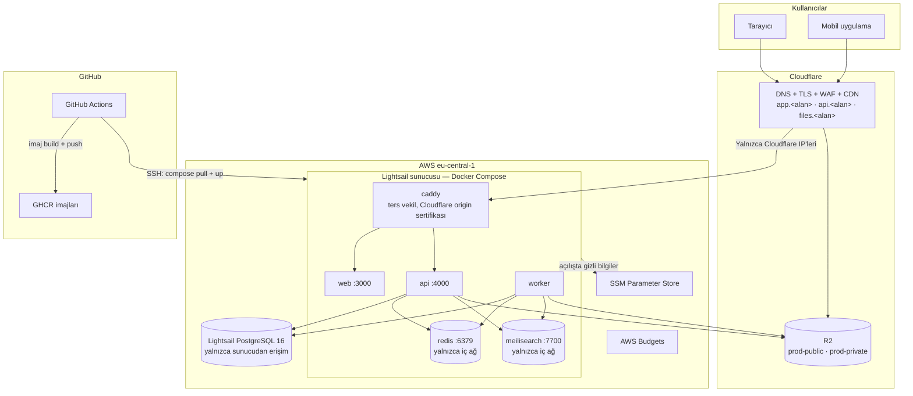

# Altyapı

| Alan | Değer |
| --- | --- |
| Sürüm | 1.0 |
| Tarih | 2026-10-24 |
| İlgili belgeler | [ADR-0012](../04-decisions/adr-0012-hosting-aws-lightsail-and-cloudflare.md) · [environments-cicd.md](../06-operations/environments-cicd.md) · [runbook.md](../06-operations/runbook.md) · [non-functional-requirements.md](../02-requirements/non-functional-requirements.md) |

## 1. Hosting kararı

| Konu | Karar |
| --- | --- |
| Bulut | AWS, bölge `eu-central-1` (Frankfurt); hukuki görüş onaylı |
| Uygulama sunucusu | AWS Lightsail sanal sunucusu (Linux), Docker Compose ile `caddy`, `api`, `worker`, `web`, `redis`, `meilisearch` |
| Veritabanı | Lightsail yönetilen PostgreSQL 16 (otomatik günlük yedek ve zamana göre geri yükleme) |
| Dosya ve CDN | Cloudflare R2 + Cloudflare CDN, DNS, TLS |
| Gizli bilgiler | AWS Systems Manager Parameter Store (SecureString) |
| Container imajları | GitHub Container Registry (GHCR), özel |
| Mobil derleme | Expo EAS Build |

**Neden Lightsail (ve neden ECS/RDS değil)?** Lightsail'in sabit aylık fiyatı 100 USD bütçenin tahminini kolaylaştırır ve yük dengeleyici, NAT gateway gibi sabit ücretli bileşenleri gerektirmez. Bedeli: otomatik ölçekleme ve gelişmiş ağ özellikleri yoktur. Tasarım tavanına (NFR-01–07) kadar tek sunucu yeterlidir; aşıldığında aynı Docker imajları EC2/ECS + RDS'e taşınır (bkz. §6). Alternatifler [design-doc.md](design-doc.md) §5'te.

📌 VARSAYIM: Lightsail sunucu boyutu en az 4 GB RAM ve 2 vCPU'dur (Meilisearch ~1 GB, Node süreçleri 3 × ~400 MB, Redis ~100 MB, işletim sistemi ve tampon). Kesin plan ve fiyat F0.4 adımında AWS fiyat sayfasından doğrulanır ve NFR-90 bütçe tablosuyla karşılaştırılır.

📌 VARSAYIM: Lightsail yönetilen veritabanının zamana göre geri yükleme süresi ve yedek saklama süresi NFR-33/NFR-35 hedeflerini karşılar. F0.4 adımında doğrulanır; karşılamıyorsa RDS'e geçiş değerlendirilir.

## 2. Dağıtım diyagramı (production)

## 3. Ortamlar

| Ortam | Altyapı | Veri | SMS | Maliyet notu |
| --- | --- | --- | --- | --- |
| `local` | Geliştirici bilgisayarı, Docker Compose (PostgreSQL, Redis, Meilisearch, MinIO) | Seed + sahte veri | Mock | 0 |
| `staging` | Küçük Lightsail sunucusu; PostgreSQL aynı sunucuda Docker'da | Anonimleştirilmiş veya demo veri | Mock | Kullanılmadığında kapatılır (NFR bütçe: 10 USD) |
| `production` | §1–§2 | Gerçek | Gerçek sağlayıcı (Y2 yayın aşamasından itibaren) | — |

Ayrıntı: [environments-cicd.md](../06-operations/environments-cicd.md).

## 4. Ağ ve erişim

| Kural | Uygulama |
| --- | --- |
| Gelen trafik | Sunucu güvenlik duvarı yalnızca 443'e Cloudflare IP aralıklarından ve 22'ye (SSH) yönetici IP'sinden izin verir |
| SSH | Yalnızca anahtar; parola kapalı; CI dağıtımı ayrı, yalnızca `deploy` komutunu çalıştırabilen bir anahtarla |
| Veritabanı | Herkese açık değil; yalnızca uygulama sunucusundan; TLS zorunlu |
| Redis, Meilisearch | Yalnızca Docker iç ağında; dışarıya port açılmaz; Meilisearch ana anahtarı gizli bilgi |
| Veritabanı rolleri | `app_user` (RLS'e tabi, DDL yok), `migrator` (yalnızca migration'da), `readonly` (raporlama ve elle inceleme) |
| R2 anahtarları | Ortam ve bucket başına ayrı; `api` ve `worker` yalnızca kendi ortamının bucket'larına erişir |

## 5. Yedekleme ve kurtarma

| Varlık | Yöntem | Saklama | Hedef |
| --- | --- | --- | --- |
| PostgreSQL | Yönetilen otomatik yedek + zamana göre geri yükleme | 7 gün | RPO ≤ 5 dk (NFR-33) |
| PostgreSQL | Haftalık manuel anlık görüntü (pazar 03:00) | 4 hafta | Uzun süreli geri dönüş |
| Uygulama sunucusu | Durumsuz; Docker imajları GHCR'de, yapılandırma depoda, gizli bilgiler SSM'de | — | Yeni sunucu ≤ 30 dk (runbook RB-04) |
| Redis | Yedeklenmez (kuyruklar ve önbellek yeniden oluşur; bekleyen işler outbox'tan yeniden üretilir) | — | — |
| Meilisearch | Yedeklenmez; tam yeniden indeksleme komutu (≤ 15 dk, 100.000 varyant) | — | — |
| R2 | Sağlayıcı dayanıklılığı; belgeler yeniden üretilebilir | — | — |
| Geri yükleme testi | Ayda bir, staging'e (NFR-36) | — | Sonuç runbook'a yazılır |

## 6. Büyüme yolu

| Tetikleyici | Adım |
| --- | --- |
| Sunucu CPU ortalaması %70'i 1 hafta aşar veya bellek %85 | Lightsail'de bir üst plana geç |
| Meilisearch belleği sunucuyu zorlar | Meilisearch'ü ayrı küçük sunucuya taşı |
| Kesintisiz dağıtım veya iş saatleri dışı erişilebilirlik ihtiyacı | 2 uygulama sunucusu + Lightsail yük dengeleyici |
| Tasarım tavanı aşılır veya kurumsal müşteri gereksinimi | EC2/ECS + RDS Multi-AZ'a taşınma (aynı imajlar) |

## 7. Maliyet kontrolü

1. AWS Budgets: 70 ve 90 USD uyarıları (NFR-91), e-posta.
2. NAT gateway, yük dengeleyici ve RDS pilotta kullanılmaz.
3. Staging, kullanılmadığında `scripts/staging-stop.sh` ile durdurulur.
4. Ayda bir maliyet incelemesi (runbook RB-10).
