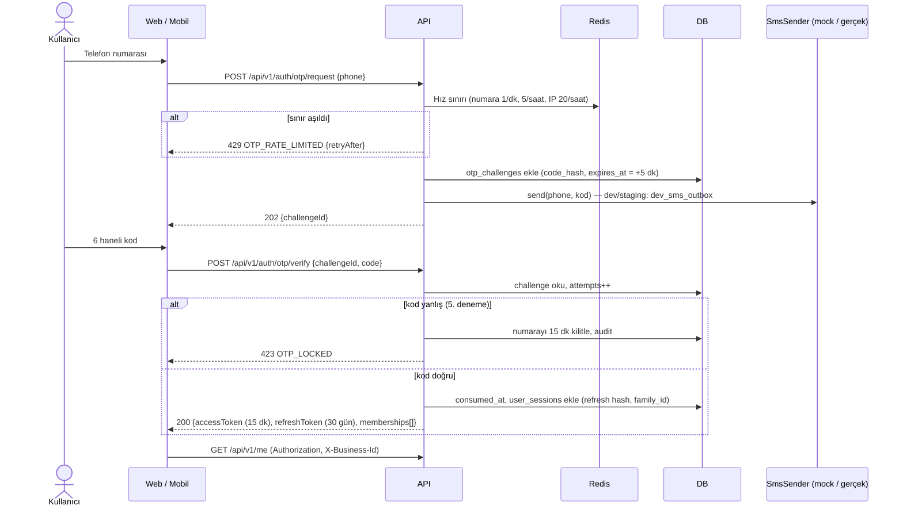
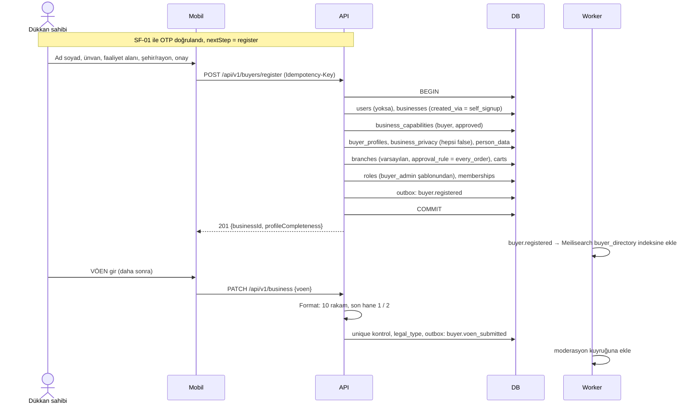
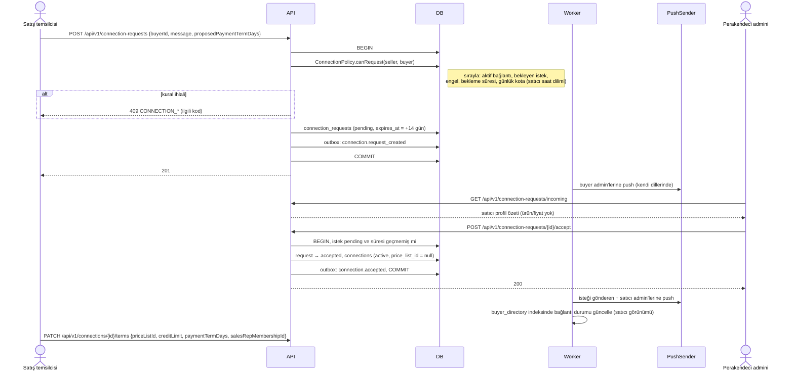
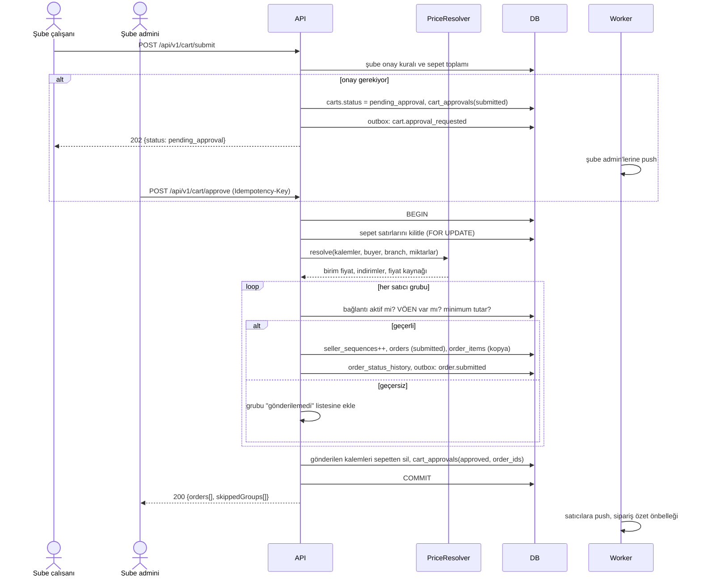
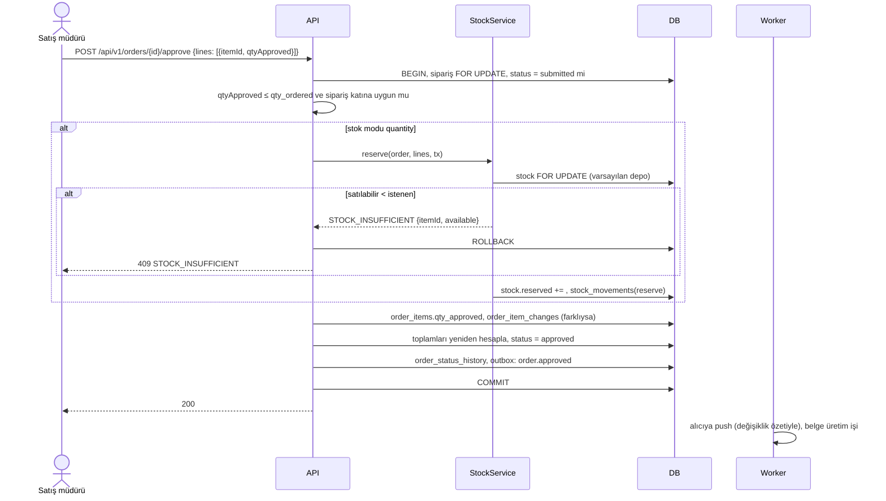
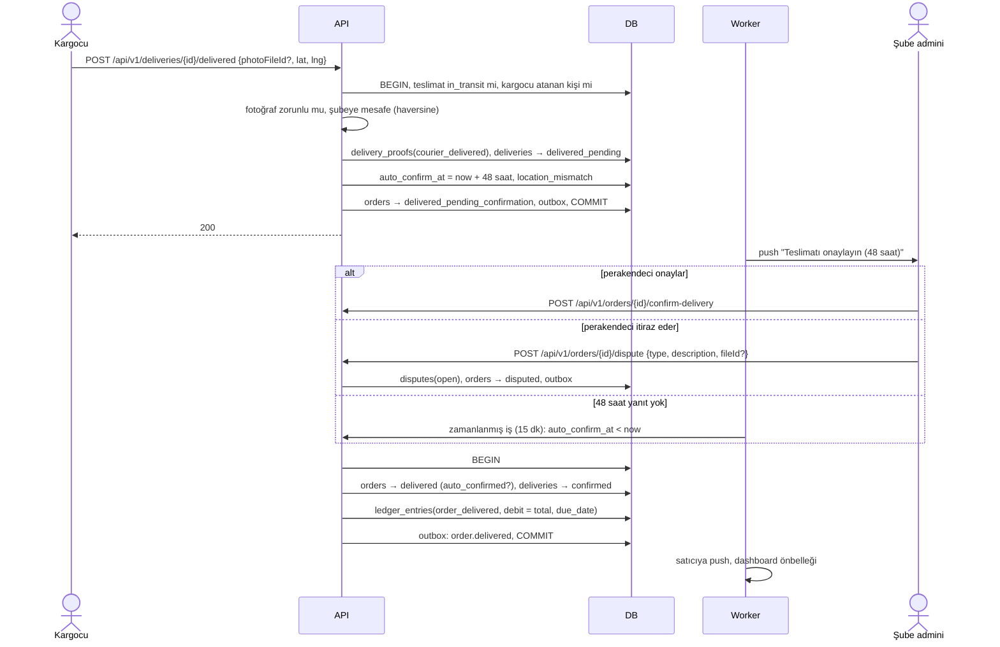
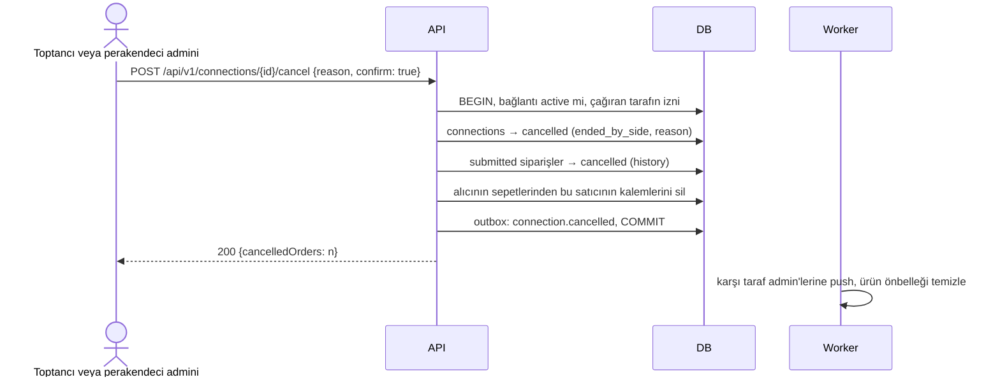
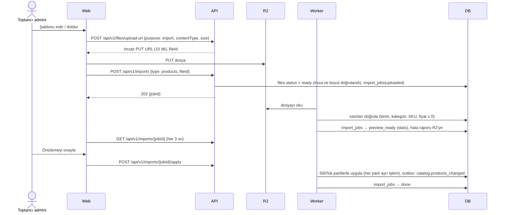
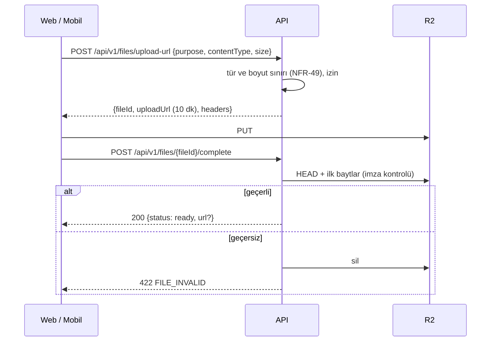

# Sequence Akışları

| Alan | Değer |
| --- | --- |
| Sürüm | 1.0 |
| Tarih | 2026-10-24 |
| İlgili belgeler | [state-machines.md](state-machines.md) · [api/openapi.yaml](api/openapi.yaml) · [c4-component.md](c4-component.md) |

Bu belge en kritik dokuz akışı ve her akışın hata senaryolarını tanımlar. Diyagramlardaki `API` bir NestJS isteğini, `DB` tek bir PostgreSQL işlemini (transaction) gösterir. `Worker` adımları outbox olayından sonra, isteğe yanıt döndükten sonra çalışır.

Hata kodları [api/openapi.yaml](api/openapi.yaml) içindeki `ErrorCode` listesiyle aynıdır.

## SF-01 — Telefon ve OTP ile giriş (US-001)

| Hata senaryosu | Davranış |
| --- | --- |
| SMS sağlayıcısı hata verir | `SmsSender` 2 kez yeniden dener (1 sn, 3 sn); başarısızsa `503 SMS_UNAVAILABLE`, challenge `consumed_at` ile kapatılır, kullanıcı 60 sn sonra tekrar isteyebilir |
| Kod süresi dolmuş | `400 OTP_EXPIRED` |
| Kayıtlı olmayan numara ile giriş | Kod yine gönderilir (numara varlığı sızdırılmaz); doğrulamadan sonra yanıt `memberships: []` ve `nextStep: "register"` |
| Kullanıcı `locked` / `deleted` | Doğrulamadan sonra `403 USER_DISABLED` |
| Yenileme anahtarı ikinci kez kullanıldı | Aynı `family_id`'deki tüm oturumlar iptal; `401 REFRESH_TOKEN_REUSED`; audit |
| Platform rolü, TOTP kurulu | Yanıt `nextStep: "totp"`; erişim anahtarı yalnızca TOTP doğrulamasından sonra verilir (US-002) |

## SF-02 — Perakendeci kaydı (US-005, US-006)

| Hata senaryosu | Davranış |
| --- | --- |
| Aynı istek iki kez (zayıf ağ) | `Idempotency-Key` aynı yanıtı döner; ikinci işletme oluşmaz |
| VÖEN formatı hatalı | `422 VOEN_INVALID` |
| VÖEN başka bir alıcı işletmede kayıtlı | `409 VOEN_ALREADY_REGISTERED` |
| Zorunlu alan eksik | `422 VALIDATION_FAILED` + alan listesi |
| İndeksleme başarısız | Outbox olayı 5 kez artan beklemeyle yeniden denenir; gece tam yeniden indeksleme telafi eder |

## SF-03 — Bağlantı isteği ve kabul (US-021, US-023, US-024)

| Hata senaryosu | Davranış |
| --- | --- |
| İki temsilci aynı anda aynı perakendeciye istek gönderir | Kısmi unique indeks (`pending`) ikinciyi reddeder → `409 CONNECTION_REQUEST_ALREADY_PENDING` |
| Kabul sırasında istek süresi dolmuş | `409 CONNECTION_REQUEST_EXPIRED` |
| Kabul sırasında satıcı askıya alınmış veya aboneliği `read_only` | Kabul yine yapılır (perakendecinin kararı); satıcı yeni istek gönderemez. 📌 VARSAYIM |
| Perakendeci satın alma rolüyle kabul etmeye çalışır | `403 PERMISSION_DENIED` |
| Koşul atanırken başka satıcının fiyat listesi kimliği verilir | RLS satırı göstermez → `404 NOT_FOUND` |

## SF-04 — Sepet gönderimi, şube onayı ve bölünme (US-040–US-042)

| Hata senaryosu | Davranış |
| --- | --- |
| Herhangi bir adımda veritabanı hatası | Tek işlem geri alınır; hiçbir sipariş oluşmaz; sepet değişmez (US-042 AC5); `500` + istek kimliği |
| Onay sırasında fiyat değişti | Fiyat onay anında yeniden hesaplanır; yanıtta `priceChanged: true` olan satırlar işaretlenir. 📌 VARSAYIM: Fiyat değişikliği gönderimi engellemez, yalnızca bildirilir (şube admini zaten son ekranı görmüştür) |
| Bir grubun bağlantısı gönderimden önce iptal edildi | O grup `skippedGroups`'ta `CONNECTION_NOT_ACTIVE` ile döner; diğerleri oluşur |
| Alıcının VÖEN'i yok | Tüm gönderim `422 VOEN_REQUIRED` ile reddedilir |
| Şube admini aynı anda iki kez onaylar | `Idempotency-Key` + sepet satır kilidi; ikinci istek aynı yanıtı alır |
| 5'ten fazla satıcı veya 100'den fazla kalem | Desteklenir; NFR-12 hedefi yalnızca bu sınıra kadar geçerlidir |

## SF-05 — Toptancı sipariş onayı ve stok rezervasyonu (US-043, US-039)

| Hata senaryosu | Davranış |
| --- | --- |
| Miktar artırılmak istenir | `422 ORDER_QTY_INCREASE_NOT_ALLOWED` |
| Tüm satırlar 0'a düşürülür | `422 ORDER_EMPTY_USE_REJECT` (reddetme akışı kullanılmalı) |
| Sipariş zaten onaylanmış/iptal | `409 INVALID_STATE_TRANSITION` |
| Eşzamanlı iki onay son stoğa | Satır kilidi; ikinci `409 STOCK_INSUFFICIENT` |
| Abonelik `read_only` | `403 SUBSCRIPTION_READ_ONLY` |

📌 VARSAYIM: MVP'de rezervasyon toptancının varsayılan deposundan yapılır. Çok depolu toptancıda depo seçimi Faz 2'dedir.

## SF-06 — Teslim, onay, otomatik onay ve cari borç (US-047, US-048, US-050)

| Hata senaryosu | Davranış |
| --- | --- |
| Kargocu çevrimdışı | Mobil istek `Idempotency-Key` ile saklanır ve bağlantı gelince gönderilir; sunucu zamanı yerine istemcinin `deliveredAt` alanı kaydedilir ve sunucu zamanından 24 saatten eskiyse reddedilir. 📌 VARSAYIM: MVP'de yalnızca bu tek uç için basit yeniden deneme kuyruğu; tam offline mod Faz 3 |
| GPS izni yok | Konum boş kaydedilir; `location_mismatch = true` olarak işaretlenir |
| Aynı sipariş için cari kaydı iki kez | `ledger_entries` kısmi unique (`order_id`, `order_delivered`) ikinciyi engeller |
| Zamanlanmış iş iki kopyada çalışır | Redis kilidi + `status = delivered_pending` koşullu güncelleme; yalnızca biri etkiler |
| İtiraz süre dolduktan sonra | Sipariş artık `delivered`; `409 INVALID_STATE_TRANSITION`; düzeltme toptancının cari düzeltme kaydıyla yapılır |

## SF-07 — Bağlantı iptali (US-025)

| Hata senaryosu | Davranış |
| --- | --- |
| `confirm` alanı yok | `422 CONFIRMATION_REQUIRED` |
| Onaylı/yoldaki siparişler | Etkilenmez; teslimat ve cari normal devam eder |
| Mobil önbellekte eski ürün listesi | Sonraki ürün/sepet isteği `403 CONNECTION_NOT_ACTIVE` döner; istemci önbelleği temizler |

## SF-08 — Excel ile ürün içe aktarma (US-031)

| Hata senaryosu | Davranış |
| --- | --- |
| Dosya .xlsx değil veya > 10 MB | `422 FILE_INVALID` |
| 5.000 satırdan fazla | `422 IMPORT_TOO_MANY_ROWS` |
| Uygulama ortasında hata | Tamamlanan partiler kalır; iş `failed` ve hangi satıra kadar uygulandığı raporlanır; kullanıcı aynı dosyayı yeniden yükleyebilir (SKU ile güncelleme idempotendir) |
| Önizleme 24 saat onaylanmaz | İş ve dosya silinir |

## SF-09 — Dosya yükleme (görsel, teslim fotoğrafı)

Ürün görseli `public` bucket'a, teslim fotoğrafı ve belgeler `private` bucket'a yazılır. `private` dosyalar yalnızca süreli imzalı GET URL'siyle (5 dk) okunur.

📌 VARSAYIM: Görsel küçültme (200 / 800 / 1600 px) Cloudflare'in görsel dönüştürme özelliğiyle değil, worker'da yükleme sonrası yapılır (ek ücretli özellik kullanmamak için).
