# Durum Makineleri

| Alan | Değer |
| --- | --- |
| Sürüm | 1.0 |
| Tarih | 2026-10-24 |

Durumu değişen her varlığın geçişleri bu belgede tanımlıdır. Kod (`*StateMachine` sınıfları) bu tablolarla birebir aynı olmalıdır: tabloda olmayan bir geçiş `409 INVALID_STATE_TRANSITION` döner. Her geçiş `audit_logs`'a, sipariş geçişleri ayrıca `order_status_history`'ye yazılır.

## 1. Bağlantı isteği (`connection_requests.status`)

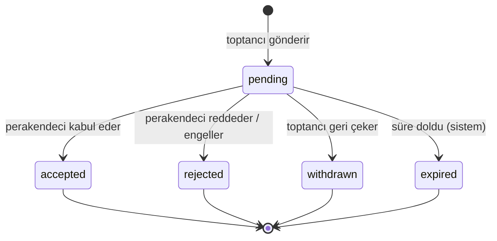

| Geçiş | Kim | Koşul (guard) | Yan etki |
| --- | --- | --- | --- |
| → pending | Satıcı, `connections.request.send` izni | `ConnectionPolicy.canRequest` geçer (aktif bağlantı yok, bekleyen istek yok, engel yok, bekleme süresi yok, kota var) | Kota sayacı; olay `connection.request_created` (push) |
| pending → accepted | Alıcı, `connections.request.respond` | İstek süresi dolmamış | Yeni `connections` satırı (`active`); olay `connection.accepted` |
| pending → rejected | Alıcı, `connections.request.respond` veya `connections.block` | — | Bekleme süresi başlar; olay `connection.rejected` |
| pending → withdrawn | İsteği gönderen satıcı | — | Olay yok |
| pending → expired | Sistem (15 dk'da bir; `connection.request_expiry_interval_minutes`) | `expires_at <= now()` (kabul/red ile aynı sınır: o andan sonra yanıtlanamaz) | Olay `connection.request_expired` (gönderen + satıcı adminlerine bildirim) |

## 2. Bağlantı (`connections.status`)

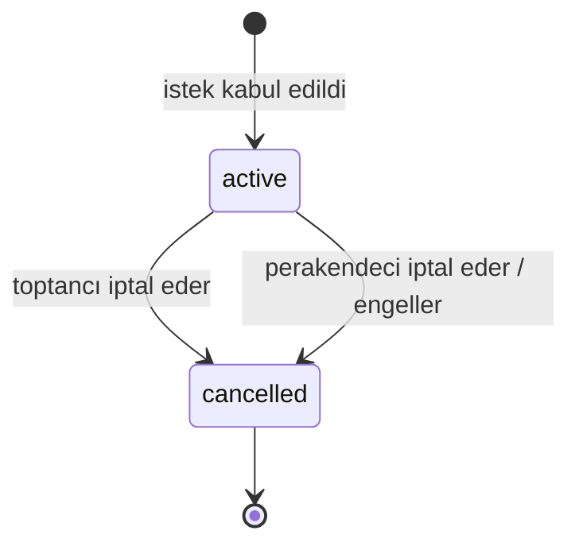

| Geçiş | Kim | Koşul | Yan etki |
| --- | --- | --- | --- |
| active → cancelled | Satıcı veya alıcı, `connections.cancel` | Gerekçe ve ikinci onay | `submitted` siparişler `cancelled`; o satıcının sepet kalemleri silinir; `ended_by_side`; alıcı iptalinde bekleme süresi başlar; olay `connection.cancelled` |

Kodda `ConnectionStateMachine` (F2.15a); tablo dışı geçiş `409 INVALID_STATE_TRANSITION`. Engel de bu geçişi kullanır (`end_reason = blocked`); sepet/sipariş yan etkileri `ConnectionCancelledHandler` kancalarıyla aynı işlemde (F4.5).

Bir iptal edilmiş bağlantı **hiçbir zaman** yeniden `active` olmaz. Yeniden bağlantı = yeni istek + yeni `connections` satırı (K6).

## 3. Sipariş (`orders.status`)

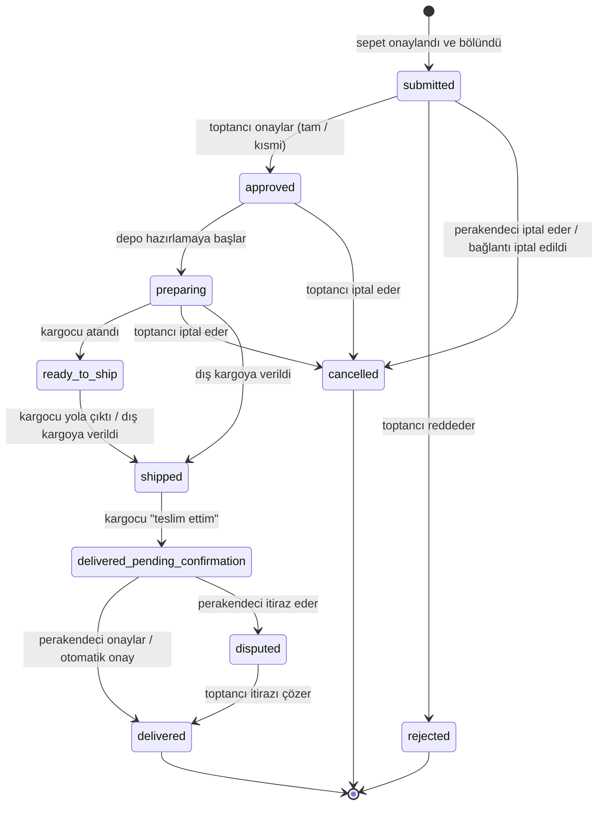

| Geçiş | Kim | Koşul | Yan etki |
| --- | --- | --- | --- |
| → submitted | Sistem (`CartService.submit`) | Bağlantı aktif; VÖEN var; minimum tutar sağlanmış | Satır kopyaları; olay `order.submitted` |
| submitted → approved | Satıcı, `orders.approve` | Stok modu `quantity` ise satılabilir stok yeterli | `qty_approved` yazılır; değişiklikler `order_item_changes`; stok `reserve`; olay `order.approved` |
| submitted → rejected | Satıcı, `orders.approve` | Gerekçe zorunlu | Olay `order.rejected` |
| submitted → cancelled | Alıcı (`orders.cancel_own`) veya sistem (bağlantı iptali) | — | Olay `order.cancelled` |
| approved/preparing → cancelled | Satıcı, `orders.cancel` | Gerekçe zorunlu | Stok `release`; olay `order.cancelled` |
| approved → preparing | Satıcı, `orders.prepare` | — | — |
| preparing → ready_to_ship | Satıcı, `delivery.assign` | Kargocu üyeliği aktif | `deliveries` (`own_courier`, `assigned`) |
| ready_to_ship → shipped | Kargocu, `delivery.update_own` | — | Stok `ship`; `deliveries.departed_at`; olay `order.shipped` |
| preparing → shipped | Satıcı, `delivery.assign` | Dış kargo firması ve takip no | `deliveries` (`manual_carrier`, `in_transit`); stok `ship` |
| shipped → delivered_pending_confirmation | Kargocu (`delivery.update_own`) veya satıcı (manuel kargoda) | Fotoğraf zorunluysa var | `delivery_proofs`; `auto_confirm_at`; konum uyuşmazlığı hesabı; olay `order.delivered_pending` |
| delivered_pending_confirmation → delivered | Alıcı (`orders.confirm_delivery`) veya sistem (`auto_confirm_at < now()`) | — | `delivered_at`; `auto_confirmed`; **aynı işlemde** cari borç kaydı; olay `order.delivered` |
| delivered_pending_confirmation → disputed | Alıcı, `orders.confirm_delivery` | Tür ve açıklama | `disputes` (`open`); olay `order.disputed` |
| disputed → delivered | Satıcı, `orders.resolve_dispute` | Çözüm notu | Kabulde satır miktarları düzeltilir; `delivered_at`; cari borç düzeltilmiş tutarla; olay `order.delivered` |

**Not — "Ödendi" durumu yok:** Analiz raporundaki taslak diyagramda yer alan "Ödendi · Kapandı" durumu bu modelde yoktur. Tahsilatlar sipariş bazında değil, satıcı–alıcı çiftinin carisinde tutulur (bir ödeme birden fazla siparişi kapatabilir). 📌 VARSAYIM: MVP'de tahsilatın siparişlere dağıtımı yapılmaz; vade ve yaşlandırma, cari hareketlerinden en eski borç ilk kapanır (FIFO) kuralıyla raporda hesaplanır.

## 4. Teslimat (`deliveries.status`)

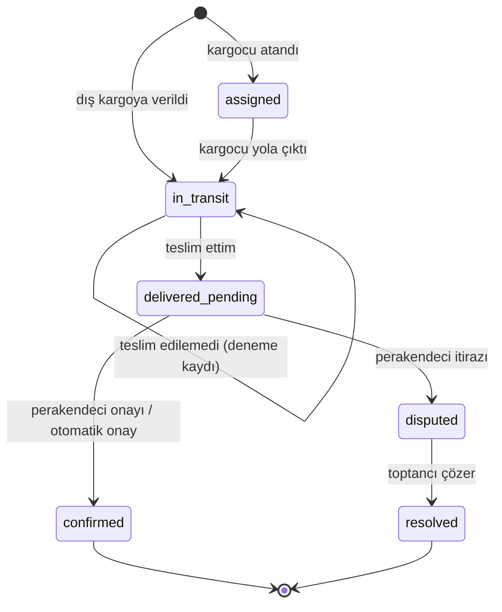

Teslimat durumu sipariş durumuyla aynı işlemde güncellenir. Eşleşme:

| `deliveries.status` | `orders.status` |
| --- | --- |
| assigned | ready_to_ship |
| in_transit | shipped |
| delivered_pending | delivered_pending_confirmation |
| confirmed | delivered |
| disputed | disputed |
| resolved | delivered |

## 5. İtiraz (`disputes.status`)

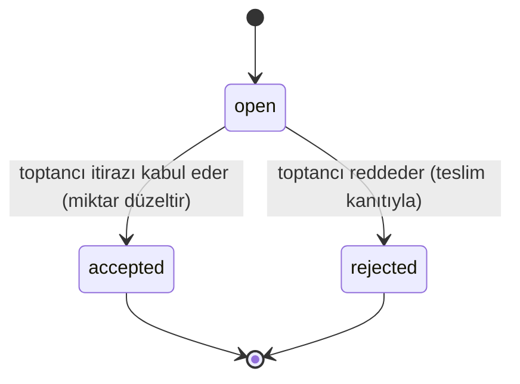

⚠️ AÇIK SORU: Toptancı itirazı reddederse perakendecinin başka bir itiraz yolu (platform admini hakemliği) olacak mı? 📌 VARSAYIM: MVP'de yok; anlaşmazlık taraflar arasında platform dışında çözülür.

## 6. Sepet (`carts.status`)

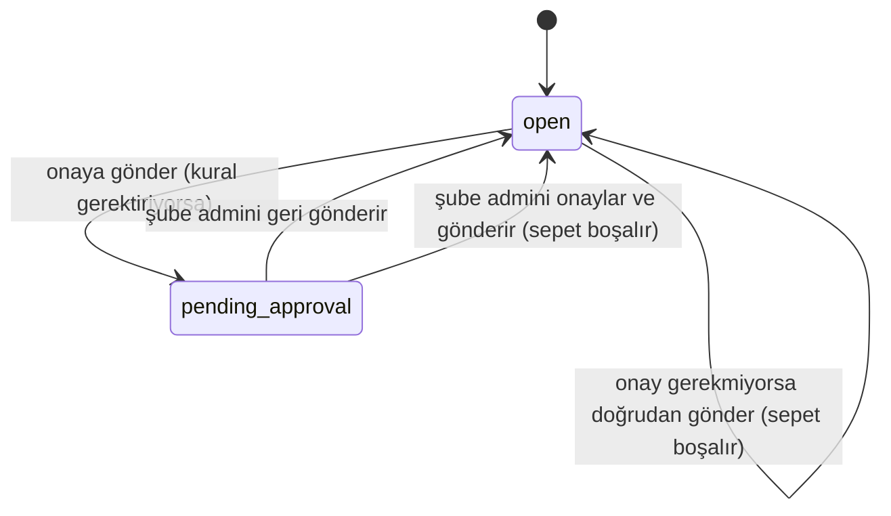

Bölünmede gönderilemeyen gruplar (minimum tutar altı, bağlantısı aktif olmayan) sepette kalır.

## 7. Ödeme (`payments.status`)

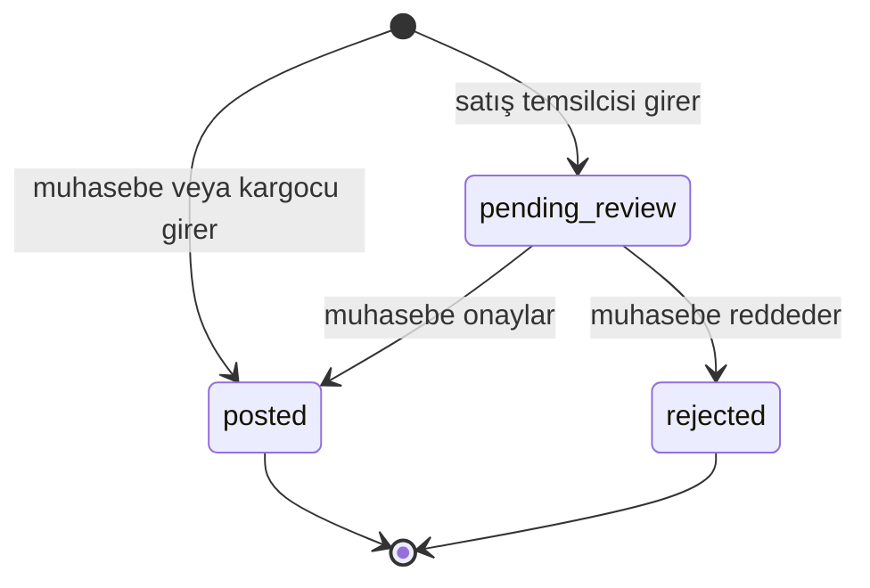

`posted` olurken aynı işlemde `ledger_entries` alacak kaydı oluşur. Hatalı bir `posted` ödeme silinmez; `reversal` cari kaydıyla düzeltilir.

## 8. Abonelik (`subscriptions.status`)

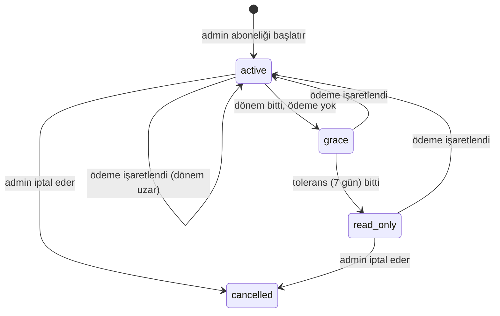

`read_only`: yeni istek ve yeni sipariş onayı yok; teslimat, cari ve okuma devam eder (US-055 AC4).

## 9. İşletme (`businesses.status`) ve bağlantısız hesap aşamaları

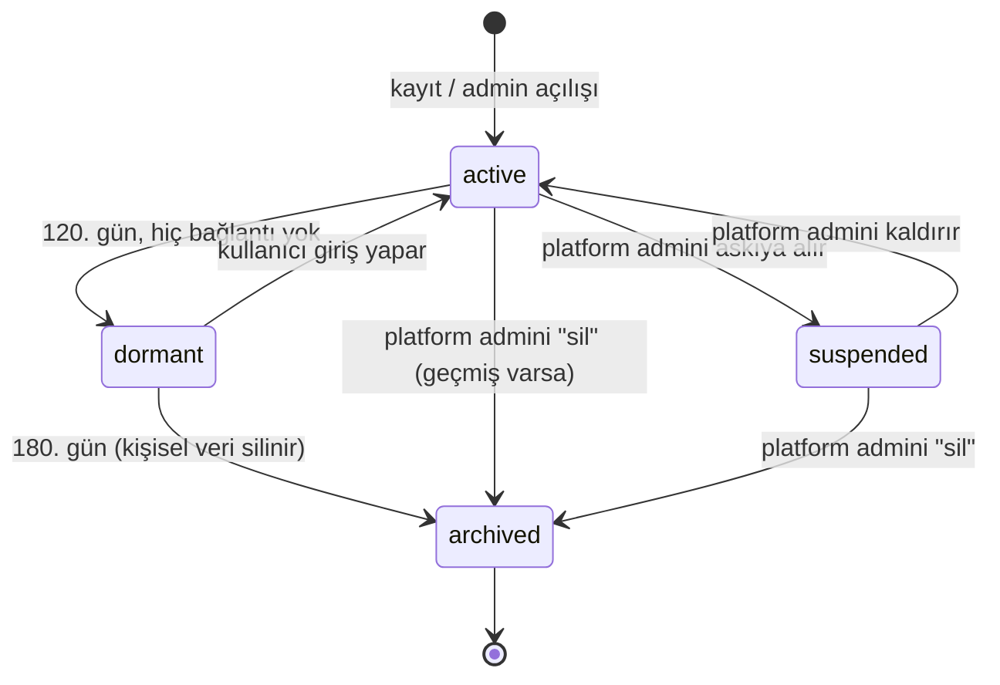

`buyer_profiles.dormant_stage`: `none` → `reminded_7` → `reminded_30` → `warned` (90. gün) → `deactivated` (120. gün). Girişte `none`'a döner. Yalnızca hiç bağlantı, sipariş veya cari kaydı olmayan alıcılara uygulanır (US-027 AC5).

## 10. İşletme yeteneği (`business_capabilities.status`)

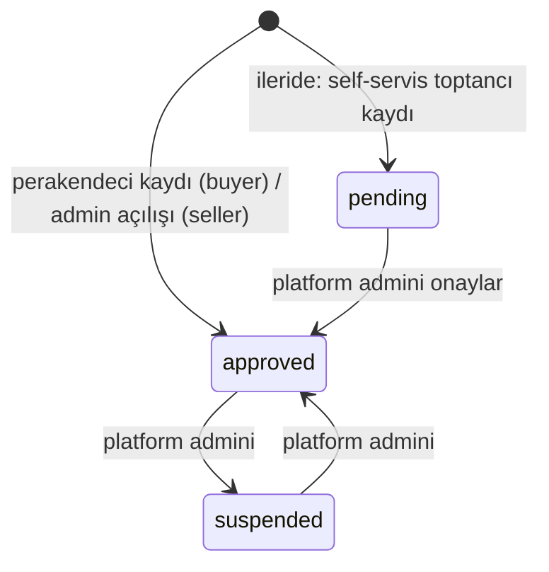

## 11. Excel içe aktarma (`import_jobs.status`)

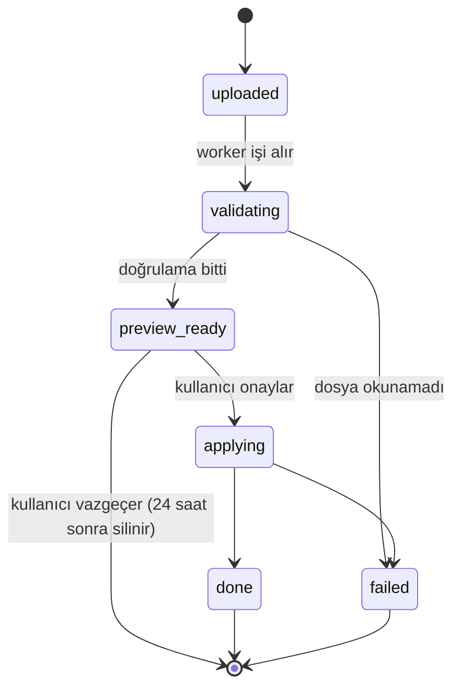

## 12. Toptancı başvurusu (`seller_applications.status`)

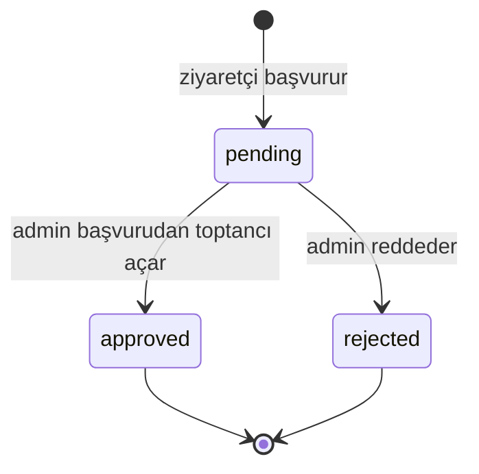

| Geçiş | Kim | Koşul (guard) | Yan etki |
| --- | --- | --- | --- |
| → pending | Kimliksiz ziyaretçi (`POST /seller-applications`) | IP hız sınırı (`seller_application.ip_max_per_hour`); aynı VÖEN ile `pending` başvuru yok (yoksa `409 SELLER_APPLICATION_ALREADY_PENDING`) | Yok (başvuru admin listesinde görünür, US-008 AC1) |
| pending → approved | Platform rolü `super_admin`, `operations` (`POST /admin/sellers` + `applicationId`) | Toptancı açılışı aynı işlemde başarılı (US-009) | `business_id`, `reviewed_by` yazılır; audit `seller_application.approved` |
| pending → rejected | Platform rolü `super_admin`, `operations` | — | `reviewed_by` yazılır; audit `seller_application.rejected` |

`approved` ve `rejected` son durumlardır; başka geçiş `409 INVALID_STATE_TRANSITION`. Reddedilen başvurudan sonra aynı VÖEN ile yeni başvuru yapılabilir.
