# Durum Makineleri

| Alan | Değer |
| --- | --- |
| Sürüm | 1.0 |
| Tarih | 2026-10-24 |

Durumu değişen her varlığın geçişleri bu belgede tanımlıdır. Kod (`*StateMachine` sınıfları) bu tablolarla birebir aynı olmalıdır: tabloda olmayan bir geçiş `409 INVALID_STATE_TRANSITION` döner. Her geçiş `audit_logs`'a, sipariş geçişleri ayrıca `order_status_history`'ye yazılır.

## 1. Bağlantı isteği (`connection_requests.status`)

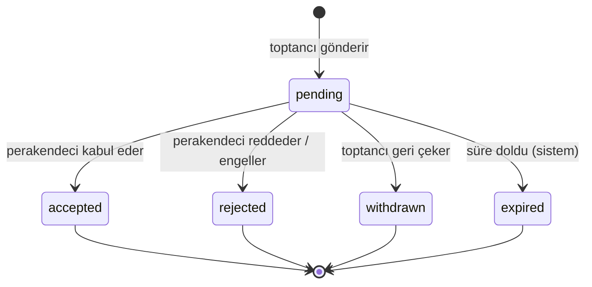

| Geçiş | Kim | Koşul (guard) | Yan etki |
| --- | --- | --- | --- |
| → pending | Satıcı, `connections.request.send` izni | `ConnectionPolicy.canRequest` geçer (aktif bağlantı yok, bekleyen istek yok, engel yok, bekleme süresi yok, kota var) | Kota sayacı; olay `connection.request_created` (push) |
| pending → accepted | Alıcı, `connections.request.respond` | İstek süresi dolmamış | Yeni `connections` satırı (`active`); olay `connection.accepted` |
| pending → rejected | Alıcı, `connections.request.respond` veya `connections.block` | — | Bekleme süresi başlar; olay `connection.rejected` |
| pending → withdrawn | İsteği gönderen satıcı | — | Olay yok |
| pending → expired | Sistem (15 dk'da bir; `connection.request_expiry_interval_minutes`) | `expires_at <= now()` (kabul/red ile aynı sınır: o andan sonra yanıtlanamaz) | Olay `connection.request_expired` (gönderen + satıcı adminlerine bildirim) |

## 2. Bağlantı (`connections.status`)

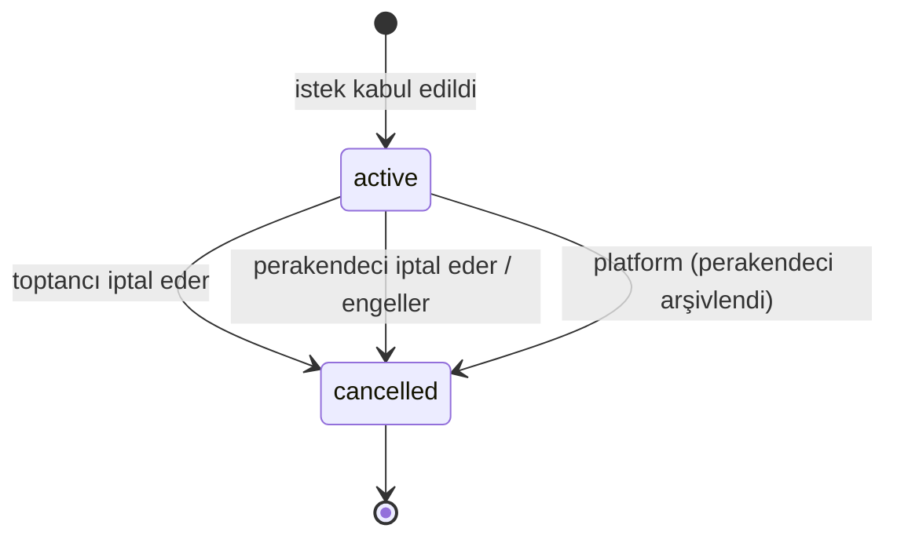

| Geçiş | Kim | Koşul | Yan etki |
| --- | --- | --- | --- |
| active → cancelled | Satıcı veya alıcı, `connections.cancel` | Gerekçe ve ikinci onay | `submitted` siparişler `cancelled`; o satıcının sepet kalemleri silinir; `ended_by_side`; alıcı iptalinde bekleme süresi başlar; olay `connection.cancelled` |
| active → cancelled | Platform (alıcı arşivlenince, F2.18) | Alıcı `archived` | `ended_by_side = platform`, `end_reason = business_archived`; aynı kancalar ve `connection.cancelled`; satıcı adminlerine "bağlantı iptal edildi". Yalnız migrator sahipli `business_close_archived_connections` yazar |

Kodda `ConnectionStateMachine` (F2.15a); tablo dışı geçiş `409 INVALID_STATE_TRANSITION`. Engel de bu geçişi kullanır (`end_reason = blocked`); sepet/sipariş yan etkileri `ConnectionCancelledHandler` kancalarıyla aynı işlemde (F4.5).

Bir iptal edilmiş bağlantı **hiçbir zaman** yeniden `active` olmaz. Yeniden bağlantı = yeni istek + yeni `connections` satırı (K6).

## 3. Sipariş (`orders.status`)

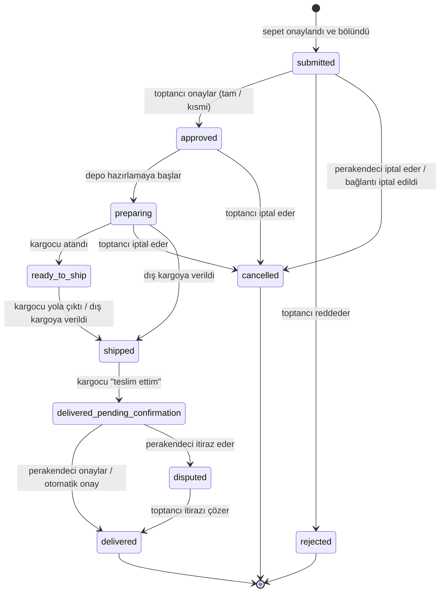

| Geçiş | Kim | Koşul | Yan etki |
| --- | --- | --- | --- |
| → submitted | Sistem (`CartService.submit`) | Bağlantı aktif; VÖEN var; minimum tutar sağlanmış | Satır kopyaları; olay `order.submitted` |
| submitted → approved | Satıcı, `orders.approve` | Stok modu `quantity` ise satılabilir stok yeterli | `qty_approved` yazılır; değişiklikler `order_item_changes`; stok `reserve`; olay `order.approved` |
| submitted → rejected | Satıcı, `orders.approve` | Gerekçe zorunlu | Olay `order.rejected` |
| submitted → cancelled | Alıcı (`orders.cancel_own`) veya sistem (bağlantı iptali) | — | Olay `order.cancelled` |
| approved/preparing → cancelled | Satıcı, `orders.cancel` | Gerekçe zorunlu | Stok `release`; olay `order.cancelled` |
| approved → preparing | Satıcı, `orders.prepare` | — | — |
| preparing → ready_to_ship | Satıcı, `delivery.assign` | Kargocu üyeliği aktif | `deliveries` (`own_courier`, `assigned`) |
| ready_to_ship → shipped | Kargocu, `delivery.update_own` | — | Stok `ship`; `deliveries.departed_at`; olay `order.shipped` |
| preparing → shipped | Satıcı, `delivery.assign` | Dış kargo firması ve takip no | `deliveries` (`manual_carrier`, `in_transit`); stok `ship` |
| shipped → delivered_pending_confirmation | Kargocu (`delivery.update_own`) veya satıcı (manuel kargoda) | Fotoğraf zorunluysa var | `delivery_proofs`; `auto_confirm_at`; konum uyuşmazlığı hesabı; olay `order.delivered_pending` |
| delivered_pending_confirmation → delivered | Alıcı (`orders.confirm_delivery`) veya sistem (`auto_confirm_at < now()`) | — | `delivered_at`; `auto_confirmed`; **aynı işlemde** cari borç kaydı; olay `order.delivered` |
| delivered_pending_confirmation → disputed | Alıcı, `orders.confirm_delivery` | Tür ve açıklama | `disputes` (`open`); olay `order.disputed` |
| disputed → delivered | Satıcı, `orders.resolve_dispute` | Çözüm notu | Kabulde satır miktarları düzeltilir; `delivered_at`; cari borç düzeltilmiş tutarla; olay `order.delivered` |

**Not — "Ödendi" durumu yok:** Analiz raporundaki taslak diyagramda yer alan "Ödendi · Kapandı" durumu bu modelde yoktur. Tahsilatlar sipariş bazında değil, satıcı–alıcı çiftinin carisinde tutulur (bir ödeme birden fazla siparişi kapatabilir). 📌 VARSAYIM: MVP'de tahsilatın siparişlere dağıtımı yapılmaz; vade ve yaşlandırma, cari hareketlerinden en eski borç ilk kapanır (FIFO) kuralıyla raporda hesaplanır.

## 4. Teslimat (`deliveries.status`)

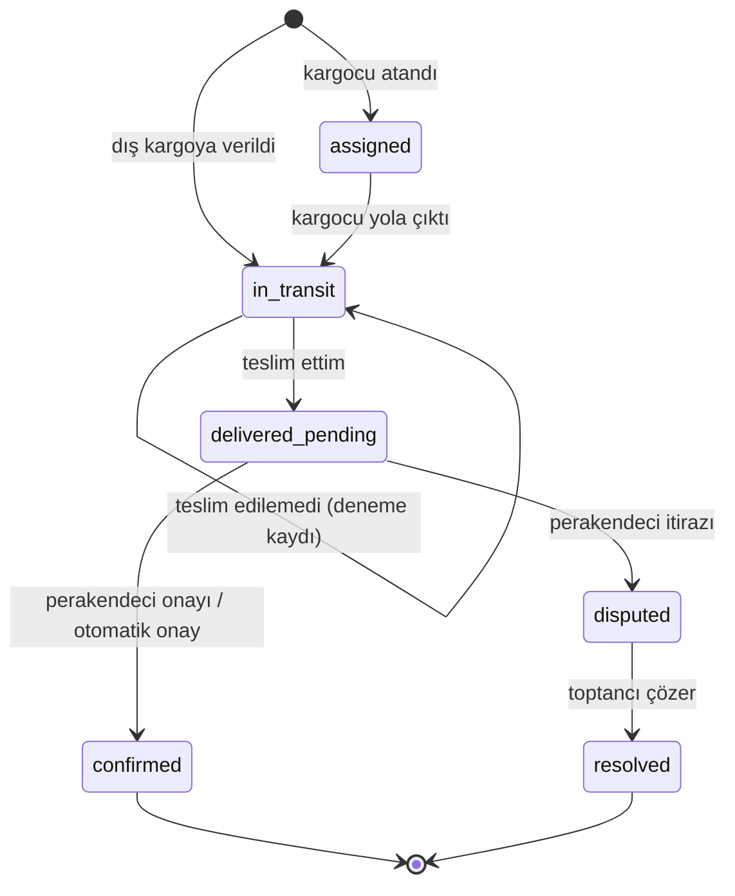

Teslimat durumu sipariş durumuyla aynı işlemde güncellenir. Eşleşme:

| `deliveries.status` | `orders.status` |
| --- | --- |
| assigned | ready_to_ship |
| in_transit | shipped |
| delivered_pending | delivered_pending_confirmation |
| confirmed | delivered |
| disputed | disputed |
| resolved | delivered |

## 5. İtiraz (`disputes.status`)

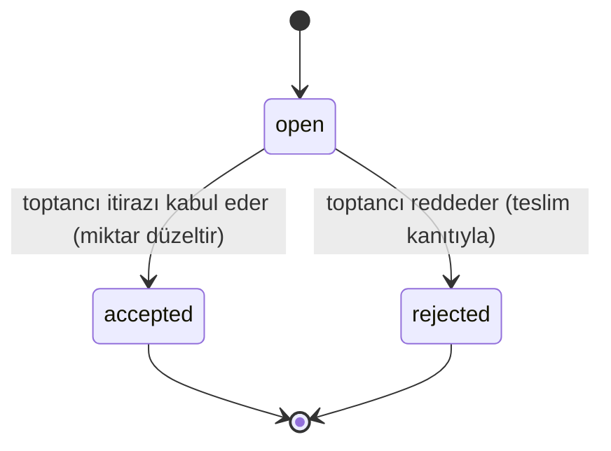

⚠️ AÇIK SORU: Toptancı itirazı reddederse perakendecinin başka bir itiraz yolu (platform admini hakemliği) olacak mı? 📌 VARSAYIM: MVP'de yok; anlaşmazlık taraflar arasında platform dışında çözülür.

## 6. Sepet (`carts.status`)

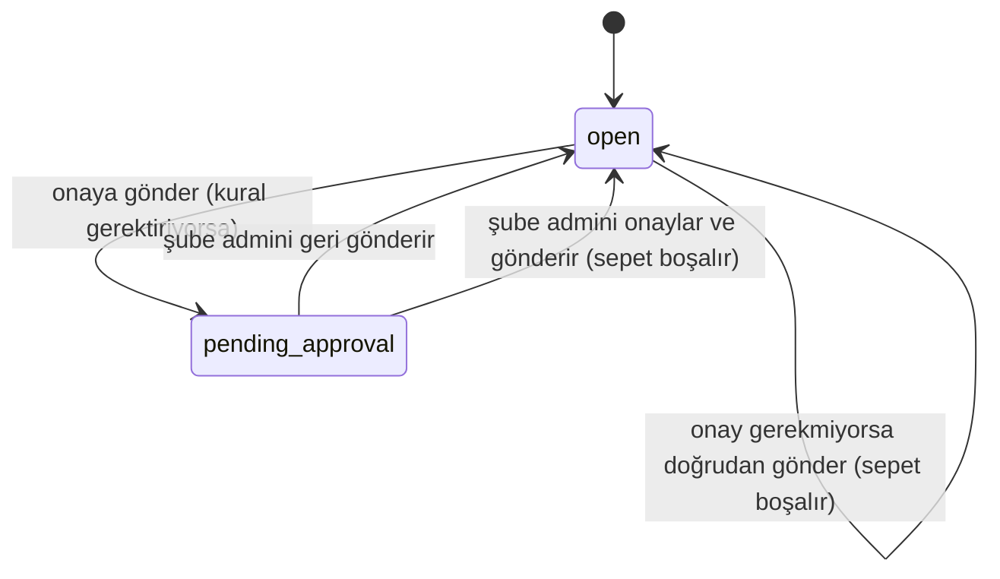

Bölünmede gönderilemeyen gruplar (minimum tutar altı, bağlantısı aktif olmayan) sepette kalır.

## 7. Ödeme (`payments.status`)

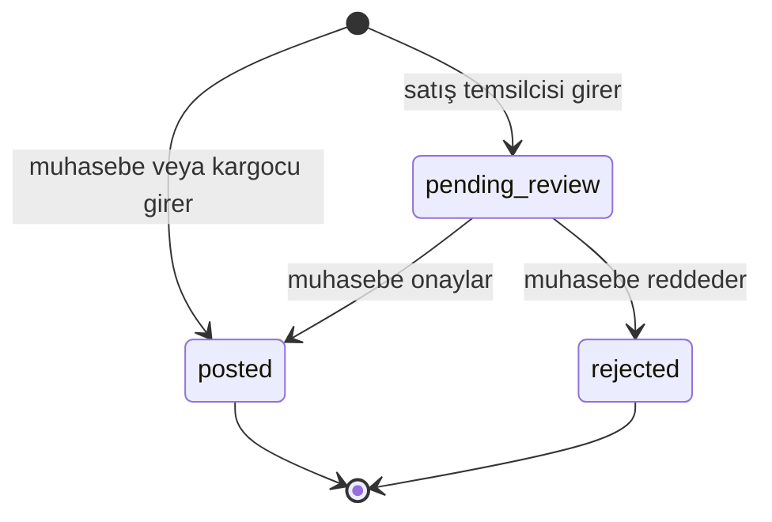

`posted` olurken aynı işlemde `ledger_entries` alacak kaydı oluşur. Hatalı bir `posted` ödeme silinmez; `reversal` cari kaydıyla düzeltilir.

## 8. Abonelik (`subscriptions.status`)

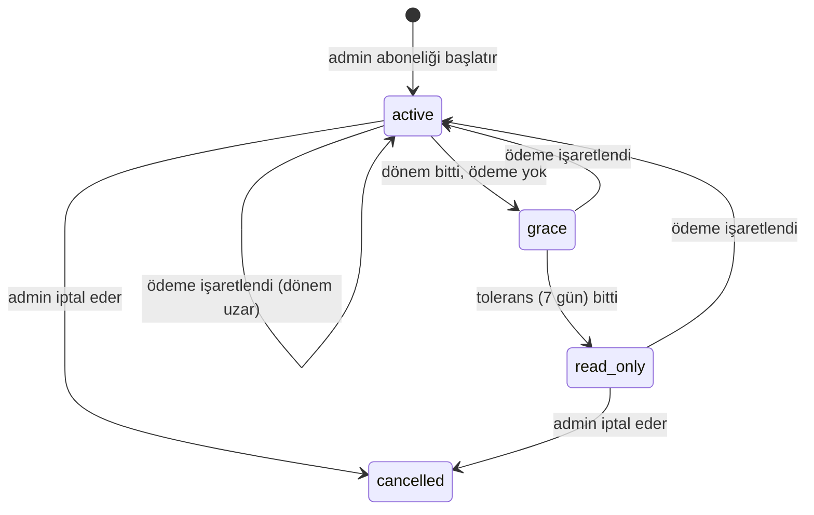

`read_only`: yeni istek ve yeni sipariş onayı yok; teslimat, cari ve okuma devam eder (US-055 AC4).

## 9. İşletme (`businesses.status`) ve bağlantısız hesap aşamaları

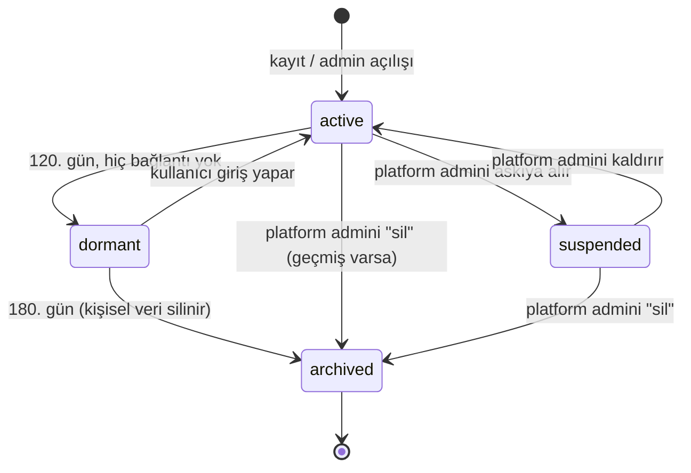

| Geçiş | Kim | Koşul | Yan etki |
| --- | --- | --- | --- |
| active → suspended, suspended → active | Platform admini (`super_admin`, `operations`), `POST /admin/businesses/{id}/status` | Gerekçe (yalnız audit) | Kullanıcılar işletme bağlamlı uçlarda `403 BUSINESS_SUSPENDED`; dizinden düşer / döner; bağlantı, istek, sipariş değişmez (US-016 AC1) |
| active → dormant | Sistem (gece işi `directory.dormant_accounts`, F2.17) | Aşama `warned` ve uyarıdan en az `deactivate_day − warning_day` gün geçti; sayaç ≥ `deactivate_day` | Aşama `deactivated`; dizinden düşer (US-027 AC3); audit `business.dormant_deactivated` |
| dormant → active | Sistem, işletmenin aktif üyesi giriş yapınca veya oturumunu yenileyince (`buyer_dormant_touch`, F2.17) | — | Aşama `none`, sayaç sıfır; dizine döner; audit `business.reactivated` |
| dormant → archived | Sistem (gece işi, F2.17) | Aşama `deactivated`, pasifleşmeden en az `delete_day − deactivate_day` gün geçti; sayaç ≥ `delete_day` | Kullanıcı kararı S1 = B (admin "sil" ile aynı): geçmiş (istek, engel) yoksa kayıt kalıcı silinir (audit `business.dormant_purged`), varsa `person_data` silinir, açık davetler kapanır (audit `business.dormant_archived`); dizinden düşer (US-027 AC4) |
| active/suspended/dormant → archived | Platform admini, `archive` (= "sil"), yalnız perakendeci | Gerekçe | Geçmiş yoksa kayıt kalıcı silinir (`business_purge`, AC3); varsa `person_data` silinir, açık davetler kapanır, aktif bağlantılar platformca kapanır (§2), istek kayıtları korunur (AC2). "Geçmiş" = bağlantı, bağlantı isteği, engel (sipariş/belge/cari F3–F5'te eklenir) |

Kodda `BusinessStateMachine` (F2.18); tablo dışı geçiş `409 INVALID_STATE_TRANSITION`. `archived` son durumdur.

`buyer_profiles.dormant_stage`: `none` → `reminded_7` → `reminded_30` → `warned` (90. gün) → `deactivated` (120. gün). Girişte `none`'a döner. Yalnızca hiç bağlantı, sipariş veya cari kaydı olmayan alıcılara uygulanır (US-027 AC5).

Ayrıntı (F2.17): sayaç `buyer_profiles.dormant_since`'tan sayılır (gün = geçen süre / 24 saat, saat dilimi yok); işletmenin herhangi bir aktif üyesi giriş yapınca veya oturumunu yenileyince aşama `none`'a döner ve sayaç yeniden başlar (bu yüzden düzenli giren hesap hatırlatma almaz ve pasifleşmez). Gece işi her perakendeciyi bir adım ilerletir: vadesi gelen en yüksek hatırlatma (`reminded_7` = `dormant.reminder_days[0]`, `reminded_30` = `[1]`; eskiler atlanır) veya sayaç `warning_day`'i geçtiyse doğrudan `warned`. `deactivated` ve arşiv yalnız bir önceki aşamadan, aradaki gün farkı kadar sonra (uyarıdaki "30 gün sonra" sözü ve AC4 "son bildirim gönderilmiş" koşulu). "Kayıt" = alıcının herhangi bir `connections` satırı (iptal dahil); bekleyen istek veya engel politikayı durdurmaz.

## 10. İşletme yeteneği (`business_capabilities.status`)

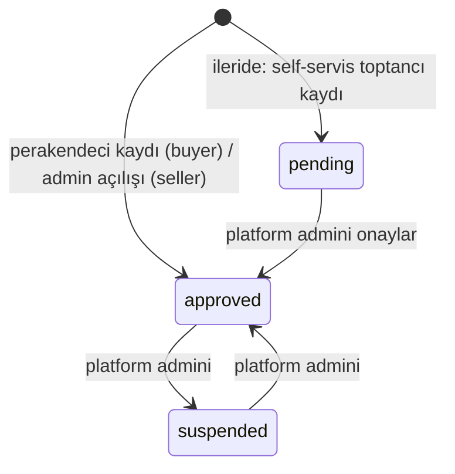

## 11. Excel içe aktarma (`import_jobs.status`)

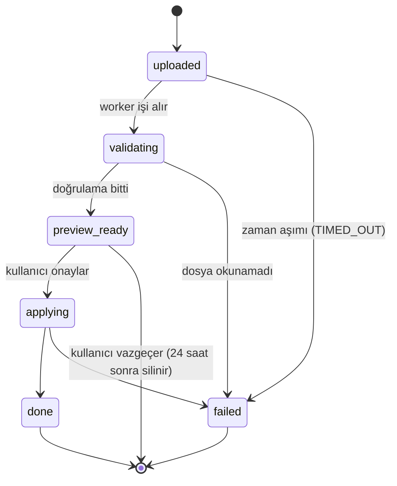

F3.5a (US-031; kart `docs/tasks/F3.5a.md`), F3.5c (uygulama; kart `docs/tasks/F3.5c.md`). Kod: `ImportJobStateMachine` (`apps/api/src/modules/imports/import-job.state-machine.ts`).

| Geçiş | Kim | Koşul (guard) | Yan etki |
| --- | --- | --- | --- |
| → uploaded | `imports.run` izinli toptancı kullanıcısı (`POST /imports`) | Dosya bu işletmenin, `purpose = import`, `ready`, başka işe bağlı değil (aksi 404 / 422). F3.7a `customer_prices`: ayrıca `pricing.manage` (403) ve perakendeciyle aktif bağlantı (`422 buyerId: not_connected`) | Outbox `import.uploaded` → `imports` kuyruğu |
| uploaded → validating | Worker (`ValidateImportJob`) | Durum hâlâ `uploaded` (koşullu güncelleme; değilse iş atlanır) | — |
| validating → preview_ready | Worker | Dosya okundu (satır hataları işi düşürmez) | `stats` (sayılar, ilk 100 sorun, notlar), hata raporu dosyası (`error_report_file_id`) |
| validating → failed | Worker | Dosya okunamadı, boyut/satır sınırı aşıldı, zorunlu sütun yok | `failure_code` |
| validating → failed | Worker, `customer_prices` işi (F3.7a) | Doğrulama anında perakendeciyle aktif bağlantı yok | `CONNECTION_INACTIVE` |
| preview_ready → applying | İşi açan kullanıcı, `POST /imports/{id}/apply` (F3.5c, S1 = A; başkası 403) | Önizleme süresi dolmamış (aksi 404); koşullu güncelleme (ikinci onay 409) | Outbox `import.apply_requested` → `imports` kuyruğu |
| preview_ready → (silinir) | Sistem işi `imports.expire_previews` (`import_jobs_expire`) | `updated_at` `imports.preview_ttl_hours` saatten eski | İş satırı, yüklenen dosya ve hata raporu silinir |
| applying → done | Worker (`ApplyImportJob`, F3.5c) | Dosya yeniden okundu ve yeniden doğrulandı; partiler bitti | `stats` gerçek sayılar, sonuç raporu (`result_report_file_id`), audit `import.applied` |
| applying → failed | Worker | Dosya okunamadı veya parti beklenmedik hatayla durdu | `APPLY_FAILED`; önceki partiler kalır, `applied_until_row` son parti |
| applying → failed | Worker, `customer_prices` işi (F3.7a) | Perakendeciyle bağlantı artık aktif değil (her parti bağlantıyı `FOR SHARE` ile yeniden denetler) | `CONNECTION_INACTIVE`; önceki partiler kalır |
| uploaded / validating / applying → failed | Sistem işi `imports.expire_previews` (`import_jobs_time_out`, F3.5c K10) | `updated_at` `imports.stuck_after_minutes` dakikadan eski | `TIMED_OUT` |
| done / failed → (silinir) | Sistem işi (`import_jobs_expire`, F3.5c S2 = A) | `updated_at` `imports.result_ttl_days` günden eski | İş satırı, yüklenen dosya, hata ve sonuç raporu silinir |

Başka geçiş `409 INVALID_STATE_TRANSITION`. Uygulama yarıda kalırsa devam ettirilmez: worker işi `applied_until_row = 0` ile alır; yinelenen teslim almaz; çöken iş zaman aşımıyla `failed` olur, kullanıcı dosyayı yeniden yükler (SKU ile güncelleme idempotent, SF-08).

## 12. Toptancı başvurusu (`seller_applications.status`)

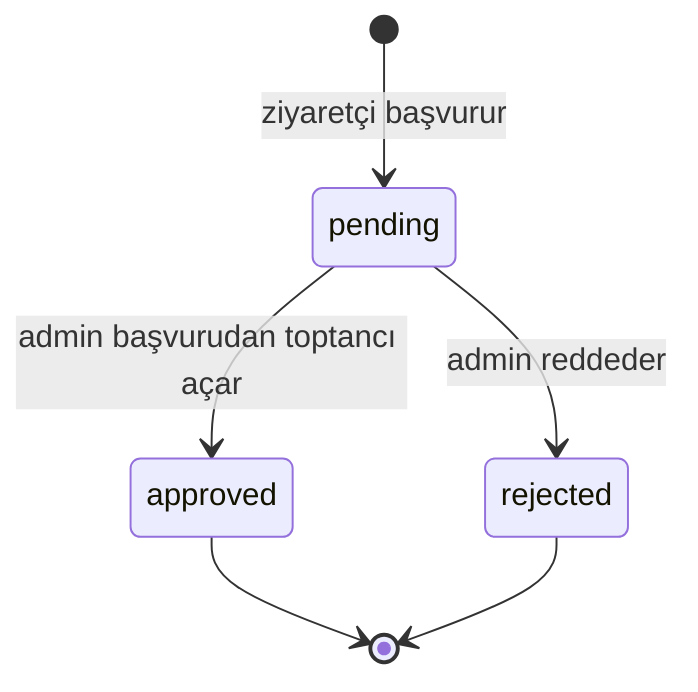

| Geçiş | Kim | Koşul (guard) | Yan etki |
| --- | --- | --- | --- |
| → pending | Kimliksiz ziyaretçi (`POST /seller-applications`) | IP hız sınırı (`seller_application.ip_max_per_hour`); aynı VÖEN ile `pending` başvuru yok (yoksa `409 SELLER_APPLICATION_ALREADY_PENDING`) | Yok (başvuru admin listesinde görünür, US-008 AC1) |
| pending → approved | Platform rolü `super_admin`, `operations` (`POST /admin/sellers` + `applicationId`) | Toptancı açılışı aynı işlemde başarılı (US-009) | `business_id`, `reviewed_by` yazılır; audit `seller_application.approved` |
| pending → rejected | Platform rolü `super_admin`, `operations` | — | `reviewed_by` yazılır; audit `seller_application.rejected` |

`approved` ve `rejected` son durumlardır; başka geçiş `409 INVALID_STATE_TRANSITION`. Reddedilen başvurudan sonra aynı VÖEN ile yeni başvuru yapılabilir.

## 13. Marka (`brands.status`)

F3.2a (US-029 AC2, R37, V5). Kod: `BrandStateMachine` (`apps/api/src/modules/catalog/brand.state-machine.ts`).

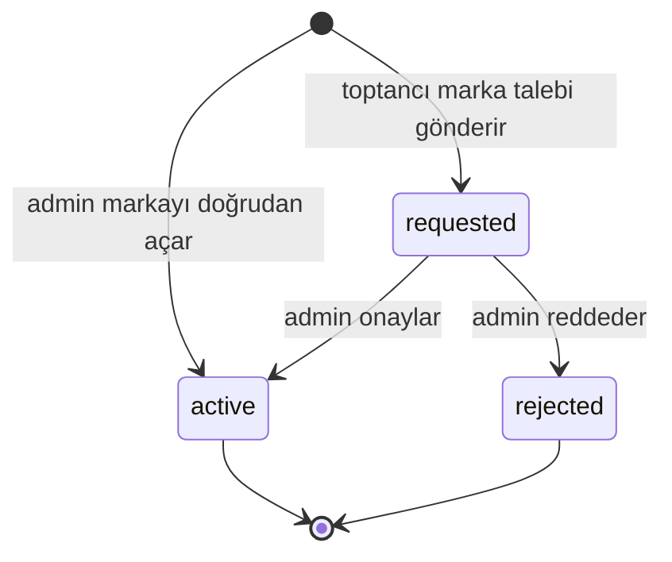

| Geçiş | Kim | Koşul (guard) | Yan etki |
| --- | --- | --- | --- |
| → requested | `catalog.manage` izinli toptancı kullanıcısı (`POST /catalog/brands`) | Yalnız `brand_request_create` (SECURITY DEFINER); onaylı ve aktif toptancı; ad tekliği (K1, 422 `name: [taken]`); kayan 24 saatte `catalog.brand_request_daily_limit` (429 `RATE_LIMITED`) | Audit `brand.requested` (işletme = toptancı); yalnız talep eden görür (V5) |
| → active (doğrudan) | Platform rolü `super_admin`, `content` (`POST /admin/catalog/brands`) | Ad tekliği | Audit `brand.created` |
| requested → active | Platform rolü `super_admin`, `content` (`PATCH /admin/catalog/brands/{id}`) | — | `decided_at`, `decided_by_user_id`; audit `brand.approved`; talebi gönderen (aktif üyeyse) + toptancı adminlerine `brand_request_approved` |
| requested → rejected | Aynı | — | `decided_at`, `decided_by_user_id`; audit `brand.rejected`; bildirim `brand_request_rejected`; ad serbest kalır; talep eden toptancının o markalı ürünlerinin markası boşalır (F3.3a tetikleyicisi, V5) |

`active` ve `rejected` son durumlardır; başka geçiş `409 INVALID_STATE_TRANSITION`. Marka silinmez (R38); `active` marka `is_active = false` ile pasifleşir (yeni üründe seçilemez), aktiflik başka durumda değişmez (409).

## 14. Ürün (`products.status`)

F3.3a (US-030 AC6; kart K1, K2). Kod: `ProductStateMachine` (`apps/api/src/modules/catalog/product.state-machine.ts`).

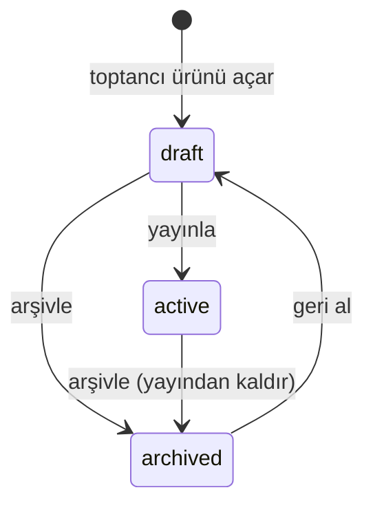

| Geçiş | Kim | Koşul (guard) | Yan etki |
| --- | --- | --- | --- |
| → draft | `catalog.manage` izinli toptancı kullanıcısı (`POST /products`) | Ad en az bir dilde, görünür kategori, seçilebilir marka (aktif veya kendi bekleyen talebi, V5), aktif birimler, ambalaj kuralları (K4) | — |
| draft → active | Aynı (`PATCH /products/{id}`, `status: active`) | Marka boş veya `active` (aksi 422 `brandId: [not_approved]`); fiyat gerekmez (V7) | `published_at`; audit `product.published`; ürün bağlı perakendecilere görünür (liste F3.12a) |
| draft → archived, active → archived | Aynı | — | Audit `product.archived`; perakendecide görünmez |
| archived → draft | Aynı | — | Audit `product.restored` |

Başka geçiş `409 INVALID_STATE_TRANSITION`. `active → draft` yoktur (gizlemek için arşiv). Arşivdeki ürün düzenlenmez, yalnız geri alınır (409). Yayındaki ürün düzenlenebilir; markası onay bekleyen markaya çevrilemez (422 `brandId: [not_approved]`). Ürün silinmez. Varyant durumu (`active` / `archived`) yalnız ürün düzenlemesiyle değişir: listede olmayan varyant arşivlenir, listede `id`'si olan arşivli varyant yeniden `active` olur (K3). Marka reddedilince ürünün markası boşalır (§13, V5).

## 15. Fiyat listesi (`price_lists.status`)

F3.6a (US-034; kart K2 = A, K3). Kod: `PriceListStateMachine` (`apps/api/src/modules/pricing/price-list.state-machine.ts`).

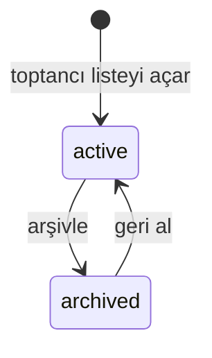

| Geçiş | Kim | Koşul (guard) | Yan etki |
| --- | --- | --- | --- |
| → active | `pricing.manage` izinli toptancı kullanıcısı (`POST /price-lists`) | Para birimi satıcınınki (aksi `422 CURRENCY_MISMATCH`) | İlk liste varsayılan olur; audit `price_list.created` |
| active → archived | Aynı (`PATCH /price-lists/{id}`, `status: archived`) | Varsayılan değil (aksi `409 PRICE_LIST_DEFAULT_PROTECTED`); aktif bir bağlantıya atanmamış (aksi `409 PRICE_LIST_IN_USE`) | Audit `price_list.archived`; listeye fiyat yazılamaz |
| archived → active | Aynı (`status: active`) | — | Audit `price_list.restored` |

Başka geçiş `409 INVALID_STATE_TRANSITION`. Arşivli liste varsayılan yapılamaz, fiyat yazılamaz (409) ve bağlantıya atanamaz (422). Liste silinmez.

