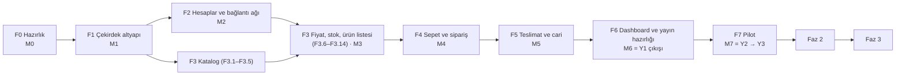

# Yol Haritası

| Alan | Değer |
| --- | --- |
| Sürüm | 1.0 |
| Tarih | 2026-10-24 |
| İlgili belgeler | [backlog.md](backlog.md) · [implementation-plan.md](../07-ai-development/implementation-plan.md) · [design-doc.md](../03-architecture/design-doc.md) §9 |

Yol haritası **takvim tarihi içermez**. Fazlar bağımlılık sırasıyla ilerler. Bir faz, milestone çıkış ölçütleri karşılanmadan bitmiş sayılmaz. Toplam iş yükü [backlog.md](backlog.md) tahminlerine göre en fazla yaklaşık 85 odaklı iş günüdür (S = 0,5, M = 1, L = 2 gün). Bu bir takvim değil, kapasite planlaması için kaba bir büyüklüktür.

## 1. Faz akışı

F3'ün katalog adımları (F3.1–F3.5) F2 ile paralel yürüyebilir; fiyat adımları bağlantı koşullarına (F2.14) bağlıdır.

## 2. Milestone'lar

| Milestone | Faz | Çıkış ölçütü (hepsi sağlanmalı) | Kapsadığı story'ler |
| --- | --- | --- | --- |
| **M0 — Hazırlık tamam** | F0 | Depo ve CI çalışıyor (boş testler yeşil); staging sunucusu ayakta; Claude Projesi ve AGENTS.md hazır; KPI hedefleri pilot toptancılarla yazılı; AWS gerçek fiyatları NFR-90 bütçesiyle uyumlu | — |
| **M1 — Çekirdek** | F1 | Mock SMS ile web ve mobilde giriş; izinden oluşan menü; kiracı izolasyonu test paketi çalışıyor ve yeşil; outbox → push bildirimi uçtan uca; çeviriler 3 dilde yükleniyor | US-001–US-004, US-012 (altyapı), US-013 (altyapı), US-054, US-057 (yazıcı), US-058, US-059, US-060 |
| **M2 — Bağlantı ağı** | F2 | Admin toptancı açar; perakendeci kaydolur; temsilci telefonla bulup istek gönderir; perakendeci kabul eder; kota, bekleme süresi, engel ve süre dolumu testleri yeşil | US-005–US-011, US-013–US-017, US-019–US-027 |
| **M3 — Katalog ve fiyat** | F3 | Toptancı Excel'den 2.000 ürünü içe aktarır; perakendeci yalnızca bağlı toptancıların ürünlerini kendi fiyatıyla 3 dilde görür ve arar; fiyat çözümleme test tablosu yeşil | US-028–US-039, US-045 (favoriler) |
| **M4 — Sipariş** | F4 | İki toptancıdan tek sepet → şube onayı → iki sipariş; toptancı kısmi onay verir; stok rezerve edilir; PDF belge 3 dilde | US-025 (sipariş etkileri), US-040–US-045 |
| **M5 — MVP özellik tamam** | F5 | PRD §5'teki 9 adımlı uçtan uca senaryo yerelde ve staging'de hatasız | US-046–US-053 |
| **M6 — Yayın hazır (Y1 çıkışı)** | F6 | Tüm Must story'ler bitti; yük testi NFR hedeflerini karşılıyor; güvenlik kontrol listesi tamam; geri yükleme provası yapıldı; production ve alarmlar hazır; gerçek SMS sağlayıcısı entegre; mobil TestFlight / Play iç testte | US-016 (birleştirme), US-055, US-056, US-057 (ekran) + Could: US-018, US-061 |
| **M7 — Pilot** | F7 | Y2: toptancı ekipleri 1 hafta sorunsuz; Y3: pilot KPI'ları ölçülüyor; pilot sonu kararı verildi ([project-charter.md](../01-discovery/project-charter.md) §8) | KPI-01–KPI-07 |

## 3. Kapsam koruma kuralları

1. Bir faz sırasında yeni bir özellik isteği gelirse backlog'a eklenir; o fazın kapsamına yalnızca bir `Must` story'nin kabul kriterini karşılamak için gerekiyorsa girer.
2. M5'e kadar `Could` story'lerine başlanmaz.
3. Bir L adım iki günü aşarsa durulur, Mimar oturumunda bölünür.
4. Pilot geri bildirimi (F7.5) yalnızca hata düzeltmesi ve küçük kullanılabilirlik değişikliği içerir; yeni özellikler Faz 2 önceliklendirmesine (F7.6) gider.

## 4. Sonraki fazlar

| Faz | Tetikleyici | Kapsam (öncelik pilot sonucuna göre belirlenir) |
| --- | --- | --- |
| Faz 2 — Operasyon | M7 kararı "devam" | Kredi limiti blokajı, yaşlandırma ve mutabakat, kampanyalar, iade, lot bazlı stok + FEFO, çok depoda rezervasyon, WhatsApp/SMS bildirim kanalları, ilk kargo API adaptörü, temsilci ziyaret modu |
| Faz 3 — Ölçek | 10 ücretli toptancı veya büyük toptancı talebi | 1C ve stok modu `sync`, e-qaimə entegrasyonu, online ödeme, ödemeli toptancı kaydı, çift rol, perakendeci premium, offline mobil, açık API, yeni ülke |
