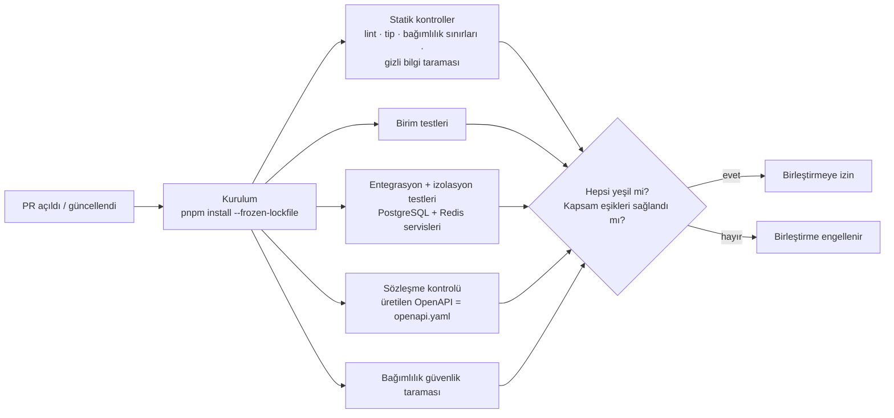
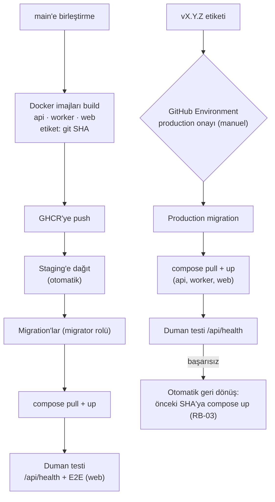

# Ortamlar ve CI/CD

| Alan | Değer |
| --- | --- |
| Sürüm | 1.0 |
| Tarih | 2026-10-24 |
| İlgili belgeler | [infrastructure.md](../03-architecture/infrastructure.md) · [test-strategy.md](../05-planning/test-strategy.md) · [runbook.md](runbook.md) · [coding-guidelines.md](../07-ai-development/coding-guidelines.md) |

## 1. Ortamlar

| Ortam | Amaç | Altyapı | Veri | SMS | Dağıtım |
| --- | --- | --- | --- | --- | --- |
| `local` | Geliştirme | Geliştirici bilgisayarı; `docker compose -f docker-compose.dev.yml` (PostgreSQL 16, Redis 7, Meilisearch, MinIO) | `seed` + `seed-demo` | `mock` | — |
| `test` | CI testleri | GitHub Actions; servis container'ları | Test fabrikaları | `mock` | Her PR |
| `staging` | Uçtan uca, UAT, yük testi | Küçük Lightsail sunucusu; PostgreSQL aynı sunucuda Docker | Demo verisi; **gerçek kişisel veri yok** | `mock` | `main`'e birleştirmede otomatik |
| `production` | Pilot ve canlı | [infrastructure.md](../03-architecture/infrastructure.md) §2 | Gerçek | Gerçek sağlayıcı (Y2'den itibaren) | Etiketle + manuel onay |

**Ortamlar arası kurallar:**

1. Production verisi hiçbir ortama kopyalanmaz.
2. Her ortamın R2 bucket'ı, Meilisearch anahtarı ve JWT imza anahtarı ayrıdır.
3. Uygulama, `APP_ENV` değerine göre başlangıçta yapılandırmayı doğrular; eksik veya geçersiz değişkenle **başlamaz** (bkz. §5).

## 2. Dal stratejisi

| Dal | Kural |
| --- | --- |
| `main` | Korumalı. Yalnızca pull request ile; CI zorunlu; doğrudan push kapalı; force push kapalı. Her zaman dağıtılabilir. |
| `feature/<adım-id>-<kısa-ad>` | Her backlog adımı için bir dal (ör. `feature/F2.12-connection-request`). Ömrü kısa tutulur (≤ 2 gün). |
| `fix/<kısa-ad>` | Hata düzeltmeleri. |
| Etiket `vX.Y.Z` | Production dağıtımı (backend + web). |
| Etiket `mobile-vX.Y.Z` | Mobil derleme ve test dağıtımı. |

Birleştirme yöntemi: **squash merge**. Commit mesajı biçimi: `<tür>(<adım-id>): <açıklama>` (ör. `feat(F2.12): bağlantı isteği uç noktası`). Türler: `feat`, `fix`, `docs`, `test`, `refactor`, `chore`.

## 3. CI hattı (her pull request)

| İş | İçerik | Başarısızlık koşulu |
| --- | --- | --- |
| `lint` | ESLint (bağımlılık sınırı kuralları dahil), Prettier kontrolü | Herhangi bir hata |
| `typecheck` | `tsc --noEmit` tüm paketlerde | Herhangi bir hata |
| `secrets` | Gizli bilgi taraması (gitleaks) | Herhangi bir bulgu |
| `unit` | Vitest birim testleri | Başarısız test |
| `integration` | Vitest + Supertest; PostgreSQL 16 ve Redis 7 servis container'ları; sıra: `db:bootstrap` → `db:migrate` (sıfırdan) → `check-rls` → `test:coverage:backend` (api birim + entegrasyon/izolasyon testleri tek çalıştırmada, kapsam eşikleriyle; F1.5a). Rol şifreleri her çalıştırmada rastgele üretilir ve loglarda maskelenir | Başarısız test; kapsam eşiği (NFR-80/81) altı; `check-rls` hatası (RLS sınıfı yorumu eksik tablo, RLS'siz kiracı tablosu) |
| `contract` | API'den OpenAPI üret → `docs/03-architecture/api/openapi.yaml` ile karşılaştır; kırıcı değişiklik denetimi | Fark var veya `/api/v1`'de kırıcı değişiklik |
| `deps-audit` | `pnpm audit --audit-level=high` | Yüksek / kritik açık |
| `build` | Tüm uygulamaların derlenmesi | Derleme hatası |

**Bağımlılık taraması istisnaları.** Yüksek/kritik bir açık için istisna yalnızca şu üç koşul birlikte sağlanırsa verilir: düzeltilmiş sürüm yok veya düzeltme kırıcı; açık yalnızca geliştirme aracında çalışıyor (production paketine veya sunucuya girmiyor); platform sahibi onayladı. İstisna kök `package.json` → `pnpm.auditConfig.ignoreGhsas` içine GHSA kimliğiyle yazılır ve aşağıdaki tabloya eklenir. Her istisna, gözden geçirme tarihinde veya ilgili paket yükseltildiğinde yeniden değerlendirilir.

| GHSA | Paket (yol) | Neden | Onay | Gözden geçirme |
| --- | --- | --- | --- | --- |
| GHSA-86w9-cpqp-85rv | node-forge 1.4.0 (`expo` → `@expo/cli`) | Düzeltilmiş sürüm yok; yalnızca geliştirici bilgisayarındaki Expo CLI | Platform sahibi, 2026-10-24 (F0.3b) | Expo SDK yükseltmesinde veya 2027-01-31 |
| GHSA-mrhx-c7xc-m3w5 | zod 3.25.76 (`expo` → `@expo/cli`) | Düzeltme yalnızca zod 4'te; @expo/cli zod 3 istiyor; yalnızca Expo CLI | Platform sahibi, 2026-10-24 (F0.3b) | Expo SDK yükseltmesinde veya 2027-01-31 |

Hedef süre: < 10 dakika (NFR-83). Bağımlılık önbelleği kullanılır.

## 4. CD hattı

**Kurallar:**

1. Production'a yalnızca staging'de duman testinden geçmiş bir SHA dağıtılır.
2. Migration'lar **geriye uyumlu** yazılır (genişlet → taşı → daralt). Kolon silme veya ad değiştirme iki ayrı sürümde yapılır. Böylece yeni migration eski kodla da çalışır ve geri dönüş güvenlidir.
3. Dağıtım SSH ile sunucuda yalnızca `/opt/app/deploy.sh <sha>` betiğini çalıştırır (SSH anahtarı bu komutla sınırlı).
4. Önerilen production dağıtım saati: Asia/Baku 20:00 sonrası ([test-strategy.md](../05-planning/test-strategy.md) §7).
5. `api` yeniden başlarken birkaç saniyelik kesinti olur; Caddy, `api` sağlıklı olana kadar 503 yerine bekletme (retry) yapar. 📌 VARSAYIM: Bu kısa kesinti iş saatleri dışı dağıtımla kabul edilebilir; kesintisiz dağıtım ihtiyacı doğarsa ikinci `api` kopyası eklenir ([infrastructure.md](../03-architecture/infrastructure.md) §6).

### 4.1 Mobil

| Adım | Araç | Tetikleyici |
| --- | --- | --- |
| Derleme | EAS Build (iOS, Android) | `mobile-vX.Y.Z` etiketi |
| Test dağıtımı | EAS Submit → TestFlight, Google Play iç test | Derleme başarılı |
| OTA güncelleme (yalnızca JS değişikliği) | Expo Updates, `production` kanalı | Manuel komut, staging kanalında denendikten sonra |
| Minimum sürüm | `settings`: `mobile.min_version.ios`, `mobile.min_version.android` | Yerel modül veya API kırıcı değişikliğinde artırılır |

## 5. Gizli bilgi ve yapılandırma yönetimi

| Ortam | Kaynak |
| --- | --- |
| `local` | `.env` (git'te yok); `.env.example` depoda, değerler sahte |
| `test` (CI) | GitHub Actions secrets; testler yalnızca mock adaptörler kullanır |
| `staging`, `production` | AWS SSM Parameter Store (`/b2b/<env>/<ANAHTAR>`, SecureString). Sunucudaki `deploy.sh` açılışta okur ve container'lara ortam değişkeni olarak verir. |

**Ortam değişkenleri** (tam liste ve tipler `packages/shared/src/env.ts` Zod şemasında; uygulama açılışta doğrular):

| Değişken | Örnek / not |
| --- | --- |
| `APP_ENV` | `local` / `test` / `staging` / `production` |
| `PORT` | API dinleme portu; varsayılan `3000` |
| `LOG_LEVEL` | `fatal` / `error` / `warn` / `info` / `debug` / `trace` / `silent`; varsayılan `info` |
| `DATABASE_URL` | `app_user` rolüyle; TLS zorunlu (local hariç) |
| `DATABASE_MIGRATOR_URL` | Yalnızca migration adımında |
| `DB_POOL_MAX` | API/worker bağlantı havuzu üst sınırı; varsayılan `10` |
| `TEST_DATABASE_ADMIN_URL` | Yalnızca CI testleri; süper kullanıcı, test veritabanını hazırlar |
| `REDIS_URL` | `redis://` veya `rediss://`; api ve worker için zorunlu (F1.2a) |
| `MEILI_URL`, `MEILI_MASTER_KEY` | — |
| `JWT_SIGNING_KEY`, `JWT_KEY_ID` | Ortam başına ayrı; HS256 imza anahtarı en az 32 karakter, `JWT_KEY_ID` 1–64 karakter (`A-Z a-z 0-9 . _ -`). Yoksa veya kısaysa api açılmaz (F1.5b) |
| `JWT_PREVIOUS_SIGNING_KEY`, `JWT_PREVIOUS_KEY_ID` | İsteğe bağlı, ikisi birlikte. Döndürmede eski anahtar: yalnızca doğrulamada kullanılır, yeni anahtar imzalar (F1.5b) |
| `TOTP_ENCRYPTION_KEY` | 32 bayt |
| `R2_ACCOUNT_ID`, `R2_ACCESS_KEY_ID`, `R2_SECRET_ACCESS_KEY`, `R2_BUCKET_PUBLIC`, `R2_BUCKET_PRIVATE`, `FILES_PUBLIC_BASE_URL` | — |
| `SMS_PROVIDER` | `mock` (production'da yasak; `APP_ENV=production` + `mock` → api açılmaz) / gerçek sağlayıcı adı (F6.5'e kadar yalnızca `mock` kabul edilir) |
| `SMS_API_KEY` | Gerçek sağlayıcıda |
| `OTP_HASH_KEY` | OTP kod özeti (HMAC-SHA256) anahtarı; en az 32 karakter, ortam başına ayrı ve rastgele. Yoksa veya kısaysa api açılmaz (F1.5a) |
| `EXPO_ACCESS_TOKEN` | Push |
| `SENTRY_DSN` | Boş bırakılabilir |
| `CORS_ORIGINS` | Web alan adları |

**Kurallar:** Gizli bilgi koda, loga, hata mesajına, OpenAPI örneklerine ve AI sohbetine yazılmaz. Sızıntı şüphesinde [runbook.md](runbook.md) RB-07 uygulanır. Anahtarlar yılda bir ve personel/araç değişikliğinde döndürülür.

## 6. Özellik bayrakları

Özellik bayrakları `settings` tablosunda `feature.<ad>` anahtarlarıyla tutulur (platform → plan → işletme). Örnek: `feature.dual_capability` (D20, kapalı), `feature.seller_self_signup` (kapalı), `feature.rep_orders_on_behalf` (US-061). Yeni özellik kapalı yayınlanır, pilot toptancıda açılır, sonra herkese.
